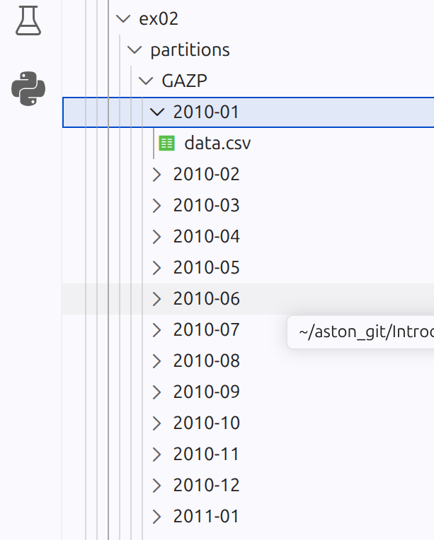
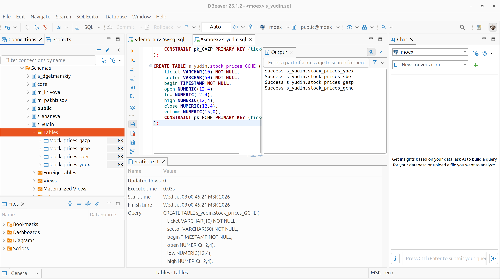
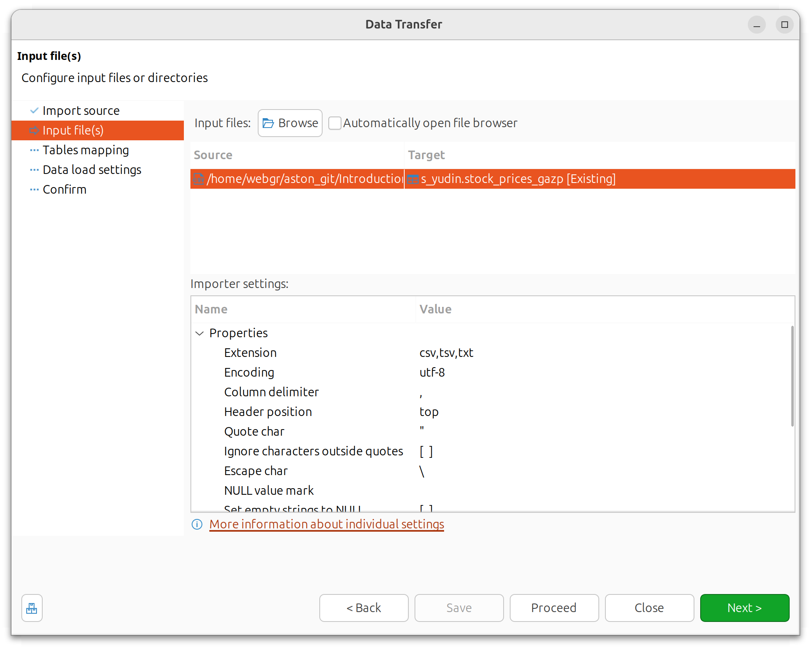
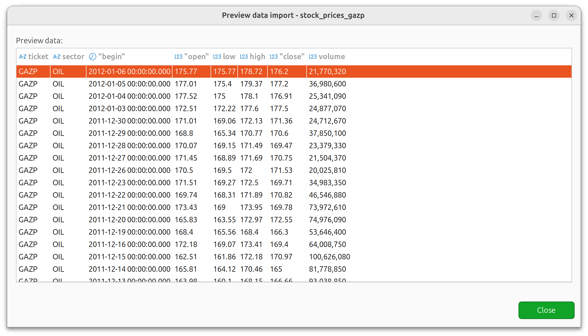
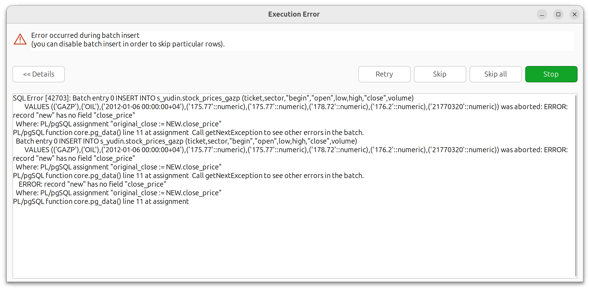
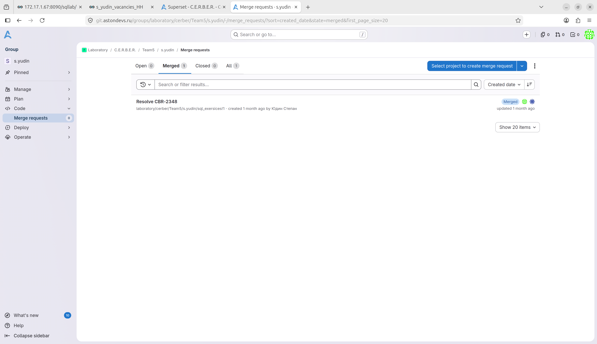

## Introduction_To_Linux

### 1. MOEX / IMOEX

- Папка для сдачи: [`ex00/`](./ex00/)

- Файлы и папки для сдачи: 
    - [`api.sh`](./ex00/api.sh), - исполняемый скрипт
    - [`raw_data/`](./ex00/raw_data/) - папка выгрузки
    - [`sectors.txt`](./ex00/sectors.txt) - названия котировок и сектор

Код скрипта:

```bash
#!/bin/bash

# Проверка наличия необходимых инструментов
command -v curl >/dev/null 2>&1 || { echo "curl is required but not installed. Aborting." >&2; exit 1; }
command -v jq >/dev/null 2>&1   || { echo "jq is required but not installed. Aborting." >&2; exit 1; }

# Создание папки для сырых данных (относительно текущей директории)
mkdir -p raw_data

# Диапазон дат: от 2010-01-01 до сегодняшнего дня
from_date="2010-01-01"
to_date=$(date +%Y-%m-%d)

# Обработка каждого переданного тикера
for ticker in "$@"; do
    echo "Fetching data for $ticker..."
    url="https://iss.moex.com/iss/engines/stock/markets/shares/securities/${ticker}/candles.json?from=${from_date}&till=${to_date}&interval=24"
    curl -s "$url" -o "raw_data/${ticker}.json"
    if [ $? -eq 0 ]; then
        echo "Saved raw_data/${ticker}.json"
    else
        echo "Error fetching data for $ticker" >&2
    fi
done
```

Пример котировок и секторов:

```
| Тикер | Сектор |
|-------|--------|
| YDEX  | IT     |
| MAIL  | IT     |
| VKCO  | IT     |
| RTKM  | IT     |
| MTSS  | IT     |
| SBER  | BANK   |
| VTBR  | BANK   |

...
```

Передадим в аргументы скрипта 4 котировки: `GAZP` `GCHE` `SBER` `YDEX`

```bash
~/aston_git/Introduction_To_Linux/src/ex00$ ./api.sh YDEX SBER GAZP GCHE
Fetching data for YDEX...
Saved raw_data/YDEX.json
Fetching data for SBER...
Saved raw_data/SBER.json
Fetching data for GAZP...
Saved raw_data/GAZP.json
Fetching data for GCHE...
Saved raw_data/GCHE.json
```

После выполнения скрипта в папке `raw_data` создано 4 файла `*.json`


Содержимое выгружаемого файла, например `GAZP.json`

```json
{
"candles": {
	"metadata": {
		"open": {"type": "double"},
		"close": {"type": "double"},
		"high": {"type": "double"},
		"low": {"type": "double"},
		"value": {"type": "double"},
		"volume": {"type": "double"},
		"begin": {"type": "datetime", "bytes": 19, "max_size": 0},
		"end": {"type": "datetime", "bytes": 19, "max_size": 0}
	},
	"columns": ["open", "close", "high", "low", "value", "volume", "begin", "end"], 
	"data": [
		[192.5, 194.5, 196.9, 191, 11649987390.2, 59815603, "2010-01-11 00:00:00", "2010-01-11 23:59:59"],
		[194, 191.8, 195.8, 190.55, 8374537092.39, 43482579, "2010-01-12 00:00:00", "2010-01-12 23:59:59"],
		[189.72, 189.3, 191.86, 188.3, 9970159571.75, 52416087, "2010-01-13 00:00:00", "2010-01-13 23:59:59"],
		[191.2, 190.83, 191.46, 188.88, 7850769149.67, 41207109, "2010-01-14 00:00:00", "2010-01-14 23:59:59"],
		[190, 187.86, 192.1, 187.25, 10555094397.78, 55571965, "2010-01-15 00:00:00", "2010-01-15 23:59:59"],
...
```

---
### 2. JSON to CSV

- Папка для сдачи задания: [`ex01/`](./ex01/)

- Файлы для сдачи: [`to_csv.sh`](./ex01/to_csv.sh), [`filter.jq`](./ex01/filter.jq)

- Дирректории: [`csv_data/`](./ex01/csv_data/) 

Код скрипта:

```bash
#!/bin/bash

command -v jq >/dev/null 2>&1 || { echo "jq is required but not installed. Aborting." >&2; exit 1; }

if [ $# -ne 1 ]; then
    echo "Usage: $0 <directory_with_json>"
    exit 1
fi

input_dir="$1"
output_dir="csv_data"

mkdir -p "$output_dir"

header="begin,open,low,high,close,volume"

for json_file in "$input_dir"/*.json; do
    [ -f "$json_file" ] || continue
    base=$(basename "$json_file" .json)
    output_file="$output_dir/${base}.csv"
    echo "$header" > "$output_file"
    jq -r -f filter.jq "$json_file" >> "$output_file"
    echo "Converted $json_file to $output_file"
done
```

Фильтр:

```jq
.["candles"]["data"][] | [.[6], .[0], .[3], .[2], .[1], .[5]] | @csv
```

Запуск скрипта:

```bash
~/aston_git/Introduction_To_Linux/src/ex01$ ./to_csv.sh ../ex00/raw_data/
Converted ../ex00/raw_data//GAZP.json to csv_data/GAZP.csv
Converted ../ex00/raw_data//GCHE.json to csv_data/GCHE.csv
Converted ../ex00/raw_data//SBER.json to csv_data/SBER.csv
Converted ../ex00/raw_data//YDEX.json to csv_data/YDEX.csv
```

В папке `csv_data` создано 4 файла `*.csv`

Пример содержания файла `GAZP.csv`

```csv
begin,open,low,high,close,volume
"2010-01-11 00:00:00",192.5,191,196.9,194.5,59815603
"2010-01-12 00:00:00",194,190.55,195.8,191.8,43482579
"2010-01-13 00:00:00",189.72,188.3,191.86,189.3,52416087
"2010-01-14 00:00:00",191.2,188.88,191.46,190.83,41207109
"2010-01-15 00:00:00",190,187.25,192.1,187.86,55571965
"2010-01-18 00:00:00",186.97,186.6,190.5,190.4,36525951
"2010-01-19 00:00:00",190.1,187.36,190.47,189.76,48626727
"2010-01-20 00:00:00",189.09,185.82,189.9,185.98,46894531
"2010-01-21 00:00:00",187.17,182.3,187.19,182.76,62823179
"2010-01-22 00:00:00",181.5,178.51,183,181.5,62923848
"2010-01-25 00:00:00",179,178.94,184.39,182.85,48727361
...
```

### 3. Partitioning and Sorting

- Папка для сдачи задания: [`ex02/`](./ex02/)

- Файлы для сдачи: [`partitioner.sh`](./ex02/partitioner.sh), [`concatenator.sh`](./ex02/concatenator.sh)

- Дирректории: [`partitions/`](./ex02/partitions/), [`rebuilt/`](./ex02/rebuilt/) 

Код скрипта `partitioner.sh`

```bash
#!/bin/bash

if [ $# -ne 1 ]; then
    echo "Usage: $0 <directory_with_csv>"
    exit 1
fi

input_dir="$1"
output_base="partitions"

mkdir -p "$output_base"

for csv_file in "$input_dir"/*.csv; do
    [ -f "$csv_file" ] || continue
    base=$(basename "$csv_file" .csv)
    stock_dir="$output_base/$base"
    mkdir -p "$stock_dir"

    header=$(head -n 1 "$csv_file")
    echo "$header" > "$stock_dir/header.csv"

    awk -v stock_dir="$stock_dir" -F ',' '
    NR > 1 {
        date = $1
        gsub(/"/, "", date)
        split(date, parts, "-")
        if (length(parts[1]) == 4 && length(parts[2]) == 2) {
            month = parts[1] "-" parts[2]
            cmd = "mkdir -p " stock_dir "/" month
            system(cmd)
            print >> (stock_dir "/" month "/data.csv")
        }
    }
    ' "$csv_file"
done
```

Код скрипта `concatenator.sh`

```bash
#!/bin/bash

input_base="partitions"
output_base="rebuilt"

mkdir -p "$output_base"

for stock_dir in "$input_base"/*; do
    [ -d "$stock_dir" ] || continue
    stock=$(basename "$stock_dir")
    header_file="$stock_dir/header.csv"
    if [ ! -f "$header_file" ]; then
        echo "Warning: header.csv not found in $stock_dir, skipping"
        continue
    fi

    # Собираем все строки из всех data.csv
    tmp_file=$(mktemp)
    find "$stock_dir" -type f -name "data.csv" -exec cat {} \; > "$tmp_file"

    # Сортируем по дате (первое поле) в убывающем порядке
    sort -t ',' -k1,1r "$tmp_file" > "$tmp_file.sorted"

    # Формируем итоговый CSV с заголовком
    output_file="$output_base/${stock}.csv"
    cat "$header_file" > "$output_file"
    cat "$tmp_file.sorted" >> "$output_file"

    rm "$tmp_file" "$tmp_file.sorted"
    echo "Rebuilt $output_file"
done
```

После запуска созданы партиции



Пересобраны после слияния `../rebuilt/GAZP.csv`:

```
begin,open,low,high,close,volume
"2012-01-06 00:00:00",175.77,175.77,178.72,176.2,21770320
"2012-01-05 00:00:00",177.01,175.4,179.37,177.2,36980600
"2012-01-04 00:00:00",177.52,175,178.1,176.91,25341090
"2012-01-03 00:00:00",172.51,172.22,177.6,177.5,24877070
"2011-12-30 00:00:00",171.01,169.06,172.13,171.36,24712670
"2011-12-29 00:00:00",168.8,165.34,170.77,170.6,37850100
"2011-12-28 00:00:00",170.07,169.15,171.49,169.47,23379330
"2011-12-27 00:00:00",171.45,168.89,171.69,170.75,21504370
"2011-12-26 00:00:00",170.5,169.5,172,171.53,20025810
...
```

---
### 4. Adding columns

- Папка для сдачи задания: [`ex03/`](./ex03/)

- Файлы для сдачи: [`add_columns.sh`](./ex03/add_columns.sh), [`sectors.txt`](./ex00/sectors.txt)

- Дирректории: [`with_columns/`](./ex03/with_columns/)

Код скрипта:

```bash

#!/bin/bash

if [ $# -ne 1 ]; then
    echo "Usage: $0 <rebuilt_directory>"
    exit 1
fi

input_dir="$1"
output_dir="with_columns"

if [ ! -d "$input_dir" ]; then
    echo "Error: Directory $input_dir does not exist."
    exit 1
fi

sectors_file=""
if [ -f "sectors.txt" ]; then
    sectors_file="sectors.txt"
elif [ -f "../ex00/sectors.txt" ]; then
    sectors_file="../ex00/sectors.txt"
else
    echo "Error: sectors.txt not found. Please place it in the current directory or in ../ex00/"
    exit 1
fi

declare -A sector_map
while IFS= read -r line; do
    # Пропускаем строки, не содержащие '|' или содержащие "Тикер"
    if [[ $line != *"|"* ]] || [[ $line == *"Тикер"* ]]; then
        continue
    fi
    # Извлекаем второе и третье поля, удаляем пробелы
    ticker=$(echo "$line" | awk -F'|' '{gsub(/^[ \t]+|[ \t]+$/, "", $2); print $2}')
    sector=$(echo "$line" | awk -F'|' '{gsub(/^[ \t]+|[ \t]+$/, "", $3); print $3}')
    if [ -n "$ticker" ] && [ -n "$sector" ]; then
        sector_map["$ticker"]="$sector"
    fi
done < "$sectors_file"

if [ ${#sector_map[@]} -eq 0 ]; then
    echo "Warning: No entries found in sectors.txt. Please check the file format."
fi

mkdir -p "$output_dir"

for csv_file in "$input_dir"/*.csv; do
    [ -f "$csv_file" ] || continue
    base=$(basename "$csv_file" .csv)
    ticket="$base"
    sector="${sector_map[$ticket]}"
    if [ -z "$sector" ]; then
        echo "Warning: Sector not found for $ticket, using empty value."
        sector=""
    fi

    output_file="$output_dir/${base}.csv"
    {
        head -n 1 "$csv_file" | awk -v ticket="$ticket" -v sector="$sector" 'BEGIN{OFS=","} {print "TICKET,SECTOR," $0}'
        tail -n +2 "$csv_file" | while IFS= read -r line; do
            echo "$ticket,$sector,$line"
        done
    } > "$output_file"
    echo "Created $output_file"
done
```

Запуск

```bash
~/aston_git/Introduction_To_Linux/src/ex03$ ./add_columns.sh ../ex02/rebuilt/
Created with_columns/GAZP.csv
Created with_columns/GCHE.csv
Created with_columns/SBER.csv
Created with_columns/YDEX.csv
```

После запуска добавлены столбцы:

```
TICKET,SECTOR,begin,open,low,high,close,volume
GAZP,OIL,"2012-01-06 00:00:00",175.77,175.77,178.72,176.2,21770320
GAZP,OIL,"2012-01-05 00:00:00",177.01,175.4,179.37,177.2,36980600
GAZP,OIL,"2012-01-04 00:00:00",177.52,175,178.1,176.91,25341090
GAZP,OIL,"2012-01-03 00:00:00",172.51,172.22,177.6,177.5,24877070
GAZP,OIL,"2011-12-30 00:00:00",171.01,169.06,172.13,171.36,24712670
GAZP,OIL,"2011-12-29 00:00:00",168.8,165.34,170.77,170.6,37850100
GAZP,OIL,"2011-12-28 00:00:00",170.07,169.15,171.49,169.47,23379330
GAZP,OIL,"2011-12-27 00:00:00",171.45,168.89,171.69,170.75,21504370
GAZP,OIL,"2011-12-26 00:00:00",170.5,169.5,172,171.53,20025810
GAZP,OIL,"2011-12-23 00:00:00",171.51,169.27,172.5,169.71,34983350
...
```

### 5. PostgreSQL

- Папка для сдачи задания: [`ex04/`](./ex04/)

- Файлы для сдачи: [`s_yudin.sql`](./ex04/s_yudin.sql)

Создадим схему и таблицы в базе `moex`

```sql
CREATE SCHEMA IF NOT EXISTS s_yudin;


CREATE TABLE IF NOT EXISTS s_yudin.stock_prices_YDEX (
    ticket VARCHAR(10) NOT NULL,
    sector VARCHAR(50) NOT NULL,
    begin TIMESTAMP NOT NULL,
    open NUMERIC(12,4),
    low NUMERIC(12,4),
    high NUMERIC(12,4),
    close NUMERIC(12,4),
    volume NUMERIC(15,0),
    CONSTRAINT pk_YDEX PRIMARY KEY (ticket, begin)
);

CREATE TABLE IF NOT EXISTS s_yudin.stock_prices_SBER (
    ticket VARCHAR(10) NOT NULL,
    sector VARCHAR(50) NOT NULL,
    begin TIMESTAMP NOT NULL,
    open NUMERIC(12,4),
    low NUMERIC(12,4),
    high NUMERIC(12,4),
    close NUMERIC(12,4),
    volume NUMERIC(15,0),
    CONSTRAINT pk_SBER PRIMARY KEY (ticket, begin)
);

CREATE TABLE IF NOT EXISTS s_yudin.stock_prices_GAZP (
    ticket VARCHAR(10) NOT NULL,
    sector VARCHAR(50) NOT NULL,
    begin TIMESTAMP NOT NULL,
    open NUMERIC(12,4),
    low NUMERIC(12,4),
    high NUMERIC(12,4),
    close NUMERIC(12,4),
    volume NUMERIC(15,0),
    CONSTRAINT pk_GAZP PRIMARY KEY (ticket, begin)
);
    
CREATE TABLE IF NOT EXISTS s_yudin.stock_prices_GCHE (
    ticket VARCHAR(10) NOT NULL,
    sector VARCHAR(50) NOT NULL,
    begin TIMESTAMP NOT NULL,
    open NUMERIC(12,4),
    low NUMERIC(12,4),
    high NUMERIC(12,4),
    close NUMERIC(12,4),
    volume NUMERIC(15,0),
    CONSTRAINT pk_GCHE PRIMARY KEY (ticket, begin)
);

```


Осуществим импорт `*.csv` средствами `dbeaver`





...

### 6. BONUS :: GIT

Для текущего проекта была создана ветка `develop`. Создание ветки по `issue` и `merge request` было выполнено в начале практики для SQL задачи.

