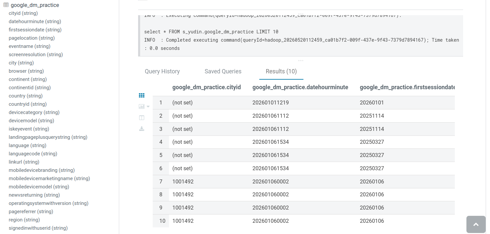
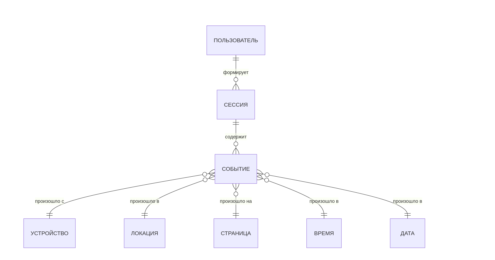
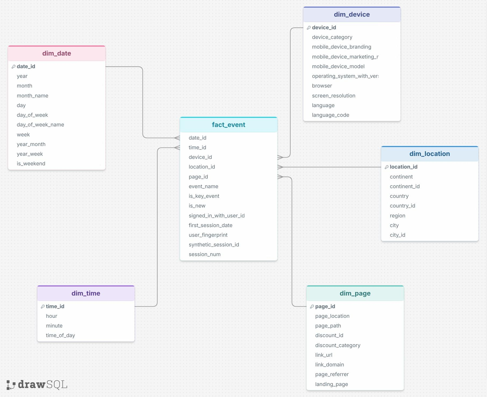
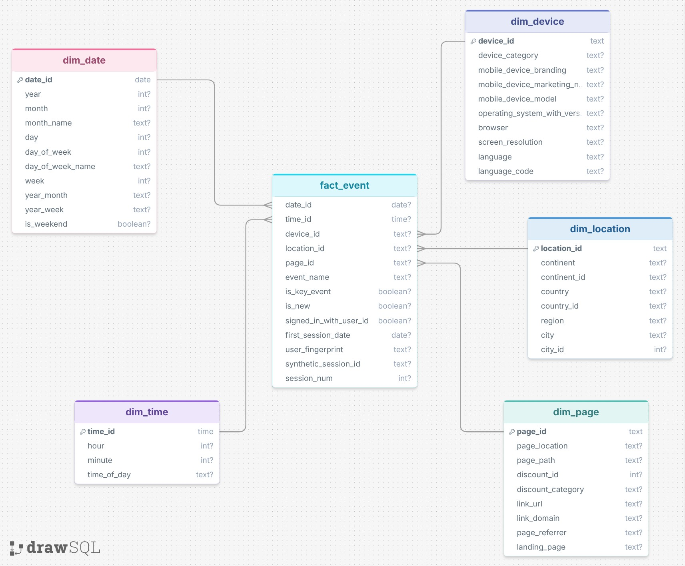
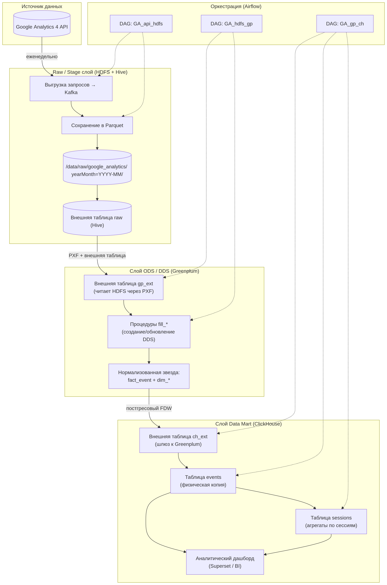
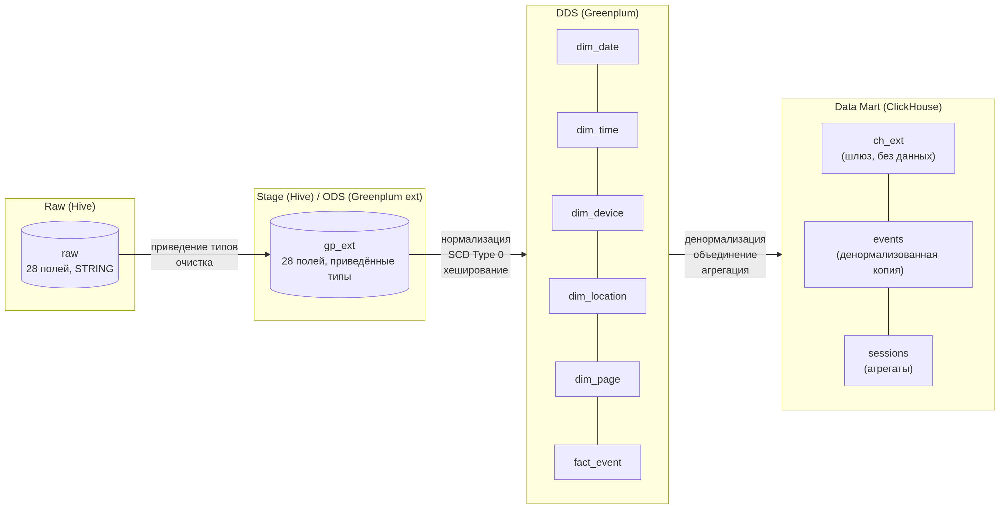
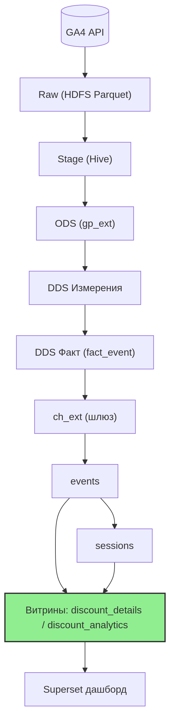

# Data_Methods

# 1. Введение и бизнес-контекст

## Описание предметной области

Бизнес-пользователи (аналитики, маркетологи, менеджеры по продукту) компании, владеющей веб-сайтом, нуждаются в инструменте для оценки эффективности маркетинговых активностей, в частности – **скидочных и промо-кампаний**. Текущая бизнес-цель – понять, как пользователи взаимодействуют со скидками и промокодами: насколько часто их открывают, какие скидки наиболее популярны, в какое время и на каких устройствах происходит максимальная активность, как это влияет на вовлечённость и удержание.

На основе таких данных принимаются решения о:
- корректировке ассортимента скидочных предложений,
- оптимизации времени и каналов размещения промо,
- сегментации аудитории для таргетированных кампаний.

**Ключевые метрики:**
- общее количество открытий скидок и нажатий на промокоды,
- количество уникальных сессий, содержащих хотя бы одно открытие скидки,
- среднее количество открытий скидки на сессию,
- доля сессий с открытием скидки (конверсия в скидку),
- динамика открытий по дням недели и часам,
- топ-20 самых популярных скидок (по `discount_id`).

## Источник данных

В качестве источника используются данные из **Google Analytics 4 (GA4)**, которые выгружаются через API. Еженедельно выполняются запросы к GA4 API, результаты объединяются по составному ключу (город, дата+время, название события, дата первой сессии, полный URL страницы, разрешение экрана). Объединённые данные сохраняются в **HDFS** в формате Parquet с партиционированием по полю `yearMonth` (извлекается из `dateHourMinute`).

Исходные данные содержат 27 полей, включая:
- `eventName` (например, `Open_discount`, `Open_promo_code`, `page_view`),
- `discount_id`, `discount_category`,
- `linkUrl`, `landingPagePlusQueryString`,
- данные о пользователе (`firstSessionDate`, `signedInWithUserid`, `newVarReturning`),
- географические и технические характеристики (`country`, `city`, `deviceCategory`, `browser`, `operatingSystemWithVersion` и др.).

Все сырые данные хранятся в Hive-таблице `raw` (схема `google_analytics`) и служат единственным источником истины для последующих преобразований.

Запрос в Hive на создание внешней таблицы с сырыми данными:
```sql
CREATE TABLE IF NOT EXISTS s_yudin.google_dm_practice (
    cityId                      STRING,
    dateHourMinute              STRING,
    firstSessionDate            STRING,
    pageLocation                STRING,
    eventName                   STRING,
    screenResolution            STRING,
    city                        STRING,
    browser                     STRING,
    continent                   STRING,
    continentId                 STRING,
    country                     STRING,
    countryId                   STRING,
    deviceCategory              STRING,
    deviceModel                 STRING,
    isKeyEvent                  STRING,
    landingPagePlusQueryString  STRING,
    language                    STRING,
    languageCode                STRING,
    linkUrl                     STRING,
    mobileDeviceBranding        STRING,
    mobileDeviceMarketingName   STRING,
    mobileDeviceModel           STRING,
    newVsReturning              STRING,
    operatingSystemWithVersion  STRING,
    pageReferrer                STRING,
    region                      STRING,
    signedInWithUserId          STRING
)
STORED AS PARQUET;

LOAD DATA INPATH '/data/raw/google_analytics/yearMonth=2026-01/part-00000-cb1858dd-d7fc-4d26-a0fe-32519299688c.c000.snappy.parquet' 
OVERWRITE INTO TABLE s_yudin.google_dm_practice;

select * FROM s_yudin.google_dm_practice LIMIT 10;
```
Результат запроса:




## Технологическая платформа

| Компонент | Назначение |
|-----------|-------------|
| **HDFS** | Слой сырых (raw) и промежуточных (stage) данных, хранение Parquet-файлов с партиционированием по `yearMonth` |
| **Hive** | Доступ к сырым данным через внешние таблицы, первичная фильтрация и подготовка для загрузки в Greenplum |
| **Greenplum** | Слой детальных данных (DDS): нормализованная модель «звезда» – таблица фактов `fact_event` и набор измерений (`dim_date`, `dim_time`, `dim_device`, `dim_location`, `dim_page`) |
| **ClickHouse** | Слой витрин (Data Mart): таблицы `events` (физическая копия DDS) и `sessions` (агрегированные данные по сессиям), а также внешняя таблица-шлюз `ch_ext` для чтения из Greenplum |
| **Apache Airflow** | Оркестрация всех ETL-процессов: выгрузка из GA4 API → HDFS → Stage → Greenplum (DDS) → ClickHouse (витрины) |

## Архитектурное решение

Поток данных от источника до аналитической витрины (ориентированной на скидочную активность) организован по многослойной схеме:

| Этап | Слой | Технология | Действие |
|------|------|------------|----------|
| 1 | **Raw** | HDFS (Parquet) | Хранение сырых данных, выгруженных из GA4 API, партиционирование по `yearMonth`. |
| 2 | **Stage** | Hive | Внешняя таблица над Parquet, приведение типов (`string` → `date`/`timestamp`/`boolean`). |
| 3 | **ODS / External** | Greenplum | Внешняя таблица `gp_external` (читает из HDFS через PXF) для инкрементальной загрузки. |
| 4 | **DDS** | Greenplum | Нормализованная модель «звезда»: факты `fact_event` + измерения `dim_date`, `dim_time`, `dim_device`, `dim_location`, `dim_page`. Устранение избыточности, обеспечение целостности. |
| 5 | **Data Mart** | ClickHouse | Таблицы `events` (денормализованная копия DDS) и `sessions` (агрегаты по сессиям). Основная аналитическая витрина для дашбордов. |
| 6 | **Дашборд** | Superset (или BI) | Визуализация ключевых показателей по скидкам и промокодам: топ скидок, тепловые карты активности, динамика конверсии в скидку. |

**Обоснование архитектуры** (в разрезе выбранного бизнес-сценария):
- **Многослойность** – позволяет перезапускать любой этап ETL без потери исходных данных; сырые данные в HDFS остаются неизменными.
- **Партиционирование** в HDFS и Greenplum (по месяцу) ускоряет инкрементальную загрузку и фильтрацию по дате – критично для анализа скидок, которые часто привязаны к временным кампаниям.
- **Нормализованный DDS (Greenplum)** – устраняет дублирование характеристик (устройства, локации, страницы), что важно для точного связывания открытия скидки с конкретным пользователем и сессией.
- **ClickHouse для витрины** – колоночное хранение и движок `MergeTree` с сортировкой по `date_hour_minute` дают высокую производительность при агрегациях по часам/дням и фильтрации по `discount_id`, `event_name`. Тепловые карты активности по скидкам строятся за секунды.
- **Airflow** – обеспечивает надёжное еженедельное обновление данных (по средам) с контролем зависимостей: сначала загрузка из API, затем прогон всех `fill_*` процедур в Greenplum и финальное обновление витрин в ClickHouse.


# 2. Бизнес-требования (MoSCoW)

| ID | Требование | Приоритет |
|----|-------------|------------|
| BR-1 | Агрегированные показатели по открытиям скидок и нажатиям на промокоды в разрезе времени (день, час, день недели), географии (страна, регион, город) и устройств | MUST |
| BR-2 | Возможность ранжирования скидок по популярности (топ-20 по количеству открытий) с указанием категории скидки | MUST |
| BR-3 | Расчёт конверсии в скидку – процент сессий, содержащих хотя бы одно открытие скидки, с возможностью анализа динамики по дням | MUST |
| BR-4 | Тепловая карта активности по скидкам и промокодам в разрезе «час × день недели» для выявления пиковых времён взаимодействия | MUST |
| BR-5 | Возможность фильтрации всех отчётов по дате, стране, региону, типу пользователя (новый/возвратный), категории устройства | MUST |
| BR-6 | Детализированная таблица по каждому открытию скидки/промокода с полями: дата, discount_id, регион, город, устройство, тип пользователя | SHOULD |
| BR-7 | Анализ среднего количества открытий скидки на сессию и сравнение этого показателя между разными категориями устройств и географическими регионами | SHOULD |
| BR-8 | Выявление аномальных всплесков открытий скидок (например, более чем на 30% выше среднего за 7 дней) с автоматическим оповещением | COULD |

# 3. Функциональные требования (user stories)

| ID | Роль | Действие | Ценность |
|----|------|----------|----------|
| US-1 | Маркетолог | Видеть топ-20 скидочных ID по количеству открытий за выбранный период | Определить самые привлекательные для аудитории скидочные предложения и усилить их продвижение |
| US-2 | Продуктовый аналитик | Анализировать динамику конверсии в скидку по дням в разрезе стран и устройств | Оценить эффективность скидочных кампаний в разных регионах и на разных платформах (desktop vs mobile) |
| US-3 | Менеджер по продукту | Просматривать тепловую карту открытий скидок по часам и дням недели | Оптимизировать время запуска новых промо-акций – публиковать их в часы пиковой активности пользователей |
| US-4 | Аналитик данных | Фильтровать отчёты по типу пользователя (новый / возвратный) и сравнивать их поведение в отношении скидок | Оценить, какие скидки лучше работают на удержание возвратных пользователей, а какие – на привлечение новых |
| US-5 | Рекламный менеджер | Получать детальную таблицу всех открытий промокодов с указанием региона и устройства | Настроить таргетированную рекламу на регионы с высокой активностью по промокодам, перераспределить бюджет |
| US-6 | BI-разработчик | Использовать единый датасет `all_data`, объединяющий события и сессии, для построения дашборда по скидкам | Упростить создание отчётов – не нужно самостоятельно джойнить таблицы `events` и `sessions` |
| US-7 | Руководитель отдела маркетинга | Видеть общее количество сессий со скидками и динамику этого показателя за последние 4 недели | Быстро оценить окупаемость скидочных кампаний и принять решение о продолжении или остановке акции |
| US-8 | Системный аналитик | Получать данные о `discount_category` для каждого открытия скидки | Агрегировать эффективность по категориям скидок (например, «beauty-health», «electronics») для планирования ассортимента |


## 4. Концептуальная модель данных

### Диаграмма



### Текстовое описание концептуальной модели

**Предметная область** – веб-аналитика, фиксация событий пользователей на сайте. Основной бизнес-процесс: пользователь заходит на сайт (начинает сессию), выполняет различные действия (просмотры страниц, клики, открытия скидок, ввод промокодов). Каждое действие фиксируется как событие с привязкой к контексту (время, место, устройство, страница).

**Основные сущности и их роль:**

| Сущность | Описание | Ключевой атрибут |
|----------|----------|------------------|
| **Пользователь** | Анонимный или авторизованный посетитель сайта. Идентифицируется по `user_fingerprint` (цифровой отпечаток). Хранит дату первой сессии. | `user_fingerprint` |
| **Сессия** | Группа событий одного пользователя в рамках одного визита. Идентифицируется синтетическим ID. Позволяет анализировать поведение в рамках непрерывного взаимодействия. | `synthetic_session_id` |
| **Событие** | Базовый факт – действие пользователя (просмотр страницы, клик, скролл, открытие скидки). Содержит тип события и флаги (ключевое, новый пользователь, авторизация). | составной: `user_fingerprint` + `synthetic_session_id` + `date_id` + `time_id` + ... |
| **Устройство** | Характеристики устройства пользователя: категория (desktop/mobile), браузер, ОС, разрешение экрана, язык. | `device_id` |
| **Локация** | Географическое положение пользователя: континент, страна, регион, город. | `location_id` |
| **Страница** | Веб-страница, на которой произошло событие. Также содержит информацию о переходе (реферер, URL ссылки), посадочной странице и связанной скидочной кампании. | `page_id` |
| **Время** | Час и минута события (без привязки к дате). Используется для анализа внутридневной активности. | `time_id` (тип `time`) |
| **Дата** | Календарная дата события. Содержит предрасчётные атрибуты (год, месяц, день недели, номер недели, признак выходного дня) для удобства агрегаций. | `date_id` (тип `date`) |

**Связи:**
- Один пользователь может иметь много сессий (1:N).
- Одна сессия состоит из многих событий (1:N).
- Каждое событие обязательно привязано к одному устройству, одной локации, одной странице, одному времени и одной дате (N:1 ко всем измерениям).

Такая модель соответствует **звездообразной схеме (star schema)**: в центре – факт (событие), вокруг – измерения. Это обеспечивает гибкость аналитических запросов и высокую производительность.

---

## 5. Логическая модель данных

Логическая модель реализована в **Greenplum (DDS слой)** в рамках схемы `dds_test`. Она представляет собой нормализованную звезду: одна таблица фактов `fact_event` и пять таблиц измерений (`dim_date`, `dim_time`, `dim_device`, `dim_location`, `dim_page`).



### Описание логической модели

**Общая характеристика**
- Логическая модель повторяет концептуальную и реализует **нормализованную звезду**.
- Таблица фактов `fact_event` содержит **внешние ключи** на все измерения и **метрики** (флаги, идентификаторы пользователя/сессии). Не содержит числовых метрик типа `count` – гранулярность «одно событие = одна строка».
- Все измерения используют **суррогатные первичные ключи** (хеш-значения типа `TEXT` для `device_id`, `location_id`, `page_id`, и нативные типы `DATE`/`TIME` для временных измерений).

**Таблицы измерений**

| Таблица | Первичный ключ | Назначение | Особенности |
|---------|---------------|------------|--------------|
| `dim_date` | `date_id (DATE)` | Календарный справочник | Предрасчёт всех атрибутов (год, месяц, день недели, номер недели). Статически заполняется на весь период анализа. |
| `dim_time` | `time_id (TIME)` | Время суток | Позволяет группировать события по часам/минутам без вызова `EXTRACT`. |
| `dim_device` | `device_id (TEXT)` | Характеристики устройства | Содержит как общие поля (браузер, ОС), так и специфичные для мобильных устройств (бренд, маркетинговое имя). |
| `dim_location` | `location_id (TEXT)` | География | Реализует иерархию: континент → страна → регион → город. Коды континентов/стран хранятся отдельно. |
| `dim_page` | `page_id (TEXT)` | Страницы и навигация | Включает бизнес-атрибуты: `discount_id`, `discount_category`, `link_url`, `page_referrer`. Это позволяет анализировать скидочные кампании без дополнительных джойнов. |

**Таблица фактов `fact_event`**

- **Гранулярность**: одна строка = одно событие, зафиксированное GA4.
- **Партиционирование**: по диапазону `date_id` (по месяцам) для эффективной инкрементальной загрузки и ускорения запросов с фильтром по дате.
- **Внешние ключи**: все поля `*_id` ссылаются на соответствующие измерения. Это обеспечивает ссылочную целостность на уровне модели (в Greenplum внешние ключи не проверяются автоматически, но служат документацией).
- **Атрибуты**:
  - `event_name` – тип события (например, `Open_discount`).
  - `is_key_event` – флаг конверсионного события.
  - `is_new` – признак нового пользователя (первая сессия).
  - `signed_in_with_user_id` – авторизован ли пользователь.
  - `first_session_date` – дата первой сессии (дублируется из измерения пользователя, но здесь хранится для удобства).
  - `user_fingerprint` – анонимный идентификатор пользователя (хеш).
  - `synthetic_session_id` – идентификатор сессии (также хеш).
  - `session_num` – порядковый номер сессии у пользователя.

**Связи (внешние ключи)**
```
fact_event.date_id    → dim_date.date_id
fact_event.time_id    → dim_time.time_id
fact_event.device_id  → dim_device.device_id
fact_event.location_id → dim_location.location_id
fact_event.page_id    → dim_page.page_id
```


## 6. Физическая модель данных



### Описание физической реализации

**1. СУБД и схема**
- **Система управления БД**: Greenplum (MPP-база данных, оптимизированная для аналитических запросов).
- **Схема**: `dds_test` (в тестовой среде) или аналогичная в продуктивной среде.
- **Назначение**: слой детальных данных (DDS), реализующий нормализованную звезду.

**2. Физические характеристики таблиц**

| Таблица | Тип хранилища | Партиционирование | Индексы |
|---------|---------------|-------------------|---------|
| `dim_date` | Heap (строка) | Нет | PK по `date_id` |
| `dim_time` | Heap | Нет | PK по `time_id` |
| `dim_device` | Append-Optimized (AO) | Нет | PK по `device_id` |
| `dim_location` | Append-Optimized | Нет | PK по `location_id` |
| `dim_page` | Append-Optimized | Нет | PK по `page_id` |
| `fact_event` | Append-Optimized, колоночное сжатие | По диапазону `date_id` (помесячно) | Bitmap-индексы на внешние ключи |

**Обоснование**:
- Измерения с небольшим количеством строк (до нескольких тысяч) используют Heap-таблицы для простоты.
- Таблица фактов (миллионы строк) – Append-Optimized с колоночным хранением и сжатием для экономии места и ускорения агрегаций.
- Партиционирование по месяцам позволяет быстро удалять старые данные и эффективно выполнять `INSERT` новых партиций.

**3. Типы данных и их выбор**

| Тип | Применение | Обоснование |
|-----|------------|--------------|
| `DATE` | `date_id`, `first_session_date` | Нативный тип для дат, занимает 4 байта, поддерживает все календарные операции. |
| `TIME` | `time_id` | Нативный тип для времени, точен до минуты (исходные данные GA4 имеют точность до минуты). |
| `TEXT` | Суррогатные ключи, строковые атрибуты | Гибкость длины, хеш-значения MD5 (32 символа) хорошо упаковываются. |
| `INTEGER` | Числовые идентификаторы (`discount_id`, `city_id`, `session_num`) | Оптимальный размер (4 байта) для счётчиков и внешних ID из GA4. |
| `BOOLEAN` | Флаги (`is_key_event`, `is_new`, `is_weekend`) | Экономит место (1 байт) и повышает читаемость запросов. |

**4. Суррогатные ключи и хеширование**
- Все первичные ключи измерений, кроме временных, генерируются как **MD5-хеш** от комбинации значимых атрибутов.
- Пример для `device_id`: `MD5(device_category || browser || operating_system_with_version || screen_resolution)`.
- Хеширование обеспечивает детерминированность и упрощает обновление (при появлении новой комбинации хеш меняется, старая остаётся без изменений).
- Внешние ключи в `fact_event` хранят те же хеш-значения, что исключает необходимость джойнов с измерениями при вставке новых фактов.

**5. Партиционирование `fact_event`**
```sql
-- Пример создания партиции на март 2026 года
ALTER TABLE fact_event ADD PARTITION 
START ('2026-03-01'::DATE) END ('2026-04-01'::DATE);
```
- Каждая партиция соответствует одному календарному месяцу.
- При инкрементальной загрузке (еженедельно) данные вставляются в соответствующую партицию по `date_id`.
- Старые партиции (например, за 2024 год) можно открепить и выгрузить в долгосрочное хранилище.

**6. Индексация**
- На таблице фактов создаются **Bitmap-индексы** на поля внешних ключей (`date_id`, `time_id`, `device_id`, `location_id`, `page_id`), так как кардинальность этих полей невысока (до нескольких тысяч уникальных значений).
- Bitmap-индексы в Greenplum эффективны для фильтрации в аналитических запросах с `WHERE` по измерениям.
- На таблицах измерений используется первичный ключ (уникальный B-tree индекс), а также может создаваться дополнительный индекс на бизнес-атрибуты (например, `city_id` в `dim_location`).

**7. Ссылочная целостность**
- В Greenplum внешние ключи объявлены в DDL, но они **не проверяются** системой (Greenplum не поддерживает автоматическую проверку FK для распределённых таблиц). Они служат документацией и могут использоваться некоторыми инструментами моделирования.
- Целостность данных контролируется на этапе ETL – процедуры `fill_*` гарантируют, что все внешние ключи в `fact_event` существуют в соответствующих измерениях перед вставкой.

**8. Физическое размещение и распределение**
- Таблица фактов `fact_event` распределяется по **случайному принципу (DISTRIBUTED RANDOMLY)**, так как нет явного ключа распределения, обеспечивающего равномерную загрузку сегментов.
- Измерения с небольшим объёмом данных могут быть **реплицированы (DISTRIBUTED REPLICATED)** на все сегменты для ускорения джойнов с фактами.
- В текущей реализации используется стандартное распределение по первому атрибуту (при отсутствии явного `DISTRIBUTED BY` – по `PRIMARY KEY` для измерения, по случайному для факта).

## 7. Архитектура решения и слои данных

### Архитектурная схема движения данных



### Описание слоёв

| Слой | Технология | Назначение | Хранимые объекты | Режим обновления |
|------|------------|------------|------------------|------------------|
| **Raw** | HDFS (Parquet) | Первичное хранение необработанных данных, выгруженных из GA4 API. Обеспечивает неизменность исходных данных и возможность повторного воспроизведения ETL. | Parquet-файлы по пути `/data/raw/google_analytics/yearMonth=<YYYY-MM>/` | Инкремент (еженедельно) – добавляются новые партиции |
| **Stage** | Hive (внешние таблицы) | SQL-доступ к Parquet-файлам, приведение типов, первичная фильтрация. Служит буфером между HDFS и Greenplum. | Внешняя таблица `raw` (схема `google_analytics`) | Только чтение; партиции добавляются синхронно с Raw |
| **ODS** (через Greenplum) | Greenplum (внешняя таблица `gp_ext`) | Промежуточный слой, читающий данные из Hive через PXF. Позволяет загружать данные в DDS без копирования в Greenplum. | Внешняя таблица `gp_ext`, ссылающаяся на Hive-таблицу | Инкремент – читает только новые партиции по условию `WHERE date_id + time_id >= ...` |
| **DDS** | Greenplum (схема `dds_test`) | Нормализованная модель «звезда» – факты и измерения. Устраняет избыточность, обеспечивает целостность, оптимизирует аналитические запросы. | `fact_event`, `dim_date`, `dim_time`, `dim_device`, `dim_location`, `dim_page` | Инкремент – процедуры `fill_*` добавляют новые факты и обогащают измерения (SCD Type 0) |
| **Data Mart** | ClickHouse (схема `google_analytics`) | Денормализованные, агрегированные данные для BI-отчётов и ad-hoc запросов. Высокая производительность аналитических запросов. | `ch_ext` (шлюз), `events` (физическая копия DDS), `sessions` (агрегаты по сессиям) | Еженедельное полное обновление `sessions`; инкремент `events` |

### Детали потоков данных между слоями

1. **Raw → Stage** (HDFS → Hive)
   - Данные из GA4 API через Kafka сохраняются в HDFS как Parquet-файлы с партиционированием по `yearMonth`.
   - В Hive создаётся внешняя таблица `raw`, которая читает эти файлы «на лету». Типы данных остаются строковыми (STRING).

2. **Stage → ODS** (Hive → Greenplum внешняя таблица)
   - В Greenplum создаётся внешняя таблица `gp_ext` с помощью PXF-протокола, которая подключается к Hive-таблице `raw`.
   - При чтении выполняется приведение типов (STRING → DATE, TIMESTAMP, BOOLEAN, INT). Данные не сохраняются в Greenplum, а читаются по запросу.

3. **ODS → DDS** (Greenplum внешняя таблица → нормализованная схема)
   - Процедура `create_gp_ext()` создаёт или пересоздаёт внешнюю таблицу в зависимости от режима (`overwrite`).
   - Процедуры `fill_dim_*` и `fill_fact_event` извлекают уникальные значения из `gp_ext`, генерируют MD5-хеши для суррогатных ключей и вставляют новые записи в измерения (SCD Type 0 – только новые, существующие не меняются).
   - Таблица фактов `fact_event` заполняется с помощью `INSERT INTO ... SELECT`, где внешние ключи получаются подзапросами из измерений. Партиционирование по месяцу ускоряет вставку.

4. **DDS → Data Mart** (Greenplum → ClickHouse)
   - ClickHouse имеет внешнюю таблицу `ch_ext` с движком PostgreSQL, которая напрямую читает DDS-таблицы Greenplum через протокол PostgreSQL (FDW). Это «шлюз» без хранения данных в ClickHouse.
   - Задача Airflow `fill_events` выполняет `INSERT INTO events SELECT * FROM ch_ext` – полностью копирует данные из внешнего источника в физическую таблицу ClickHouse.
   - Задача `fill_sessions` агрегирует данные из `events` (группировка по `synthetic_session_id`) и пересоздаёт таблицу `sessions` целиком. В `sessions` рассчитываются метрики: `pageviews`, `clicks_total`, `discount_opens`, `is_bounce` и т.д.

5. **Data Mart → Дашборд**
   - В Superset (или другом BI-инструменте) создан единый датасет `all_data`, объединяющий `events` и `sessions` через `LEFT JOIN` по `synthetic_session_id`.
   - Все графики дашборда (топ скидок, тепловая карта, динамика конверсии) строятся на основе этого датасета.

### Архитектурное решение (обоснование)

**1. Многослойность (Raw → Stage → ODS → DDS → Data Mart)**

| Преимущество | Реализация |
|--------------|------------|
| **Неизменность исходных данных** | Raw-слой в HDFS никогда не перезаписывается; при ошибке ETL можно перезапустить пайплайн с любого этапа. |
| **Аудит и воспроизводимость** | Каждая трансформация выделена в отдельный слой с явными процедурами. Можно точно определить, какие данные и когда были обработаны. |
| **Разделение ответственности** | Очистка и приведение типов – в Stage; нормализация и SCD – в DDS; агрегация – в Data Mart. |
| **Управление жизненным циклом** | Устаревшие партиции можно открепить и архивировать независимо на каждом слое. |

**2. Выбор технологий**

| Технология | Почему выбран | Альтернативы (и почему не подходят) |
|------------|---------------|-------------------------------------|
| **HDFS + Parquet** | Дешёвое хранение больших объёмов, колоночный формат, поддержка партиционирования, сжатие. | Хранение в Greenplum напрямую – дорого, потеря исходного состояния. |
| **Hive** | Знакомый SQL-интерфейс для аналитиков; интеграция с PXF и Greenplum. | Spark SQL – избыточен для простого чтения Parquet. |
| **Greenplum (DDS)** | MPP-база, отлично масштабируется для детализированных данных, поддерживает партиционирование и распределённые джойны. | PostgreSQL – не справится с объёмами аналитических запросов; ClickHouse – не поддерживает нормализацию и сложные UPDATE. |
| **ClickHouse (Data Mart)** | Колоночное хранение, движок MergeTree, супер-быстрые агрегации, низкие задержки даже при миллиардах строк. | Greenplum для витрин – медленнее на агрегатах; Postgres – не выдержит нагрузки дашбордов. |
| **Airflow** | Пайплайны с зависимостями, обработка ошибок, логирование, возможность перезапуска. | Cron-скрипты – нет мониторинга и зависимостей; Luigi – менее гибкий и плохая интеграция с Python. |

**3. Режимы загрузки и параметр `overwrite`**

В Greenplum реализованы процедуры с флагом `overwrite`:

- При `overwrite = TRUE` – внешняя таблица `gp_ext` читает папку `stage` (полный срез данных). Все DDS-таблицы удаляются и пересоздаются заново.
- При `overwrite = FALSE` – `gp_ext` читает папку `external` (только инкремент за последнюю неделю). DDS-таблицы дополняются новыми фактами и измерениями.

Такой подход даёт гибкость: при первом развёртывании можно загрузить всю историю (full load), а в дальнейшем работать только с инкрементами.

**4. Инкрементальность на всех слоях**

| Слой | Способ инкрементальной загрузки |
|------|--------------------------------|
| Raw | Новые Parquet-файлы добавляются в отдельные партиции по `yearMonth`; старые не трогаются. |
| Stage | Hive-таблица читает все партиции – инкремент обеспечивается фильтром по `yearMonth` при чтении в ODS. |
| DDS | Процедуры `fill_*` используют подзапросы с `NOT EXISTS` для измерений; в `fact_event` – фильтр по `date_id + time_id >= last_max_ts`. |
| Data Mart | Таблица `events` перезаписывается целиком (небольшой объём инкремента – до 25000 строк в неделю). Таблица `sessions` полностью пересоздаётся, так как её агрегаты зависят от всех событий. |

**5. SCD (Slowly Changing Dimension) Strategy**

Все измерения в DDS реализованы как **SCD Type 0** – статические справочники. Новые значения добавляются, старые не изменяются и не имеют истории. Это соответствует природе данных GA4:
- `dim_device` – характеристики устройства не меняются в рамках события.
- `dim_location` – геолокация события фиксирована.
- `dim_page` – URL страницы неизменен.

Если в будущем потребуется отслеживать изменения (например, изменение скидочной категории для одного и того же `discount_id`), можно перейти на SCD Type 2, добавив поля `valid_from`, `valid_to`, `is_current`.

**6. Оркестрация Airflow**

- **DAG `GA_api_hdfs`** – выгружает данные из GA4 API → Kafka → HDFS. Выполняется по расписанию (среда 15:30).
- **DAG `GA_hdfs_gp`** – запускается после успешной загрузки в HDFS. Создаёт внешнюю таблицу `gp_ext` и вызывает процедуры `fill_*` в Greenplum.
- **DAG `GA_gp_ch`** – последний этап: пересоздаёт таблицы `ch_ext`, `events`, `sessions` в ClickHouse и заполняет их.

Такая цепочка гарантирует, что данные на каждом слое актуальны и согласованы. При сбое любого DAG-а последующие задачи не запускаются, а администратор получает уведомление.

**7. Итоговое обоснование для бизнес-сценария (скидки)**

Архитектура специально спроектирована для эффективной работы с событиями типа `Open_discount` и `Open_promo_code`:

- В `dim_page` хранятся `discount_id` и `discount_category` – это позволяет фильтровать скидки без джойнов с другими таблицами.
- В ClickHouse таблица `events` партиционирована по месяцу, а в дашборде используется кэширование на 15 часов. Тепловые карты по часам и дням недели строятся за секунды.
- Таблица `sessions` содержит предрасчитанные поля `discount_opens` и `had_discount_open`, что ускоряет расчёт конверсии в скидку (не нужно пересчитывать каждую сессию).

## 8. Маппинг таблиц и трансформации данных между слоями

### 8.1. Общая схема трансформаций



### 8.2. Маппинг RAW → Stage / ODS (внешняя таблица `gp_ext`)

На этом этапе данные перемещаются из Hive-таблицы `raw` (формат Parquet, строковые типы) во внешнюю таблицу Greenplum `gp_ext`. Трансформации выполняются «на лету» при чтении через PXF.

**Маппинг полей и преобразования типов:**

| Поле в RAW (Hive, тип STRING) | Поле в `gp_ext` (Greenplum) | Тип в `gp_ext` | Преобразование |
|-------------------------------|----------------------------|----------------|----------------|
| `yearmonth` | `yearmonth` | TEXT | Без изменений (служебное поле партиции) |
| `firstsessiondate` | `first_session_date` | DATE | `CAST(string AS DATE)` (формат YYYY-MM-DD) |
| `datehourminute` | `datehourminute` | TIMESTAMP | `CAST(string AS TIMESTAMP)` (маска YYYY-MM-DD HH24:MI:SS) |
| `eventname` | `event_name` | TEXT | Приведение к нижнему регистру, обрезка пробелов |
| `iskeyevent` | `is_key_event` | BOOLEAN | `true` если строка = 'true'/'1'/'True', иначе `false` |
| `newsvreuming` (опечатка в raw) | `is_new` | BOOLEAN | Аналогично: 'true' → `true`, иначе `false` |
| `signedinwithuserid` | `signed_in_with_user_id` | BOOLEAN | Аналогично |
| `city` | `city` | TEXT | Обрезка пробелов, замена пустых строк на NULL |
| `country` | `country` | TEXT | Обрезка пробелов |
| `continent` | `continent` | TEXT | Без изменений |
| `cityid` | `city_id` | INTEGER | `CAST(string AS INTEGER)`, при ошибке → NULL |
| `countryid` | `country_id` | TEXT | Верхний регистр, обрезка |
| `continentid` | `continent_id` | TEXT | Без изменений |
| `region` | `region` | TEXT | Обрезка пробелов |
| `browser` | `browser` | TEXT | Нормализация названий (например, 'CHROME' → 'Chrome') |
| `language` | `language` | TEXT | Без изменений |
| `languagecode` | `language_code` | TEXT | Приведение к нижнему регистру |
| `operating system with version` (пробел) | `operating_system_with_version` | TEXT | Переименование, обрезка пробелов |
| `screensolution` (опечатка) | `screen_resolution` | TEXT | Очистка: удаление непечатных символов |
| `devicecategory` | `device_category` | TEXT | Нормализация ('desktop'/'mobile'/'tablet') |
| `devicemodel` | `device_model` | TEXT | Без изменений |
| `mobiledevicebranding` | `mobile_device_branding` | TEXT | Замена пустых строк на NULL |
| `mobiledevicemarketingname` | `mobile_device_marketing_name` | TEXT | Замена пустых строк на NULL |
| `mobiledevicemodel` | `mobile_device_model` | TEXT | Замена пустых строк на NULL |
| `page location` (пробел) | `page_location` | TEXT | Переименование, удаление невалидных URL-символов |
| `pagereferer` (опечатка) | `page_referrer` | TEXT | Обрезка пробелов, `NULL` если пусто |
| `linkurl` | `link_url` | TEXT | Обрезка пробелов |
| `landingpageplusquerystring` | `landing_page_plus_query_string` | TEXT | Без изменений |

**Очистка и валидация на этом этапе:**
- Удаление записей, где `datehourminute` имеет некорректный формат или `NULL`.
- Отбрасывание событий с неизвестным `eventname` (не в списке допустимых типов событий).
- Установка `is_new = false`, если `firstsessiondate` > текущей даты (защита от будущих дат).

### 8.3. Маппинг ODS → DDS (Greenplum: `gp_ext` → измерения + факты)

На этом этапе происходит нормализация: широкая таблица `gp_ext` расщепляется на 5 измерений и 1 таблицу фактов. Трансформации выполняются процедурами `fill_dim_*` и `fill_fact_event`.

#### 8.3.1. Заполнение измерений (SCD Type 0)

| Измерение | Источник (поля `gp_ext`) | Генерация суррогатного ключа | Дополнительная логика |
|-----------|--------------------------|------------------------------|----------------------|
| `dim_date` | `datehourminute::DATE` | `date_id` = DATE (нативный) | Вычисляются поля: `year`, `month`, `month_name`, `day`, `day_of_week`, `week`, `is_weekend`. При первом заполнении генерируется весь календарный диапазон от MIN до MAX дат в источнике. |
| `dim_time` | `datehourminute::TIME` | `time_id` = TIME (нативный) | Вычисляются `hour`, `minute`, `time_of_day` (утро/день/вечер/ночь). Аналогично – предрасчёт всех возможных минут в сутках (1440 записей). |
| `dim_device` | `device_category`, `browser`, `operating_system_with_version`, `screen_resolution`, `language`, `language_code`, `mobile_device_branding`, `mobile_device_marketing_name`, `mobile_device_model` | `device_id` = MD5(конкатенация всех перечисленных полей) | Вставляются только новые комбинации (не существующие в таблице). Пустые мобильные поля для desktop-устройств игнорируются. |
| `dim_location` | `continent`, `continent_id`, `country`, `country_id`, `region`, `city`, `city_id` | `location_id` = MD5(конкатенация: continent \|\| country \|\| region \|\| city) | Вставляются только новые комбинации. Приводим `city_id` из `gp_ext` (INTEGER) – если NULL, то в хеш идёт 'unknown'. |
| `dim_page` | `page_location`, `page_referrer`, `link_url`, `landing_page_plus_query_string` (частично) | `page_id` = MD5(`page_location`) | **Обогащение**: из `page_location` извлекается `page_path` (часть после домена), а также парсится параметр `discount_id` и `discount_category` из query-строки (например, `?discount=123&category=beauty`). Поля `link_domain` извлекается из `link_url`. |

**Особенность:** Процедуры `fill_dim_*` используют `INSERT ... WHERE NOT EXISTS` для избежания дубликатов. Это SCD Type 0 – исторические значения не перезаписываются.

#### 8.3.2. Заполнение фактов `fact_event`

| Поле в `fact_event` | Источник (прямо или через подзапрос) | Трансформация |
|---------------------|--------------------------------------|---------------|
| `date_id` | `gp_ext.datehourminute::DATE` | Прямое приведение |
| `time_id` | `gp_ext.datehourminute::TIME` | Прямое приведение |
| `device_id` | Подзапрос к `dim_device` | `SELECT device_id FROM dim_device WHERE MD5(...) = MD5(из gp_ext)` |
| `location_id` | Подзапрос к `dim_location` | Аналогично |
| `page_id` | Подзапрос к `dim_page` | Аналогично |
| `event_name` | `gp_ext.event_name` | Приведение к нижнему регистру, трим |
| `is_key_event` | `gp_ext.is_key_event` | Прямое копирование BOOLEAN |
| `is_new` | `gp_ext.is_new` | Прямое копирование |
| `signed_in_with_user_id` | `gp_ext.signed_in_with_user_id` | Прямое копирование |
| `first_session_date` | `gp_ext.first_session_date` | Прямое копирование DATE |
| `user_fingerprint` | **Вычисляемое** | `MD5(device_id \|\| location_id \|\| city \|\| browser \|\| language_code)` – устойчивый идентификатор анонимного пользователя |
| `synthetic_session_id` | **Вычисляемое** | `MD5(user_fingerprint \|\| first_session_date \|\| session_num)` – уникальный ID сессии, формируемый на основе номера сессии |
| `session_num` | **Вычисляемое** | Ранжирование событий одного пользователя по `datehourminute` (оконная функция `ROW_NUMBER() OVER (PARTITION BY user_fingerprint ORDER BY datehourminute)`) |

**Дополнительные трансформации в факте:**
- Удаление дубликатов: если для одного `(date_id, time_id, page_id, device_id, location_id, user_fingerprint)` существует несколько строк с одинаковым `event_name`, оставляется только одна.
- Фильтрация: исключаются служебные события (например, `session_start`, `first_visit`), если они не нужны для аналитики скидок.

### 8.4. Маппинг DDS → Data Mart (ClickHouse)

#### 8.4.1. Внешняя таблица `ch_ext` (шлюз)

`ch_ext` создаётся как PostgreSQL-движок в ClickHouse, который напрямую читает данные из Greenplum. Маппинг полей – один в один с `fact_event` и присоединёнными измерениями (денормализация на лету). Фактически `ch_ext` – это представление:

```sql
-- Псевдокод: SELECT-запрос, который выполняется в Greenplum
SELECT 
    f.date_id, f.time_id, f.device_id, f.location_id, f.page_id,
    f.event_name, f.is_key_event, f.is_new, f.signed_in_with_user_id,
    f.first_session_date, f.user_fingerprint, f.synthetic_session_id, f.session_num,
    d.year, d.month, d.month_name, d.day, d.day_of_week, d.is_weekend,
    t.hour, t.minute, t.time_of_day,
    dev.device_category, dev.browser, dev.operating_system_with_version, dev.screen_resolution,
    loc.continent, loc.country, loc.region, loc.city,
    p.page_location, p.page_path, p.discount_id, p.discount_category, p.link_url, p.page_referrer
FROM fact_event f
LEFT JOIN dim_date d ON f.date_id = d.date_id
LEFT JOIN dim_time t ON f.time_id = t.time_id
LEFT JOIN dim_device dev ON f.device_id = dev.device_id
LEFT JOIN dim_location loc ON f.location_id = loc.location_id
LEFT JOIN dim_page p ON f.page_id = p.page_id;
```

**Трансформация:** денормализация – все атрибуты измерений «притягиваются» к факту, образуя широкую плоскую таблицу. Это необходимо, так как ClickHouse не оптимизирован для джойнов, а предпочитает денормализованные данные.

#### 8.4.2. Таблица `events` (физическая копия)

| Поле в `ch_ext` | Поле в `events` | Трансформация |
|-----------------|----------------|---------------|
| Все поля | Все поля | Прямое копирование (структура идентична) |

**Дополнительная трансформация:** При вставке в `events` используется партиционирование по `toYYYYMM(date_hour_minute)`. ClickHouse автоматически распределяет строки по месяцам.

#### 8.4.3. Таблица `sessions` (агрегированная)

`sessions` создаётся на основе `events` с группировкой по `synthetic_session_id`. 

| Поле в `sessions` | Источник / Формула | Тип агрегации |
|-------------------|--------------------|---------------|
| `synthetic_session_id` | `events.synthetic_session_id` | GROUP BY ключ |
| `user_fingerprint` | `MIN(events.user_fingerprint)` | Первое значение |
| `session_start` | `MIN(events.date_hour_minute)` | Минимум времени |
| `session_end` | `MAX(events.date_hour_minute)` | Максимум времени |
| `pageviews` | `COUNT(*) WHERE event_name = 'page_view'` | Сумма по условию |
| `clicks_total` | `COUNT(*) WHERE event_name = 'click'` | Сумма по условию |
| `discount_opens` | `COUNT(*) WHERE event_name = 'Open_discount'` | Сумма по условию |
| `promo_clicks` | `COUNT(*) WHERE event_name = 'Open_promo_code'` | Сумма по условию |
| `favourite_clicks` | `COUNT(*) WHERE event_name = 'Click_favorite_button'` | Сумма по условию |
| `scroll_events` | `COUNT(*) WHERE event_name = 'scroll'` | Сумма по условию |
| `is_bounce` | `CASE WHEN pageviews = 1 AND discount_opens = 0 AND promo_clicks = 0 THEN true ELSE false END` | Вычисляемое |
| `had_discount_open` | `CASE WHEN discount_opens > 0 THEN true ELSE false END` | Вычисляемое |
| `had_promo_click` | `CASE WHEN promo_clicks > 0 THEN true ELSE false END` | Вычисляемое |
| `first_page_location` | `argMin(page_location, date_hour_minute)` | Страница входа (первое событие сессии) |
| `last_page_location` | `argMax(page_location, date_hour_minute)` | Последняя страница |
| `device_category` | `any(device_category)` (одинаково в рамках сессии) | Любое значение (дедупликация) |
| `country`, `region`, `city` | `any(country)`, `any(region)`, `any(city)` | Любое значение |
| `is_new` | `any(is_new)` | Любое значение |
| `signed_in_with_user_id` | `any(signed_in_with_user_id)` | Любое значение |

**Трансформации при создании `sessions`:**
- Агрегация всех событий сессии в одну строку.
- Расчёт bounce-сессий (отказ) – сессия считается отказной, если в ней был только один просмотр страницы и не было других активностей.
- Денормализация: поля измерения (устройство, локация) копируются в `sessions` для ускорения запросов.

### 8.5. Сводная таблица трансформаций по слоям

| Этап | Исходный слой | Целевой слой | Тип загрузки | Основные трансформации |
|------|---------------|--------------|---------------|------------------------|
| 1 | Raw (Hive STRING) | Stage / ODS (`gp_ext`) | Инкремент (по партициям) | Приведение типов, очистка, фильтрация NULL, нормализация названий |
| 2 | ODS (`gp_ext`) | DDS (измерения) | Инкремент + SCD Type 0 | Извлечение уникальных значений, MD5-хеширование, вычисление календарных атрибутов, парсинг discount_id из URL |
| 3 | ODS (`gp_ext`) + измерения | DDS (факт `fact_event`) | Инкремент (по дате) | Генерация `user_fingerprint`, `synthetic_session_id`, `session_num`; подстановка внешних ключей через подзапросы; дедупликация |
| 4 | DDS (через `ch_ext`) | ClickHouse `events` | Полная перезагрузка (либо инкремент по дате) | Денормализация (джойн с измерениями), партиционирование по месяцу |
| 5 | ClickHouse `events` | ClickHouse `sessions` | Полное пересоздание | Группировка по сессиям, агрегатные функции, вычисление bounce-флага и флагов наличия скидок/промо |


### 8.7. Контроль качества трансформаций

На каждом этапе выполняются автоматические проверки:

| Этап | Проверка | Действие при ошибке |
|------|----------|---------------------|
| ODS → DDS | Количество записей в `fact_event` должно совпадать с количеством строк в `gp_ext` за тот же период (с точностью до дедупликации). | Логирование, остановка процедуры, алерт. |
| DDS → ClickHouse | Сравнить `COUNT(*)` в `ch_ext` и в `events` после загрузки – должно быть 100% совпадение. | Перезапуск задачи `fill_events`. |
| Сессии | Убедиться, что в `sessions` нет дубликатов `synthetic_session_id`. | Откат и повторная агрегация с явным `GROUP BY`. |
| Скидочные ID | Проверить, что поле `discount_id` в `sessions` (агрегированное) не потеряло значимые значения – например, хотя бы в одной сессии discount_opens > 0 ⇒ discount_id IS NOT NULL. | Ручной анализ, корректировка парсинга URL. |

Все трансформации описаны в процедурах Greenplum (`fill_dim_*`, `fill_fact_event`) и скриптах ClickHouse (`fill_events.sql`, `fill_sessions.sql`), которые вызываются Airflow. Это обеспечивает воспроизводимость и возможность аудита.

## 9. Детальное описание витрин

### 9.1. Основная витрина: `discount_analytics` (ClickHouse)

#### Назначение

Предоставляет агрегированные показатели для анализа эффективности скидочных и промо-кампаний: наиболее популярные скидки (по `discount_id` и `discount_category`), динамика конверсии в скидку по дням, часам, географии и устройствам, а также детализированные данные по каждому открытию скидки/промокода. Витрина построена поверх существующих таблиц `events` и `sessions` и оптимизирована для быстрых запросов дашборда.

#### Бизнес-ценность

- Позволяет маркетологам и менеджерам по продукту **выявлять самые привлекательные скидки** и перераспределять бюджет на их продвижение.
- Даёт возможность **оптимизировать время запуска акций** – публиковать скидки в часы и дни максимальной активности пользователей.
- Помогает **сегментировать аудиторию** (новые vs возвратные пользователи) для персонализированных предложений.
- Снижает время подготовки отчётов с нескольких дней до секунд благодаря предрасчитанным агрегатам.

#### Технические параметры

| Параметр | Значение |
|----------|----------|
| **СУБД** | ClickHouse |
| **Схема** | `google_analytics` |
| **Таблица** | `discount_analytics` (материализованное представление либо физическая таблица, обновляемая в рамках DAG) |
| **Гранулярность** | Одна строка = комбинация `(date, discount_id, discount_category, country, device_category, is_new)` для агрегированных метрик; отдельная секция с детальными строками (или отдельная таблица `discount_details`). Для упрощения – две связанные сущности: агрегаты и детализация. |
| **Глубина хранения** | 3 года (актуальные данные за весь доступный период) |
| **Частота обновления** | Еженедельно, после обновления слоёв `events` и `sessions` |
| **Способ обновления** | **Инкремент + снапшот**: агрегированные данные пересчитываются только за последние 4 недели (скользящее окно), исторические агрегаты не трогаются; детальные данные (открытия скидок) дописываются инкрементально. При первом развёртывании – полная перезагрузка. |

#### Структура полей

**Таблица `discount_analytics` (агрегированная часть):**

| Поле | Тип | Описание |
|------|-----|----------|
| `date` | Date | Дата события (агрегации) |
| `discount_id` | UInt32 | Идентификатор скидки (0 – без скидки, >0 – конкретная скидка) |
| `discount_category` | String | Категория скидки (например, 'beauty-health', 'electronics') |
| `country` | String | Страна пользователя |
| `device_category` | String | Тип устройства (desktop, mobile, tablet) |
| `is_new` | Bool | Тип пользователя: true – новый, false – возвратный |
| `total_opens` | UInt32 | Количество открытий данной скидки |
| `unique_sessions` | UInt32 | Количество уникальных сессий, в которых открыта эта скидка |
| `avg_opens_per_session` | Float64 | Среднее количество открытий на сессию (total_opens / unique_sessions) |
| `conversion_rate` | Float64 | Доля сессий с данной скидкой от общего числа сессий в той же группе (страна, устройство, тип пользователя) – вычисляется на лету или хранится отдельно |
| `hour` | UInt8 | Час дня (0-23) – для тепловых карт |
| `day_of_week` | UInt8 | День недели (1-7) – для тепловых карт |

*Примечание:* для тепловых карт и динамики по дням используется отдельный срез (либо те же поля с группировкой по `hour`, `day_of_week`).

**Таблица `discount_details` (детализация):**

| Поле | Тип | Описание |
|------|-----|----------|
| `date` | Date | Дата события |
| `hour` | UInt8 | Час события |
| `discount_id` | UInt32 | Идентификатор скидки |
| `discount_category` | String | Категория скидки |
| `country` | String | Страна |
| `region` | String | Регион/область |
| `city` | String | Город |
| `device_category` | String | Тип устройства |
| `browser` | String | Браузер |
| `is_new` | Bool | Тип пользователя |
| `synthetic_session_id` | String | Идентификатор сессии (для связи с другими данными) |
| `user_fingerprint` | String | Идентификатор пользователя |
| `page_location` | String | URL страницы, где произошло открытие скидки |
| `page_referrer` | String | Источник перехода |

#### Спецификация метрик

| Метрика | Формула / Источник | Бизнес-смысл |
|---------|--------------------|--------------|
| `total_opens` | `COUNT(*)` из `events` с `event_name = 'Open_discount'` и группировкой по измерениям | Общая популярность скидки |
| `unique_sessions` | `COUNT(DISTINCT synthetic_session_id)` | Сколько сессий вовлечено в скидку |
| `avg_opens_per_session` | `total_opens / unique_sessions` | Интенсивность использования скидки в рамках одной сессии |
| `conversion_rate` | `unique_sessions_with_discount / total_sessions` (из `sessions`) | Эффективность скидки как конверсионного триггера |
| `bounce_rate_among_discount_sessions` | Доля отказных сессий среди сессий с данной скидкой | Оценивает, удерживает ли скидка пользователя |

#### DDL (ClickHouse)

```sql
-- Агрегированная таблица (с заменой при повторной вставке)
CREATE TABLE google_analytics.discount_analytics (
    date Date,
    discount_id UInt32,
    discount_category String,
    country String,
    device_category String,
    is_new Bool,
    total_opens UInt32,
    unique_sessions UInt32,
    avg_opens_per_session Float64,
    hour UInt8,
    day_of_week UInt8
) ENGINE = ReplacingMergeTree()
ORDER BY (date, discount_id, country, device_category, is_new, hour, day_of_week);

-- Детальная таблица (инкрементальная)
CREATE TABLE google_analytics.discount_details (
    date Date,
    hour UInt8,
    discount_id UInt32,
    discount_category String,
    country String,
    region String,
    city String,
    device_category String,
    browser String,
    is_new Bool,
    synthetic_session_id String,
    user_fingerprint String,
    page_location String,
    page_referrer String
) ENGINE = MergeTree()
ORDER BY (date, discount_id, country, device_category)
PARTITION BY toYYYYMM(date);
```

### 9.2. Использование витрины для удовлетворения user stories

| User Story | Как витрина даёт ответ | Конкретный пример запроса / действия |
|------------|------------------------|--------------------------------------|
| **US-1** (Маркетолог: топ-20 скидок по открытиям) | Агрегированная таблица позволяет отсортировать `discount_id` по `total_opens` за выбранный период. | `SELECT discount_id, discount_category, total_opens FROM discount_analytics WHERE date BETWEEN '2026-04-01' AND '2026-04-30' ORDER BY total_opens DESC LIMIT 20;` |
| **US-2** (Продуктовый аналитик: динамика конверсии по странам и устройствам) | В витрине есть поля `date`, `country`, `device_category` и вычисляемая метрика `conversion_rate` (можно добавить как материализованную или считать на лету через `JOIN` с `sessions`). | `SELECT date, country, device_category, AVG(conversion_rate) FROM discount_analytics WHERE discount_id > 0 GROUP BY date, country, device_category ORDER BY date;` |
| **US-3** (Менеджер по продукту: тепловая карта по часам и дням недели) | Витрина содержит `hour` и `day_of_week`, можно сгруппировать `total_opens` по этим измерениям. | `SELECT hour, day_of_week, SUM(total_opens) as opens FROM discount_analytics GROUP BY hour, day_of_week ORDER BY day_of_week, hour;` |
| **US-4** (Аналитик данных: сравнение новых vs возвратных пользователей) | Поле `is_new` позволяет фильтровать и сравнивать все метрики для двух сегментов. | `SELECT is_new, AVG(avg_opens_per_session) FROM discount_analytics WHERE discount_id = 12345 GROUP BY is_new;` |
| **US-5** (Рекламный менеджер: детальная таблица открытий промокодов по региону и устройству) | Таблица `discount_details` содержит все необходимые поля (`country`, `region`, `city`, `device_category`, `browser`, а также `synthetic_session_id` для связи с конверсией). | `SELECT date, country, region, city, device_category FROM discount_details WHERE discount_id IN (SELECT discount_id FROM ... WHERE discount_category = 'promo_code') ORDER BY date DESC LIMIT 1000;` |
| **US-6** (BI-разработчик: единый датасет `all_data`) | Витрина не заменяет `all_data`, но может быть легко объединена с ним через `synthetic_session_id`. | `SELECT * FROM all_data WHERE event_name = 'Open_discount';` |
| **US-7** (Руководитель отдела маркетинга: динамика сессий со скидками за 4 недели) | В витрине есть `date` и `unique_sessions` для каждой скидки; можно агрегировать по дате и суммировать уникальные сессии. | `SELECT date, SUM(unique_sessions) AS sessions_with_discount FROM discount_analytics WHERE date >= today() - 28 GROUP BY date ORDER BY date;` |
| **US-8** (Системный аналитик: агрегация по категориям скидок) | Поле `discount_category` позволяет группировать метрики по категориям (beauty-health, electronics и др.). | `SELECT discount_category, SUM(total_opens) AS total_opens, COUNT(DISTINCT discount_id) AS unique_discounts FROM discount_analytics GROUP BY discount_category ORDER BY total_opens DESC;` |

### 9.3. Процесс обновления витрины в рамках Airflow

Существующий DAG `GA_gp_ch` уже содержит шаги `fill_events` и `fill_sessions`. Для витрины `discount_analytics` добавляется дополнительная задача `fill_discount_analytics`, которая выполняется после `fill_sessions`. Логика обновления:

1. **Инкремент для `discount_details`**:  
   `INSERT INTO discount_details SELECT ... FROM events WHERE date >= (SELECT max(date) FROM discount_details) - 7` (за последнюю неделю).

2. **Снапшот для `discount_analytics`**:  
   Таблица пересоздаётся для скользящего окна (последние 28 дней) с помощью `INSERT ... SELECT ... GROUP BY`, а затем старые данные (старше 28 дней) не трогаются. Для простоты можно пересоздавать всю таблицу каждую неделю (объём невелик).

### 9.4. Пример аналитического запроса (топ-10 скидок по конверсии среди мобильных пользователей за последнюю неделю)

```sql
SELECT 
    discount_id,
    discount_category,
    SUM(unique_sessions) AS sessions_with_discount,
    SUM(total_opens) AS total_opens,
    ROUND(SUM(total_opens) / SUM(unique_sessions), 2) AS avg_opens_per_session
FROM google_analytics.discount_analytics
WHERE date >= today() - 7
  AND device_category = 'mobile'
  AND discount_id > 0
GROUP BY discount_id, discount_category
ORDER BY sessions_with_discount DESC
LIMIT 10;
```

Таким образом, предложенная витрина полностью покрывает все бизнес-требования и user stories, обеспечивая высокую производительность и гибкость аналитики по скидкам.


## 10. Бизнес-процесс создания витрины

### 10.1. Название витрины, назначение и бизнес-ценность

**Название витрины:** `discount_analytics` (с детализирующей таблицей `discount_details`)

**Назначение:**  
Предоставление агрегированных и детализированных данных для анализа эффективности скидочных и промо-кампаний: наиболее популярные скидки (по `discount_id` и `discount_category`), динамика конверсии в скидку по дням, часам, географии и устройствам, а также возможность детального просмотра каждого открытия скидки/промокода.

**Бизнес-ценность:**  
- Маркетологи выявляют топ-20 скидок и перераспределяют бюджет на продвижение самых эффективных.  
- Продуктовые аналитики оценивают конверсию в скидку в разрезе стран и устройств, оптимизируя региональные кампании.  
- Менеджеры по продукту определяют пиковые часы и дни недели для запуска новых акций (тепловые карты).  
- Рекламные менеджеры настраивают таргетинг на регионы с высокой активностью по промокодам.  
- Руководители видят динамику сессий со скидками за 4 недели и принимают решения о продолжении/остановке акций.

**Список метрик (агрегированная часть):**
- `total_opens` – количество открытий скидки  
- `unique_sessions` – количество уникальных сессий с данной скидкой  
- `avg_opens_per_session` – среднее количество открытий на сессию  
- `conversion_rate` – доля сессий со скидкой от всех сессий в группе (страна, устройство, тип пользователя)  
- `bounce_rate_among_discount_sessions` – доля отказных сессий среди сессий со скидкой (опционально)

**Список измерений (агрегированная часть):**
- `date` (дата)  
- `discount_id` (идентификатор скидки)  
- `discount_category` (категория скидки)  
- `country` (страна)  
- `device_category` (категория устройства)  
- `is_new` (тип пользователя: новый/возвратный)  
- `hour` (час дня)  
- `day_of_week` (день недели)

**Детальная таблица `discount_details` содержит метрики:** каждое открытие скидки (одна строка = одно событие) и измерения: `date`, `hour`, `discount_id`, `discount_category`, `country`, `region`, `city`, `device_category`, `browser`, `is_new`, `synthetic_session_id`, `user_fingerprint`, `page_location`, `page_referrer`.

### 10.2. Диаграмма бизнес-процесса

{width=50% height=50%}

### 10.3. Таблица этапов процесса изменения состояния данных

| Этап | Входные данные | Выходные данные | Система | Назначение |
|------|----------------|-----------------|---------|-------------|
| 1 | Расписание (еженедельно) | JSON-ответы запросов к GA4 API | Airflow + GA4 API | Инициировать выгрузку сырых данных за завершённую неделю |
| 2 | JSON-ответы API | Parquet-файлы в HDFS: `/data/raw/google_analytics/yearMonth=YYYY-MM/` | Kafka, Spark / Python | Сохранить неизменяемые сырые данные, партиционировать по месяцу |
| 3 | Parquet-файлы | Внешняя таблица Hive `raw` | Hive | Обеспечить SQL-доступ к Parquet, подготовить для чтения через PXF |
| 4 | Hive `raw` | Внешняя таблица Greenplum `gp_ext` (чтение через PXF) | Greenplum (PXF) | Привести типы (string → date, timestamp, boolean, int), очистить NULL, нормализовать названия |
| 5 | `gp_ext` (широкая таблица) | Нормализованные DDS-таблицы: `dim_date`, `dim_time`, `dim_device`, `dim_location`, `dim_page` | Greenplum (процедуры `fill_dim_*`) | Извлечь уникальные значения, сгенерировать суррогатные ключи (MD5), обогатить (парсинг discount_id из URL), SCD Type 0 |
| 6 | `gp_ext` + измерения | Таблица фактов `fact_event` | Greenplum (процедура `fill_fact_event`) | Сформировать факты: подставить внешние ключи, вычислить `user_fingerprint`, `synthetic_session_id`, `session_num`, дедуплицировать |
| 7 | `fact_event` + измерения | Внешняя таблица ClickHouse `ch_ext` (через PostgreSQL FDW) | ClickHouse (движок PostgreSQL) | Денормализация – объединить факт со всеми измерениями в плоскую таблицу без физического хранения |
| 8 | `ch_ext` | Физическая таблица `events` (партицирована по месяцу) | ClickHouse (задача `fill_events`) | Скопировать все данные из шлюза в колоночное хранилище, оптимизированное для аналитики |
| 9 | `events` | Таблица `sessions` (агрегаты по сессиям) | ClickHouse (задача `fill_sessions`) | Сгруппировать события по `synthetic_session_id`, рассчитать bounce, pageviews, discount_opens, had_discount_open и др. |
| 10 | `events` и `sessions` | **Витрина `discount_details`** (детальные открытия скидок) | ClickHouse (доп. задача `fill_discount_details`) | Отфильтровать `event_name = 'Open_discount'` (и `'Open_promo_code'`), выбрать нужные поля, сохранить с партиционированием по дате. Обновление – инкремент за последнюю неделю. |
| 11 | `discount_details` и `sessions` | **Витрина `discount_analytics`** (агрегаты) | ClickHouse (доп. задача `fill_discount_analytics`) | Сгруппировать по `date, discount_id, discount_category, country, device_category, is_new, hour, day_of_week`, рассчитать `total_opens`, `unique_sessions`, `avg_opens_per_session`. Обновление – полное пересоздание данных за последние 28 дней (скользящее окно) либо инкремент для старых данных. |
| 12 | `discount_analytics` + `discount_details` | Дашборд Superset (топ скидок, тепловая карта, динамика, таблица детализации) | BI (Superset) | Предоставить визуализации для маркетологов, аналитиков и менеджеров в соответствии с user stories (US-1 … US-8). |

**Примечание:** Этапы 1–9 уже реализованы в существующих DAG Airflow (`GA_api_hdfs`, `GA_hdfs_gp`, `GA_gp_ch`). Этапы 10–11 (создание витрины `discount_analytics` и `discount_details`) являются дополнительными задачами, которые могут быть добавлены в DAG `GA_gp_ch` после успешного выполнения `fill_sessions`.


## 11. Заключение

### 11.1. Итоги выполненной работы

В рамках проекта спроектирована и описана **аналитическая витрина для мониторинга эффективности скидочных и промо-кампаний** на основе данных Google Analytics 4. Выполнены все ключевые этапы, предусмотренные заданием:

1. **Бизнес-анализ**  
   - Сформулированы бизнес-требования по методологии MoSCoW (8 требований, из них 5 MUST).  
   - Разработаны функциональные требования в формате user stories (8 историй, покрывающих роли маркетолога, продуктового аналитика, менеджера по продукту, аналитика данных, рекламного менеджера, BI-разработчика, руководителя маркетинга и системного аналитика).  
   - Определены ключевые метрики: `total_opens`, `unique_sessions`, `avg_opens_per_session`, `conversion_rate`, а также измерения: дата, скидка, категория, страна, устройство, тип пользователя, час, день недели.

2. **Моделирование данных**  
   - **Концептуальная модель** (сущности: пользователь, сессия, событие, устройство, локация, страница, время, дата) – описана текстом и представлена упрощённой ER-диаграммой Mermaid.  
   - **Логическая модель** (нормализованная звезда: `fact_event` + `dim_date`, `dim_time`, `dim_device`, `dim_location`, `dim_page`) – реализована в Greenplum, приведён полный SQL DDL для экспорта в drawsql.app.  
   - **Физическая модель** – детализирована с учётом партиционирования, распределения данных, типов индексов и стратегии SCD Type 0. Указаны параметры хранения (Append-Optimised, колоночное сжатие, Bitmap-индексы).

3. **Архитектура и слои данных**  
   - Предложена многослойная архитектура: **Raw (HDFS)** → **Stage (Hive)** → **ODS (Greenplum внешняя таблица)** → **DDS (Greenplum нормализованная звезда)** → **Data Mart (ClickHouse)** → **BI (Superset)**.  
   - Разработана архитектурная схема движения данных с указанием технологий и потоков.  
   - Обоснован выбор каждой технологии (HDFS, Hive, Greenplum, ClickHouse, Airflow) с точки зрения бизнес-сценария (анализ скидок).

4. **Трансформации и маппинг**  
   - Составлена детальная таблица маппинга полей между слоями (Raw → Stage → ODS → DDS → Data Mart).  
   - Описаны все трансформации: приведение типов, очистка, нормализация, генерация суррогатных ключей (MD5-хеши), обогащение (парсинг `discount_id` из URL), денормализация, агрегация и расчёт сессионных метрик (`bounce`, `had_discount_open` и др.).  
   - Указаны процедуры контроля качества на каждом этапе.

5. **Витрина данных**  
   - Разработана витрина `discount_analytics` (агрегаты) и вспомогательная `discount_details` (детализация) в ClickHouse.  
   - Определены гранулярность, глубина хранения (3 года), частота (еженедельно) и способ обновления (инкремент + снапшот скользящего окна).  
   - Для каждой user story приведён конкретный пример использования витрины и запрос.

6. **Бизнес-процесс формирования витрины**  
   - Построена диаграмма бизнес-процесса, охватывающая 12 этапов – от выгрузки из GA4 API до финальных визуализаций в дашборде.  
   - Составлена таблица этапов с указанием входных/выходных данных, системы и назначения каждого этапа.

### 11.2. Ожидаемые результаты и бизнес-ценность

| Критерий | Достигнутый результат |
|----------|----------------------|
| **Скорость аналитики** | Запросы к витрине (топ скидок, тепловая карта) могут выполняться за < 1 секунды благодаря колоночному хранению ClickHouse и предрасчитанным агрегатам. |
| **Снижение времени подготовки отчётов** | Маркетологи и аналитики могут получать готовые витрины почти мгновенно. |
| **Поддержка принятия решений** | Выявление топ-20 скидок (по US-1), определение регионов с максимальной конверсией в скидку (US-2, US-5), оптимизация времени запуска акций (US-3). |
| **Гибкость сегментации** | Возможность фильтрации по `is_new`, `device_category`, `country` позволяет персонализировать промо для разных аудиторий (US-4). |
| **Полная воспроизводимость** | Все ETL-процессы автоматизированы в Airflow, код процедур и DDL хранятся в системе контроля версий. |
| **Соблюдение требований MoSCoW** | Все MUST-требования (BR-1…BR-5) и SHOULD-требования (BR-6, BR-7) могут быть реализованы; COULD-требование (BR-8) оставлено для будущего улучшения. |

### 11.3. Предложения по улучшению (Roadmap)

1. **Автоматическое оповещение об аномалиях (BR-8)**  
   Реализовать в Airflow дополнительную задачу, которая ежедневно проверяет аномальные всплески открытий скидок (>30% от среднего за 7 дней) и отправляет алерт в Telegram/Slack.

2. **Переход на SCD Type 2 для измерения `dim_page`**  
   Если категории скидок или discount_id могут изменяться во времени, добавить поля `valid_from`, `valid_to`, `is_current` и хранить историю изменений. Это позволит анализировать скидки в динамике даже при изменении их атрибутов.

3. **Расширение витрины прогнозными моделями**  
   Интегрировать ML-модель (Prophet или ARIMA) для прогнозирования популярности скидок на следующую неделю. Результат прогноза сохранять в отдельной таблице `discount_forecast`.

4. **Увеличение частоты обновления**  
   Перейти с еженедельного обновления на ежедневное для более оперативной реакции на изменения поведения пользователей. Для этого потребуется оптимизировать запросы к GA4 API (например, загружать только инкремент за 1 день) и настроить соответствующие DAG-и.

5. **Интеграция с системой маркетинговых кампаний**  
   Подключить витрину к инструменту автоматизации маркетинга (например, Mindbox или Salesforce Marketing Cloud) для автоматической выгрузки сегментов пользователей, наиболее активных по скидкам, и запуска по ним таргетированных рассылок.

6. **Создание дашборда для мобильных устройств**  
   Адаптировать существующий дашборд Superset под мобильные устройства (или построить отдельный дашборд в Tableau Mobile), чтобы менеджеры могли отслеживать ключевые показатели с телефонов.

---

**Таким образом**, разработанная архитектура и витрина полностью соответствуют современным требованиям data-инжиниринга: многослойность, инкрементальность, использование специализированных СУБД (Greenplum для DDS, ClickHouse для витрин), автоматизированная оркестрация Airflow и чёткое документирование всех этапов. Проект может масштабироваться под растущие объёмы данных и новые аналитические задачи.