# Excel_practice


Предварительный анализ задания показал, что все пункты можно выполнить в Google Sheets.

Файл работы находится по ссылке:

[https://docs.google.com/spreadsheets/d/13VolTfLNv3uh7yYNjznrKYeGsYvZL2upQwyV2lSZ6IY/edit?usp=sharing](https://docs.google.com/spreadsheets/d/13VolTfLNv3uh7yYNjznrKYeGsYvZL2upQwyV2lSZ6IY/edit?usp=sharing)

## Часть 1 «Подготовка данных»

### Задание 1.1. Импорт и форматирование

**1. Импорт CSV-файла**  
- Google Sheets, новый документ.  
- **Файл → Импорт**.


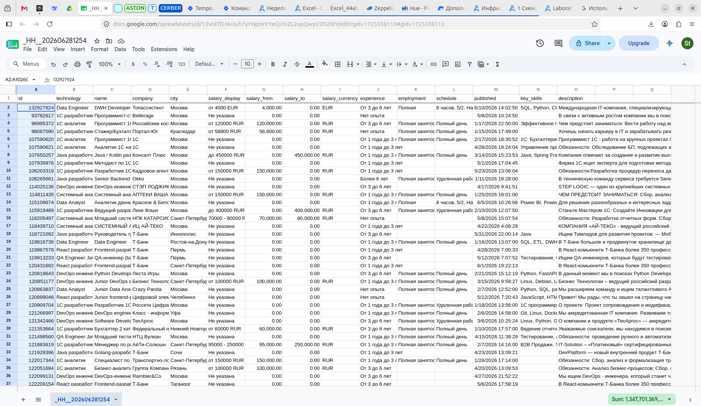


**2. Преобразование типов данных**  
- Google Sheets автоматически определяет типы (числа, даты, текст). 
Установим пропущенные столбцы:  
  - Столбцы `salary_from`, `salary_to`, `published` должны быть Financial и датой соответственно.  
  - **Формат → Число** и формат "Financial".  
  - `published` – **Формат → Число → Дата и время**.  

**3. Преобразование диапазона в «Таблицу»**
  - Выделите весь диапазон с данными (включая заголовки).  
  - Нажмите **Формат → Convert to table**  

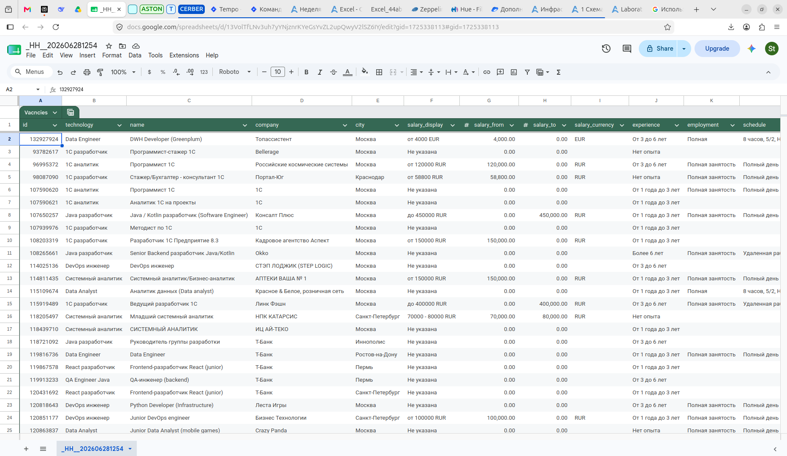

---

### Задание 1.2. Обработка дубликатов

**1. Создать столбец `is_duplicate`**  

`=COUNTIF(Vacancies[id], A5)`

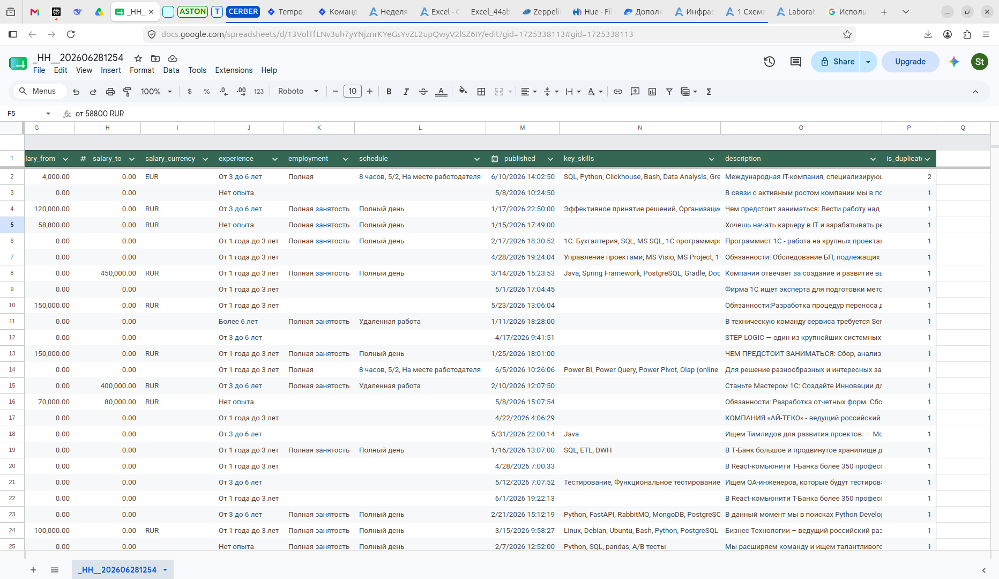

**2. Условное форматирование для подсветки дублей**  
- Выделим весь диапазон с данными.  
- **Формат → Условное форматирование**.  
- В правиле укажем:  
  - **Применить к диапазону**: `A2:O`.  
  - **Форматирование ячеек если** → **Пользовательская формула**.  
  - Вводим формулу: `=$P2>1` (is_duplicate в столбце P).  
  - Цвет заливки и **Готово**.  

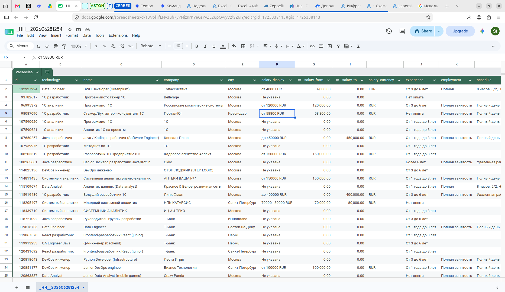

**3. Подсчёт дубликатов**  
В любой свободной ячейке (например, R2) пишем заголовок.
- Формула для варианта А (число строк, которые можно удалить):  
```
=counta(A2:A) - counta(UNIQUE(A2:A))
```  

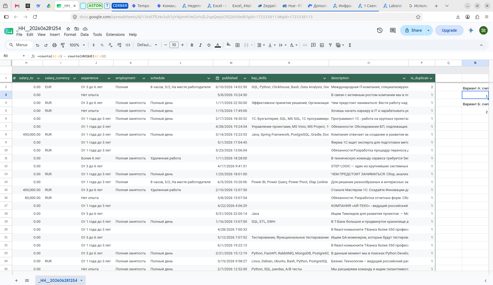

- Для варианта Б (число строк, имеющих дубли, включая первое вхождение):  
```
=countif(P2:P, ">1")
```

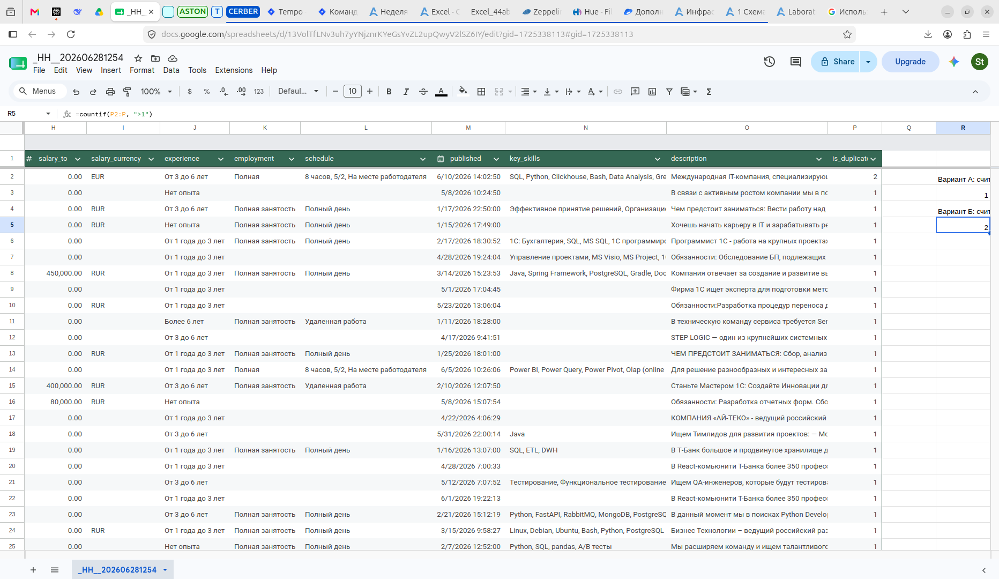

**4. Создать копию листа и удалить дубликаты (оставить самую позднюю публикацию)**  

- Новый лист **Clean_Data**

- **Данные → Сортировать диапазон → Дополнительные параметры**.  

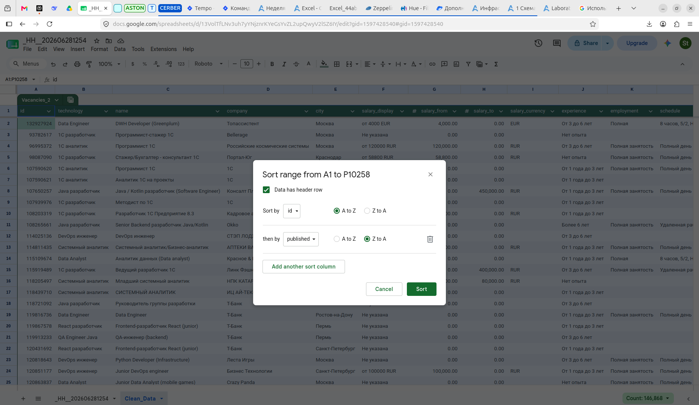

- **Данные → Очистить дубликаты**.  

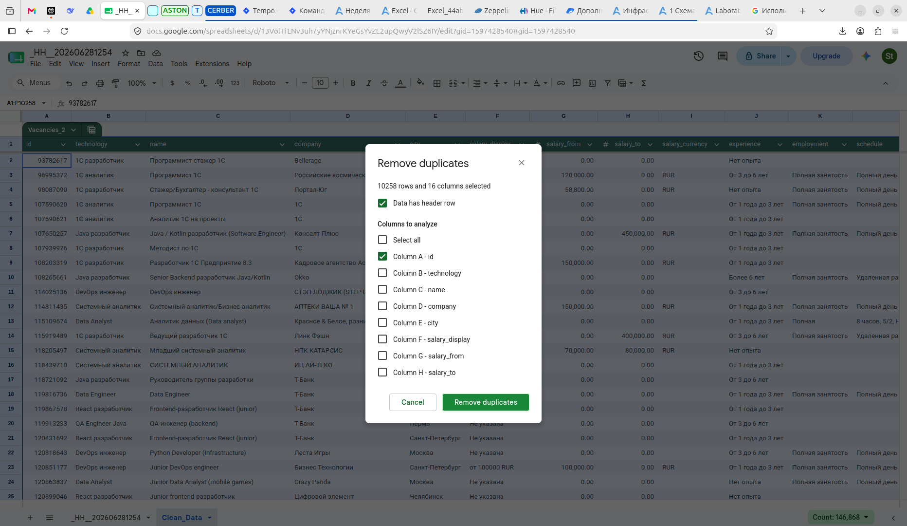

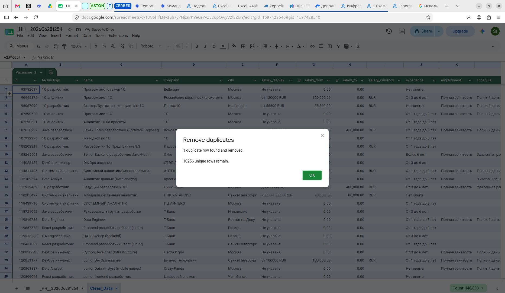

### Задание 1.3. Обработка пропусков в зарплатах

**1. Добавить столбец `salary_filled`**  
- Новый столбец (после `salary_currency`) `salary_filled`.  
- В ячейку первой строки данных вводим формулу:  

```
=if(or(G2>0, H2>0),1,0)
```
- Растягиваем на столбец

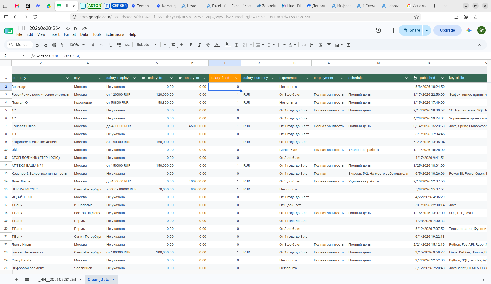

**2. Добавить столбец `salary_avg` (средняя зарплата)**  
- щё один новый столбец `salary_avg`.  
- В первую ячейку данных введем формулу:

```
=IF(and(G2>0,H2>0), (G2+H2)/2, IF(G2>0, G2, IF(H2>0, H2, "")))
```

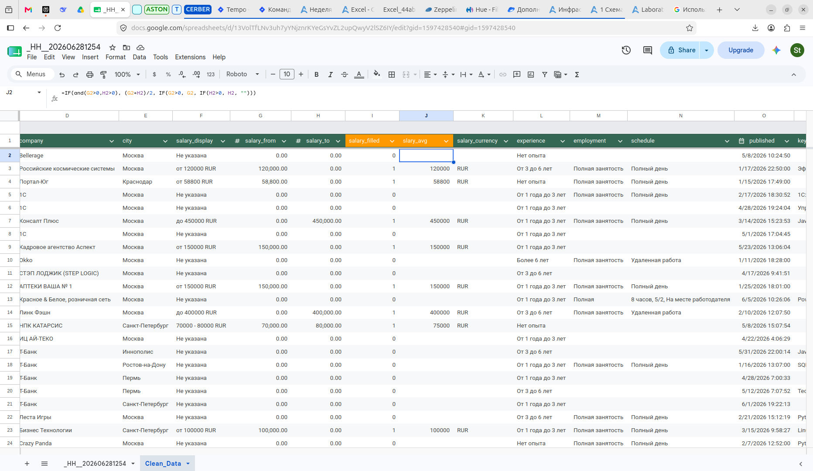


## Часть 2 «Анализ данных формулами»

### Подготовка листа `Summary`

1. Новый лист **Summary**

### Задание 2.1. Общая статистика

На листе `Summary` создайте таблицу со следующими показателями (например, в столбцах A–B):

| Показатель | Формула / значение |
|------------|-------------------|
|Доля вакансий с указанной зарплатой (%) |	=COUNTIF(Clean_Data[salary_filled], "=1")/COUNTA(Clean_Data[id])
Количество уникальных городов | =COUNTUNIQUE(Clean_Data[city])
Количество уникальных компаний	| =COUNTUNIQUE(Clean_Data[company])
Медианная зарплата (salary_avg, где указана)	| =MEDIAN(Clean_Data[salary_avg])
Минимальная зарплата	| =min(MINIFS(Clean_Data[salary_from],Clean_Data[salary_from],">0"), MINIFS(Clean_Data[salary_to],Clean_Data[salary_to],">0"))
Максимальная зарплата	| =MAX(MAXIFS(Clean_Data[salary_to],Clean_Data[salary_to],">0"),Clean_Data[salary_from])
Общее количество вакансий (после очистки)	| =COUNTA(Clean_Data[id])
Средняя зарплата (salary_avg, где указана)	| =AVERAGE(Clean_Data[salary_avg])


### Задание 2.2. Анализ по городам (Топ-10)

1. Получим список 10 городов с наибольшим числом вакансий с помощью **QUERY**:

```
=QUERY(Clean_Data[city], "select E, count(E) where E is not null group by E order by count(E) desc limit 10 label E 'Город', count(E) 'Количество'")
```

2. Для каждого города из полученного списка рассчитаем дополнительные метрики:
   - **Доля вакансий с указанной зарплатой** (в C2):
```
=COUNTIFS(Clean_Data[salary_filled], ">0", Clean_Data[city], A14)/COUNTIF(Clean_Data[city], A14)	
```
  - **Средняя зарплата** 

```
=AVERAGEIF(Clean_Data[city], A14, Clean_Data[salary_avg])
```
Скопируем формулы вниз для всех 10 городов.


### Задание 2.3. Анализ по опыту

Создадим таблицу:
Опыт	|Кол-во вакансий	|Доля от общего (%)	|Средняя зарплата
---|---|---|---
`=UNIQUE(Clean_Data[experience])`|	`=COUNTIF(Clean_Data[experience], A28)`	|`=B28/COUNTA(Clean_Data[experience])`	|`=AVERAGEIF(Clean_Data[experience], A28, Clean_Data[salary_avg])`

Скопируйте для каждой категории.

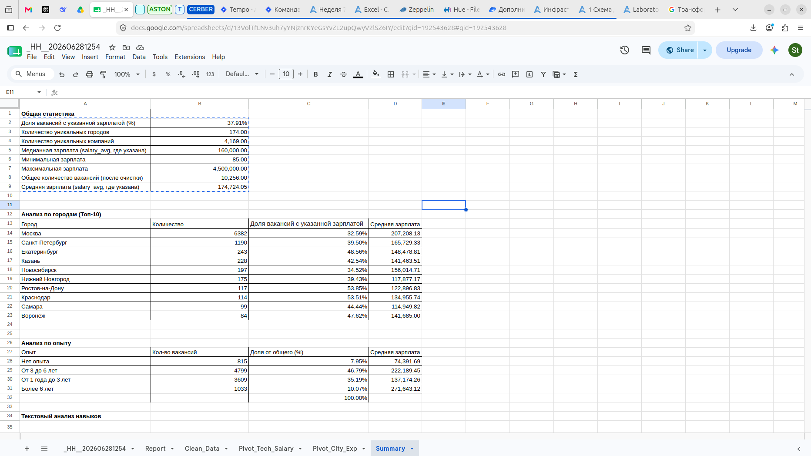

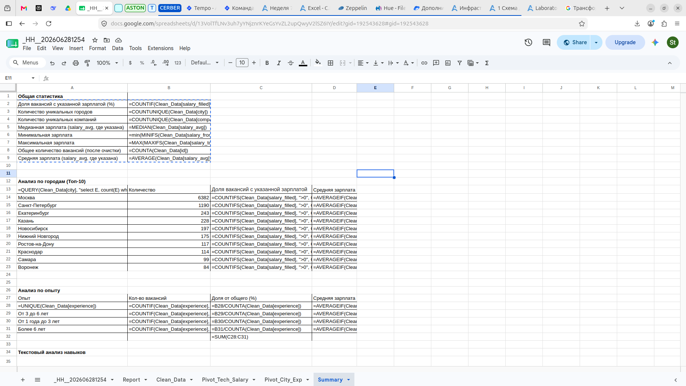


### Задание 2.4. Текстовый анализ навыков


1. **Построим таблицу «Топ-10 навыков»**:
   - Вручную перечислим наиболее частые навыки из поля `key_skills`.  
   - Для каждого навыка используйте формулу с подстановочными знаками `*навык*`.  
   - Отсортируйте по убыванию количества.

2. **Подсчёт вакансий, упоминающих конкретный навык** (например, SQL):
```
=COUNTIF(Clean_Data[key_skills], "*SQL*")	
```

3. **Доля от общего числа вакансий**
```
=B37/COUNTA(Clean_Data[id])
```

### Задание 2.5. Поиск зарплаты по id с помощью XLOOKUP

1. На листе `Summary` создадим блок для поиска:

Enter id: |	Название	|Город	|Средняя зарплата
-|-|-|-
|| `=XLOOKUP(A51,Clean_Data[id],Clean_Data[name],"No data")`	|`=XLOOKUP(A51,Clean_Data[id],Clean_Data[city],"No data")`	|`=XLOOKUP(A51,Clean_Data[id],Clean_Data[salary_avg],"No data")`

2. **Почему XLOOKUP удобнее ВПР?**
   - Ищет значение в любом столбце (не только в первом слева).
   - Не требует сортировки данных.
   - Может возвращать результат из любого столбца (вправо или влево).
   - Встроенная обработка ошибок (аргумент `"Не найдено"`).


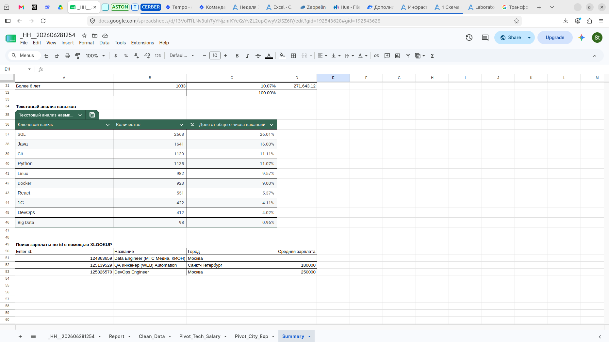

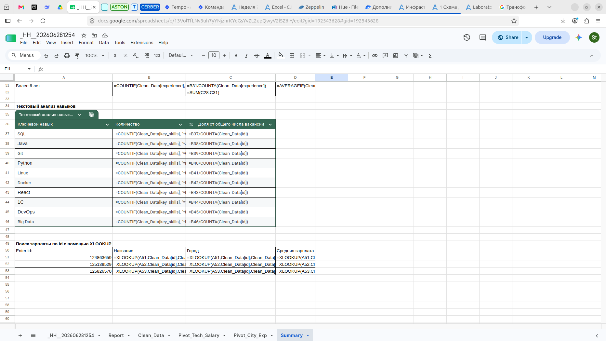


## Часть 3 «Сводная таблица»


### Задание 3.1. Сводная таблица «Город × Опыт»

**1. Создание сводной таблицы**  
 
- Выделим весь диапазон.  
- **Данные → Сводная таблица**.  
- В появившемся окне:  
  - **Диапазон** – автоматически определится (например, `Clean_Data!A1:Q100`)  
  - **Разместить** –  **Новый лист** (**Pivot_City_Exp**).  
- **Создать**.

**2. Настройка полей**  
В боковой панели «Редактор сводной таблицы»:

- **Строки** → добавим **city** (поле `city`).  
- **Столбцы** → добавим **experience**.  
- **Значения** → добавим **id**, но выбрать **СЧЁТ**. Для этого:  
  - Нажмем на добавленное поле `id` в области значений.  
  - В выпадающем меню выберем **Сводка по** → **СЧЁТ**.  
- **Фильтры** → добавим **technology**.  

**3. Перевод значений в проценты**  
- В области значений жмем на поле `id` (сводка – СЧЁТ) → **Показать как** → **% от общей суммы**.  

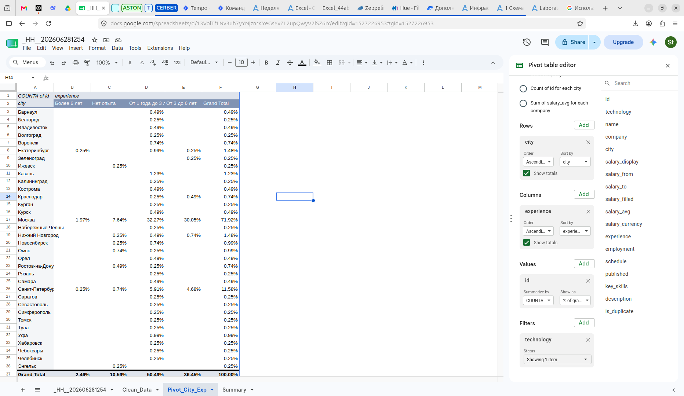

---

### Задание 3.2. Сводная таблица «Зарплаты по технологиям»

**1. Создание второй сводной таблицы**  
- **Данные → Сводная таблица** → на **Новом листе** (**Pivot_Tech_Salary**).  

**2. Настройка полей**  
- **Строки** →  **technology**.  
- **Значения** → дважды поле **salary_avg**:  
  - Первое поле: сводка → **СРЗНАЧ** (это средняя зарплата).  
  - Второе поле: сводка → **СЧЁТ** (количество вакансий, на основе которых посчитано среднее).  

**3. Сортировка**  
- **Строки** →  **technology**
- **Order** -> Desc, **Sort by** AVERAGE of slary_avg

**4. Форматирование**  
- Отформатируем столбец со средней зарплатой **Формат → Число → Дополнительные форматы**.

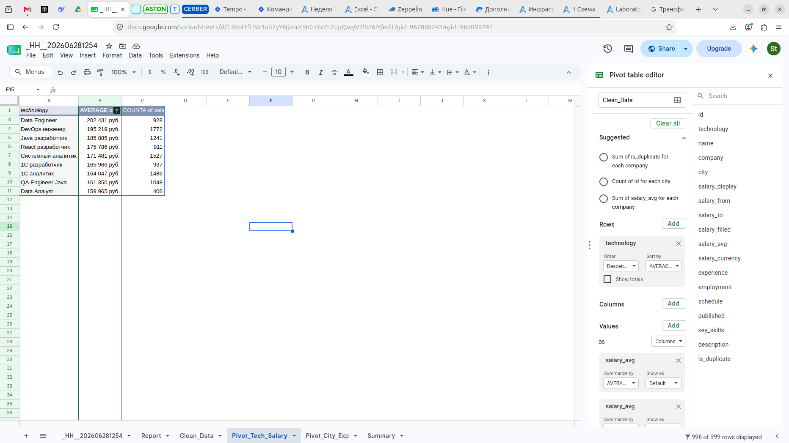


## Часть 4 «Итоговый отчёт»

### Задание 4.1. Оформление листа «Отчёт»

**1. Создание листа и заголовка**  
- Новый лист **Report** 
- В ячейку **A1** заголовок: **«Аналитический отчёт по вакансиям IT-сферы»**.  
- В ячейку **A2**  дату составления: `=TODAY()`
- заголовок: **жирный шрифт**

**2. Раздел «Общая информация»**  
- В ячейку ниже **«Общая информация»** (заголовок раздела).  
- Ниже, начиная с A5, перечислим метрики (в столбце A – название, в столбце B – значение со ссылкой на Summary):  

**3. Раздел «География вакансий»**  

- Предыдущий запрос **QUERY**, проводил сортирвку, чтобы вывести 5 городов с наибольшим числом вакансий - сделаем ссылки на таблицу.

 - Вывод:

```
="Наибольшая концентрация вакансий наблюдается в городах " & TEXTJOIN(", ", 1, A13:A14) & " - они занимают " & text(SUM(Summary!C14:C15), "0.00 %") & " от общего числа вакансий."
```


**4. Раздел «Зарплатные ожидания»**  

**1. Опыт**

- Аналогично заполним и этот раздел


**2. Технология**

- Заполнение данными:

```
=QUERY(Clean_Data!B2:J, "select B, avg(J) where J is not null group by B order by avg(J) desc limit 3 label B 'Технология', avg(J) 'Заработная плата'")
```

- Формутирем значения запрплаты

**3. Вывод**

```
="Самые высокие зарплаты предлагаются кандидатам с опытом " & XLOOKUP(max(B23:B26),B23:B26,A23:A26) & " (средняя зарпалата ~ " & TEXT(max(B23:B26), "# ##0") & " руб.)."
```
```
="По технологиям лидируют " & TEXTJOIN(", ", 1, A29:A30) & " (средняя зарплата " & TEXT(B29, "# ##0") & " руб. и " & TEXT(B30, "# ##0") & " руб. соответственно)."
```

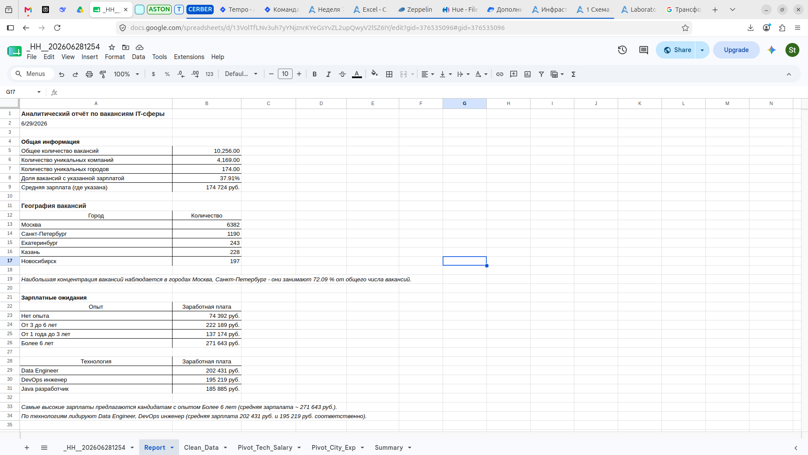

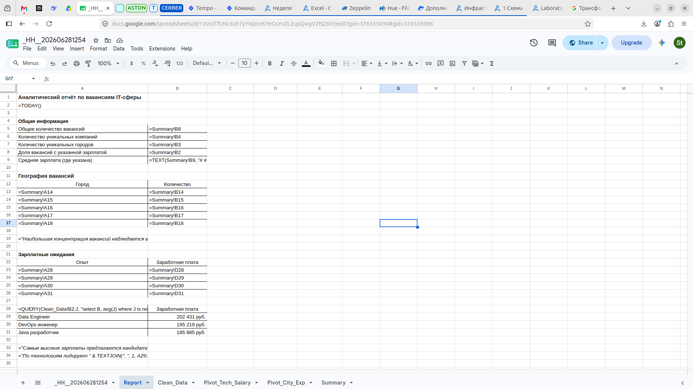

**5. Раздел «Востребованные навыки»**  
- Выберем пять навыков - сделаем ссылки на таблицу в `Summary`

**3. Добавление диаграммы**  
- На основе данных из раздела «География вакансий» создадим столбчатую диаграмму:  
  - Выделите таблицу  
  - **Вставка → Диаграмма**.  
  - В редакторе выберите тип **Столбчатая диаграмма**
  - Настройте заголовок диаграммы: *«География вакансий - Количество вакансий по городам»*.  

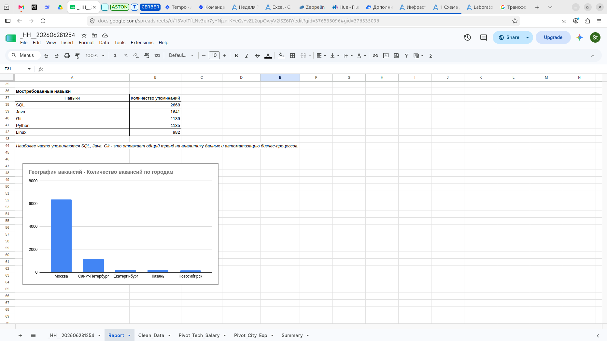

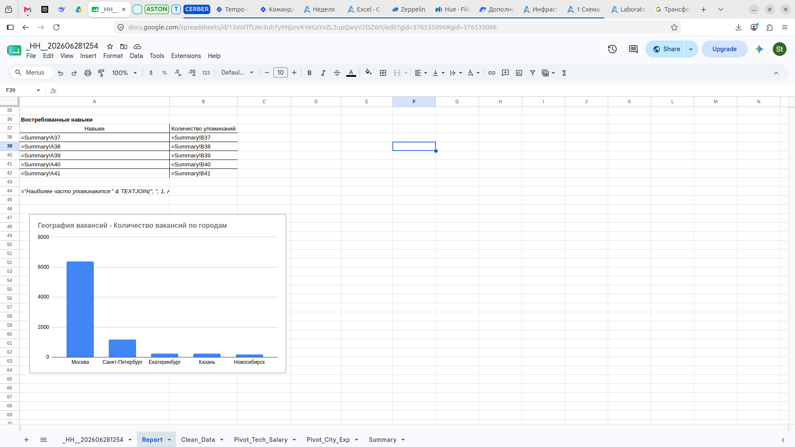