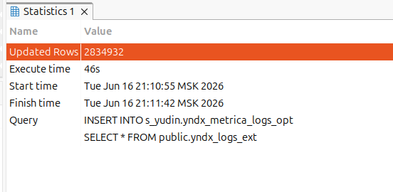
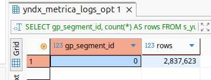
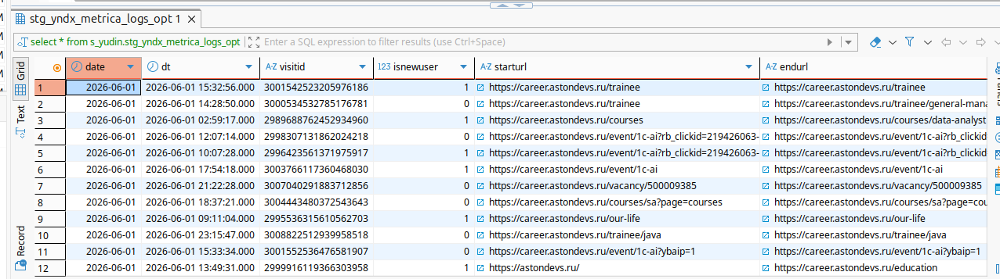
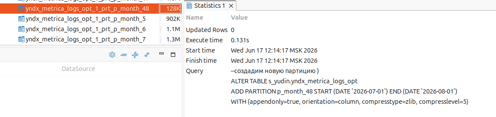
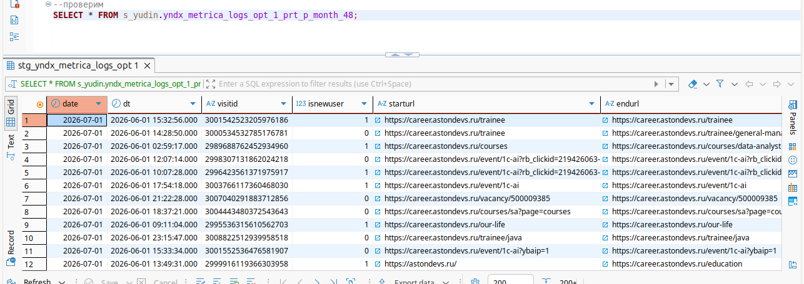
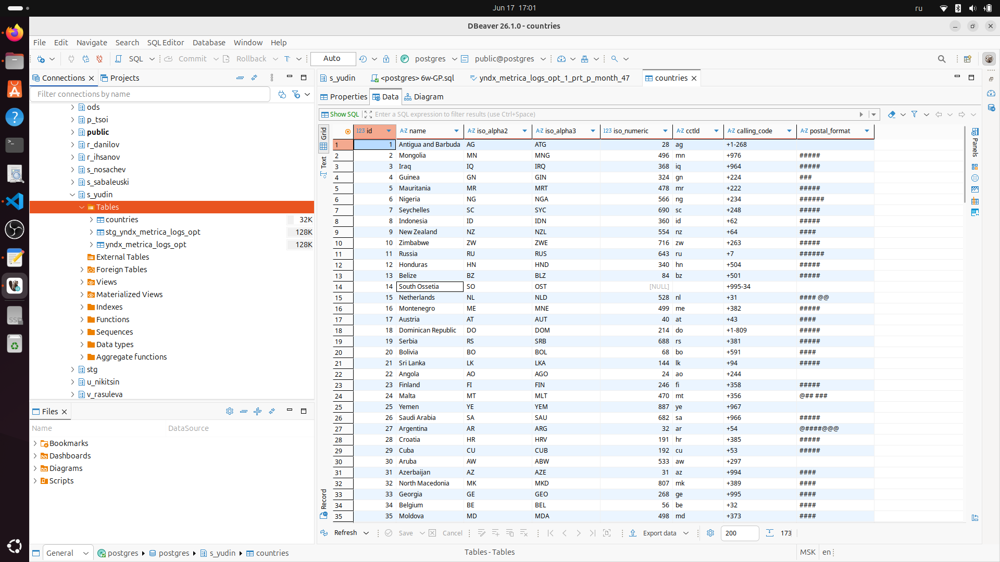
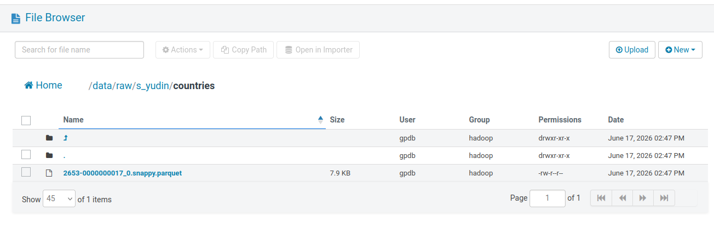
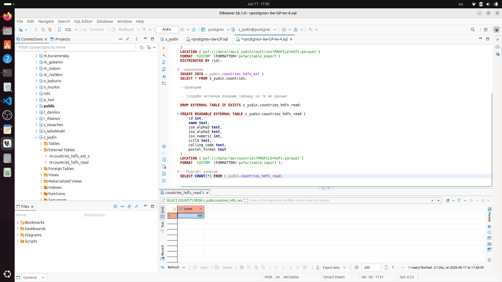
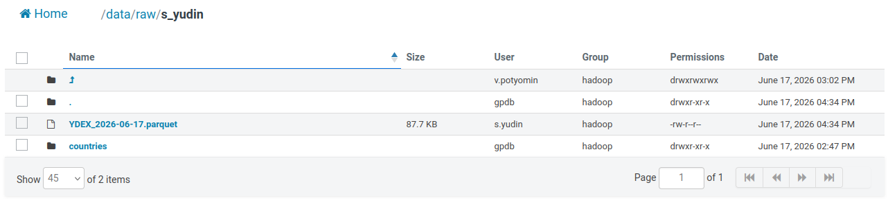
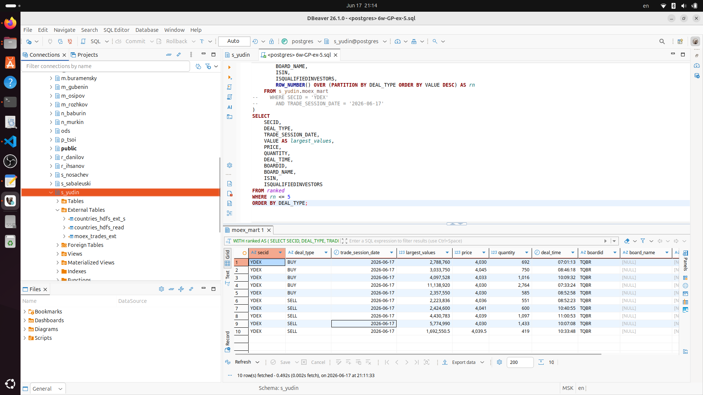

# GreenPlum_practice

## Задания 1 - 2

Решение на ходится в [6w-GP-ex-1-2.sql](./artifacts/6w-GP-ex-1-2.sql)


```sql
-------------- Задание 1 - DISTRIBUTION -------------------

--select count(*) from public.yndx_logs_ext yle where extract(year from date) = 2025;

-- min 2022-09-08
-- max 2026-06-15
-- 1153221 записей для 2025 года - партиции по месяцу

-- Создаём схему и затем оптимальную таблицу в схеме
create table s_yudin.yndx_metrica_logs_opt (
    date date,
    dt timestamp,
    visitid text,
    isnewuser bigint,
    starturl text,
    endurl text,
    pageviews bigint,
    visitduration bigint,
    regioncountry text,
    regioncity text,
    clientid text,
    ipaddress text,
    clienttimezone bigint,
    devicecategory bigint,
    mobilephone text,
    mobilephonemodel text,
    operatingsystem text,
    browser text
)
with (
	appendonly = true,
	orientation = column,
	compresstype = zlib,
	compresslevel = 5
)
distributed by (ipaddress)
partition by range (date)
(
    partition p_month start (date '2022-08-01') end (date '2026-08-01') every (interval '1 month')
);


--Загрузка данных из внешней таблицы

INSERT INTO s_yudin.yndx_metrica_logs_opt
SELECT * FROM public.yndx_logs_ext;
```


```sql
--Оценка перекоса данных (skew)

--SELECT gp_segment_id, count(*) FROM <student_schema>.yndx_metrica_logs_opt GROUP BY 1;

-- Количество строк на каждом сегменте
SELECT gp_segment_id, count(*) AS rows
FROM s_yudin.yndx_metrica_logs_opt
GROUP BY gp_segment_id;
```


```sql
--gp_segment_id	"rows"
--0	2834932
-- один сегмент - проверка бессмысленна

-- Коэффициент перекоса (значение > 1.2–1.5 считается проблемой)
--SELECT skcoid, skcnamespace, skcrelname, skccoeff
--FROM gp_toolkit.gp_skew_coefficients
--WHERE skcrelname = 'yndx_metrica_logs_opt';
```

## Задание 2 - EXCHANGE PARTITION


```sql
-------------- Задание 2 - EXCHANGE PARTITION ------------ 

--Шаг 1. Определить последнюю партицию
-- yndx_metrica_logs_opt_1_prt_p_month_48

-- Получить имя и границы последней партиции (по максимальному START)
SELECT 
    partitiontablename AS partition_name,
    partitionrangestart,
    partitionrangeend
FROM pg_partitions
WHERE schemaname = 's_yudin'
  AND tablename = 'yndx_metrica_logs_opt'
  AND partitionrangestart IS NOT NULL
ORDER BY partitionrangestart DESC
LIMIT 1;
--result:
-- yndx_metrica_logs_opt_1_prt_p_month_48	'2026-07-01'::date	'2026-08-01'::date

--Шаг 2. Создать staging-таблицу (без партиций)
--одинаковая структура с основной

CREATE TABLE s_yudin.stg_yndx_metrica_logs_opt
(LIKE s_yudin.yndx_metrica_logs_opt INCLUDING DEFAULTS INCLUDING STORAGE)
DISTRIBUTED BY (ipaddress);

--Шаг 3. Выгрузить данные из последней партиции в staging

INSERT INTO s_yudin.stg_yndx_metrica_logs_opt
SELECT * FROM s_yudin.yndx_metrica_logs_opt_1_prt_p_month_48;

select * from s_yudin.stg_yndx_metrica_logs_opt;

--т.к. послденяя партиция пустая - возьмем предыдущую
SELECT * FROM s_yudin.yndx_metrica_logs_opt_1_prt_p_month_47;
```



```sql
--удалим 48
--определим ключ партиции
SELECT partitiontablename, partitionname, partitiontype, partitionboundary
FROM pg_catalog.pg_partitions
WHERE schemaname = 's_yudin' 
  AND tablename = 'yndx_metrica_logs_opt'
  AND partitionname = 'p_month_48';

--partitionboundary:
--PARTITION p_month_48 START ('2026-07-01'::date) END ('2026-08-01'::date) 
--EVERY ('1 mon'::interval) 
--WITH (appendonly='true', orientation='column', compresstype=zlib, compresslevel='5') 

--ключ партици : '2026-07-01'
ALTER TABLE s_yudin.yndx_metrica_logs_opt DROP PARTITION for ('2026-07-01');

--выгрузим данные из 47 партиции
INSERT INTO s_yudin.stg_yndx_metrica_logs_opt
SELECT * FROM s_yudin.yndx_metrica_logs_opt_1_prt_p_month_47;

--изменим ключ партиционирования - для этого обновим дату, увеличив на 1 месяц

UPDATE s_yudin.stg_yndx_metrica_logs_opt
SET date = date + INTERVAL '1 month';
```


```sql
--создадим новую партицию )
ALTER TABLE s_yudin.yndx_metrica_logs_opt
ADD PARTITION p_month_48 START (DATE '2026-07-01') END (DATE '2026-08-01')
WITH (appendonly=true, orientation=column, compresstype=zlib, compresslevel=5);
```



```sql
--Direct Partition Exchange
ALTER TABLE s_yudin.yndx_metrica_logs_opt
EXCHANGE PARTITION p_month_48
WITH TABLE s_yudin.stg_yndx_metrica_logs_opt
WITHOUT VALIDATION;   -- для ускорения, но безопаснее с проверкой

--проверим
SELECT * FROM s_yudin.yndx_metrica_logs_opt_1_prt_p_month_48;
```



```sql
SELECT * FROM s_yudin.stg_yndx_metrica_logs_opt; -- пустая
```


## Задание 3. GPFDIST – внешняя таблица из CSV-файла


Запустим кластер согласно readme.

Скопируем таблицу источник в домашнюю директорию

`docker cp artifacts/countries.csv cbdb-cdw:/home/gpadmin/`

Запустим `gpfdist`:

```bash
[gpadmin@cdw ~]$ gpfdist -d /home/gpadmin -p 8080 -l /home/gpadmin/gpfdist.log
2026-06-17 05:27:22 5978 INFO Before opening listening sockets - following listening sockets are available:
2026-06-17 05:27:22 5978 INFO IPV6 socket: [::]:8080
2026-06-17 05:27:22 5978 INFO IPV4 socket: 0.0.0.0:8080
2026-06-17 05:27:22 5978 INFO Trying to open listening socket:
2026-06-17 05:27:22 5978 INFO IPV6 socket: [::]:8080
2026-06-17 05:27:22 5978 INFO Opening listening socket succeeded
2026-06-17 05:27:22 5978 INFO Trying to open listening socket:
2026-06-17 05:27:22 5978 INFO IPV4 socket: 0.0.0.0:8080
2026-06-17 05:27:22 5978 INFO Opening listening socket succeeded
Serving HTTP on port 8080, directory /home/gpadmin
```

Создадим внешнюю таблицу

```bash
[gpadmin@cdw ~]$ psql -d gpadmin
psql (14.4, server 14.4)
Type "help" for help.

gpadmin=# CREATE SCHEMA IF NOT EXISTS s_yudin;
CREATE SCHEMA
gpadmin=# CREATE READABLE EXTERNAL TABLE s_yudin.countries_ext (
    id int,
    name text,
    iso_alpha2 text,
    iso_alpha3 text,
    iso_numeric int,
    cctld text,
    calling_code text,
    postal_format text
)
LOCATION ('gpfdist://10.5.0.10:8080/countries.csv')   -- используйте IP координатора
FORMAT 'CSV' (HEADER DELIMITER ',')
ENCODING 'UTF8';
NOTICE:  HEADER means that each one of the data files has a header row
CREATE EXTERNAL TABLE
gpadmin=# select * from s_yudin.countries_ext limit 10;
NOTICE:  HEADER means that each one of the data files has a header row
 id |        name         | iso_alpha2 | iso_alpha3 | iso_numeric | cctld | calling_code | postal_format 
----+---------------------+------------+------------+-------------+-------+--------------+---------------
  1 | Antigua and Barbuda | AG         | ATG        |          28 | ag    | +1-268       | 
  2 | Mongolia            | MN         | MNG        |         496 | mn    | +976         | #####
  3 | Iraq                | IQ         | IRQ        |         368 | iq    | +964         | #####
  4 | Guinea              | GN         | GIN        |         324 | gn    | +224         | ###
  5 | Mauritania          | MR         | MRT        |         478 | mr    | +222         | #####
  6 | Nigeria             | NG         | NGA        |         566 | ng    | +234         | ######
  7 | Seychelles          | SC         | SYC        |         690 | sc    | +248         | #####
  8 | Indonesia           | ID         | IDN        |         360 | id    | +62          | #####
  9 | New Zealand         | NZ         | NZL        |         554 | nz    | +64          | ####
 10 | Zimbabwe            | ZW         | ZWE        |         716 | zw    | +263         | #####
(10 rows)

gpadmin=# 
```

Создадим таблицу (справочник)

```bash
gpadmin=# CREATE TABLE s_yudin.countries (
    id int,
    name text,
    iso_alpha2 text,
    iso_alpha3 text,
    iso_numeric int,
    cctld text,
    calling_code text,
    postal_format text
)
DISTRIBUTED REPLICATED;
CREATE TABLE
gpadmin=# INSERT INTO s_yudin.countries
SELECT * FROM s_yudin.countries_ext;
NOTICE:  HEADER means that each one of the data files has a header row
INSERT 0 173
gpadmin=# SELECT COUNT(*) FROM s_yudin.countries;
SELECT * FROM s_yudin.countries LIMIT 5;
 count 
-------
   173
(1 row)

 id |        name         | iso_alpha2 | iso_alpha3 | iso_numeric | cctld | calling_code | postal_format 
----+---------------------+------------+------------+-------------+-------+--------------+---------------
  1 | Antigua and Barbuda | AG         | ATG        |          28 | ag    | +1-268       | 
  2 | Mongolia            | MN         | MNG        |         496 | mn    | +976         | #####
  3 | Iraq                | IQ         | IRQ        |         368 | iq    | +964         | #####
  4 | Guinea              | GN         | GIN        |         324 | gn    | +224         | ###
  5 | Mauritania          | MR         | MRT        |         478 | mr    | +222         | #####
(5 rows)

gpadmin=# 
```

**Оптимизация структуры для JOIN**

Для ускорения соединения с таблицей yndx_metrica_logs_opt:

* Индекс на name (если таблица не колоночная) – но в Greenplum индексы на колоночных таблицах не поддерживаются. Так как справочник маленький, можно не создавать индекс.

* Распределение – REPLICATED, как уже сделано.

* Формат хранения – можно использовать APPENDONLY и даже колоночное, но для маленького справочника это излишне. Оставляем HEAP (по умолчанию) – это позволит обновлять данные, если потребуется.

### Задача 4 EXTERNAL


На кластере нет PXF

```
[gpadmin@cdw ~]$ ls -la /usr/local/pxf/
ls: cannot access '/usr/local/pxf/': No such file or directory
[gpadmin@cdw local]$ which pxf
/usr/bin/which: no pxf in (/usr/local/cloudberry-db/bin:/home/gpadmin/.local/bin:/home/gpadmin/bin:/usr/local/sbin:/usr/local/bin:/usr/sbin:/usr/bin:/sbin:/bin)
[gpadmin@cdw local]$ 
```

Выполним задание на стенде

Импортируем справочник из п.3 в формате `.csv` с помощью встроенной функции импорта в таблицу GP - `s_yudin.countries`



Остальные действия выполняются в базе GP на стенде

```sql
select * from countries c ;

CREATE EXTENSION IF NOT EXISTS pxf;
--extension "pxf" already exists, skipping

DROP EXTERNAL TABLE IF EXISTS s_yudin.countries_hdfs_ext_s;

CREATE WRITABLE EXTERNAL TABLE s_yudin.countries_hdfs_ext_s (
    id int,
    name text,
    iso_alpha2 text,
    iso_alpha3 text,
    iso_numeric int,
    cctld text,
    calling_code text,
    postal_format text
)
LOCATION ('pxf:///data/raw/s_yudin/countries?PROFILE=hdfs:parquet')
FORMAT 'CUSTOM' (FORMATTER='pxfwritable_export')
DISTRIBUTED BY (id);
```



```sql
--наполняем
INSERT INTO s_yudin.countries_hdfs_ext_s
SELECT * FROM s_yudin.countries;

--проверим

-- Создаём читаемую внешнюю таблицу на те же данные

DROP EXTERNAL TABLE IF EXISTS s_yudin.countries_hdfs_read;

CREATE READABLE EXTERNAL TABLE s_yudin.countries_hdfs_read (
    id int,
    name text,
    iso_alpha2 text,
    iso_alpha3 text,
    iso_numeric int,
    cctld text,
    calling_code text,
    postal_format text
)
LOCATION ('pxf:///data/raw/countries?PROFILE=hdfs:parquet')
FORMAT 'CUSTOM' (FORMATTER='pxfwritable_import');

-- Подсчёт записей
SELECT COUNT(*) FROM s_yudin.countries_hdfs_read;
```




### Задача 5 COMPLEX TASK 


### 1. Загрузка данных

Сбор данных осуществлялся на сервере 172.17.1.67

код в файле [load_moex.ipynb](./artifacts/load_moex.ipynb)

в результате были получен файл `YDEX_2026-06-17.parquet`

* id акции - `YDEX`
* день выгрузки - `2026-06-17`

Была выполнена выгрузка справочников [load_moex_reference.ipynb](./artifacts/load_moex_reference.ipynb), но в виду того, что в результате данные по требуемым полям были неполными или отсутствовали, дальнейшее использование этой информации опущено.

Полученный файл был перемещен с сервера в HDFS хранилище.



Операции по созданию витрины была выполнены на стенде.

```sql
-- Внешняя таблица для сделок
DROP EXTERNAL TABLE IF EXISTS s_yudin.moex_trades_ext;

CREATE EXTERNAL TABLE s_yudin.moex_trades_ext (
    TRADENO bigint,
    TRADETIME text,
    BOARDID text,
    SECID text,
    PRICE double precision,
    QUANTITY bigint,
    VALUE double precision,
    PERIOD text,
    TRADETIME_GRP bigint,
    SYSTIME text,
    BUYSELL text,
    DECIMALS bigint,
    TRADINGSESSION text,
    TRADEDATE text,
    TRADE_SESSION_DATE text
)
LOCATION ('pxf:///data/raw/s_yudin/moex/YDEX_2026-06-17.parquet?PROFILE=hdfs:parquet')
FORMAT 'CUSTOM' (FORMATTER='pxfwritable_import');

--Создание внутренней оптимизированной витрины
select * from s_yudin.moex_trades_ext;
select min(TRADETIME::time), max(TRADETIME::time) from s_yudin.moex_trades_ext;
--2026-06-17	2026-06-17
```

Обоснование оптимизации:

* Колоночное хранение – читаются только нужные колонки (например, VALUE, PRICE при расчёте максимумов).

* Сжатие – экономия места.

* Распределение не применялось - данные небольшие.

* Партиционирование не применялось - данные небольшие.

```sql
--витрина
CREATE TABLE s_yudin.moex_mart (
    BOARDID text,
    BOARD_NAME text,
    ISIN text,
    ISQUALIFIEDINVESTORS boolean,
    SECID text,
    PRICE numeric(18,6),
    VALUE numeric(20,2),
    QUANTITY bigint,
    DEAL_TYPE text,
    DEAL_TIME time,
    TRADE_SESSION_DATE date
)
WITH (appendonly=true, orientation=column, compresstype=zlib, compresslevel=5);
--DISTRIBUTED BY (SECID);


--заполнение данных
INSERT INTO s_yudin.moex_mart (BOARDID, SECID, PRICE, VALUE, QUANTITY, DEAL_TYPE, DEAL_TIME, TRADE_SESSION_DATE)
SELECT
    BOARDID,
    SECID,
    PRICE::numeric(18,6),
    VALUE::numeric(20,2),
    QUANTITY,
    CASE WHEN BUYSELL = 'B' THEN 'BUY' ELSE 'SELL' END,
    TRADETIME::time,
    TRADEDATE::date
FROM s_yudin.moex_trades_ext;

--проверка
SELECT COUNT(*) FROM s_yudin.moex_mart;
SELECT * FROM s_yudin.moex_mart LIMIT 10;

--найдем максимальную сделку по сумме (VALUE) для каждого типа (BUY/SELL):
WITH ranked AS (
    SELECT
        SECID,
        DEAL_TYPE,
        TRADE_SESSION_DATE,
        VALUE,
        PRICE,
        QUANTITY,
        DEAL_TIME,
        BOARDID,
        BOARD_NAME,
        ISIN,
        ISQUALIFIEDINVESTORS,
        ROW_NUMBER() OVER (PARTITION BY DEAL_TYPE ORDER BY VALUE DESC) AS rn
    FROM s_yudin.moex_mart
--    WHERE SECID = 'YDEX'
--      AND TRADE_SESSION_DATE = '2026-06-17'
)
SELECT
    SECID,
    DEAL_TYPE,
    TRADE_SESSION_DATE,
    VALUE AS largest_values,
    PRICE,
    QUANTITY,
    DEAL_TIME,
    BOARDID,
    BOARD_NAME,
    ISIN,
    ISQUALIFIEDINVESTORS
FROM ranked
WHERE rn <= 5
ORDER BY DEAL_TYPE;
```

Результат выполнения запроса, отображающий самые крупные сделки для конкретной акции для каждого типа (BUY / SELL) в разрезе дня

