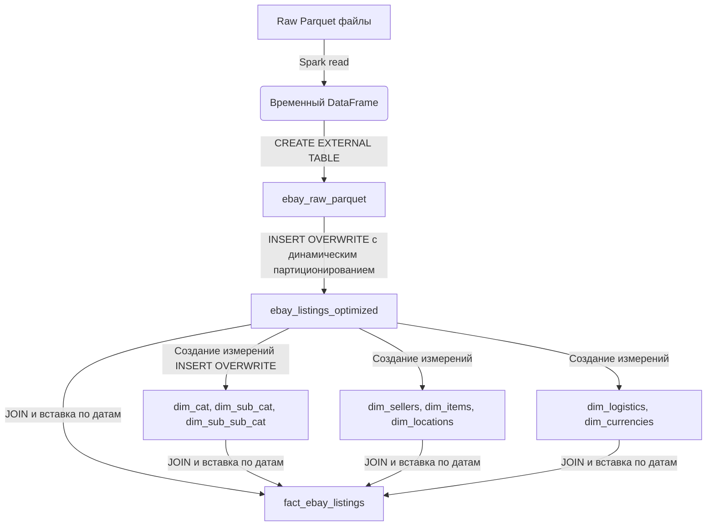

# Hadoop

задание по Hadoop включает в себя две части:

- Работа с HDFS и экосистемой 
- HiveQL

## Часть 1. Работа с HDFS и экосистемой

#

Задания 1-4 -- [1-4_hdfs_ecosystem.ipynb](./src/1-4_hdfs_ecosystem.ipynb)

Задания 5-7 -- [5-7_hdfs_ecosystem.ipynb](./src/5-7_hdfs_ecosystem.ipynb)

Задание 8 -- [8_hdfs_ecosystem.ipynb](./src/8_hdfs_ecosystem.ipynb)

#

Решение с помощью Spark.SQL -- [Spark.SQL.ipynb](./src/Spark.SQL.ipynb)

Решение с помощью Spark DataFrame API -- [Spark_DataFrame_API.ipynb](./src/Spark_DataFrame_API.ipynb)

### Схема ETL

### Инструменты
- **Apache Spark (PySpark)** – основной движок для всех трансформаций.
- **Hive Metastore** – для хранения метаданных таблиц.
- **YARN** – управление ресурсами и выполнение заданий (через `spark-submit`).
- **HDFS** – хранение данных (Parquet файлы).
- **Hue + Редактор Hive** – для выполнения DDL (создание таблиц) и выборочных проверок.
- `spark-submit` – для выполнения DML (заполения таблиц).

### Фильтры и очистки
- В таблице `ebay_listings_optimized` оставлены только записи с `snapshot_dt IS NOT NULL` (при переносе из сырой таблицы).
- При расчётах отсекаются заведомо некорректные цены (`price > 0` в задаче 1).
- В задачах, использующих `seller_feedback_percentage`, отбрасываются NULL (через условие в `WHERE` или автоматически в `AVG`).
- При построении измерений используются `DISTINCT` и агрегации (`MAX`) для устранения дубликатов – например, в `dim_sellers` группировка по `seller_name` с выбором максимальных значений по остальным атрибутам (предполагается, что у одного продавца они не меняются).

### Дедупликация
- Явная дедупликация не применялась, так как данные по своей природе содержат уникальные `itemid` для каждой строки. Однако при создании измерений использовался `GROUP BY` на ключевых полях (`seller_name`, `itemid`, `location_country`), что автоматически устраняет повторяющиеся строки в измерениях.

### Загрузка фактов частями
Чтобы снизить нагрузку на кластер, таблицы заполнялись порционно – по одной за раз. Это позволяет:
- легко перезапустить загрузку для отдельноой таблицы в случае ошибки;
- отслеживать прогресс через логи YARN или HDFS-файлы прогресса.

Все операции (кроме первичного создания таблиц) выполнены через `spark-submit` в **cluster mode**.

** таблица фактов не загружена

## Часть 2. HiveQL

#

Решение заданий HiveQL -- [HiveQL.ipynb](./src/HiveQL.ipynb)