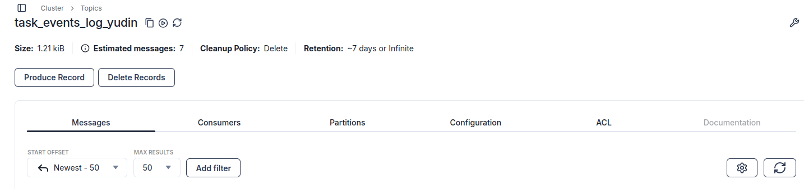
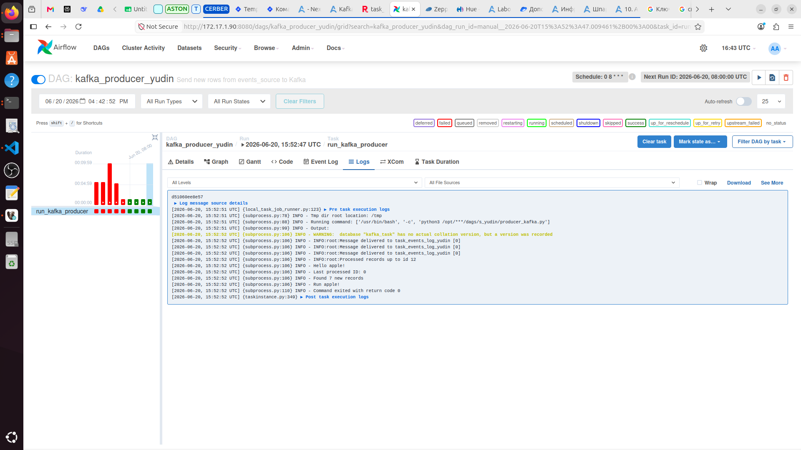
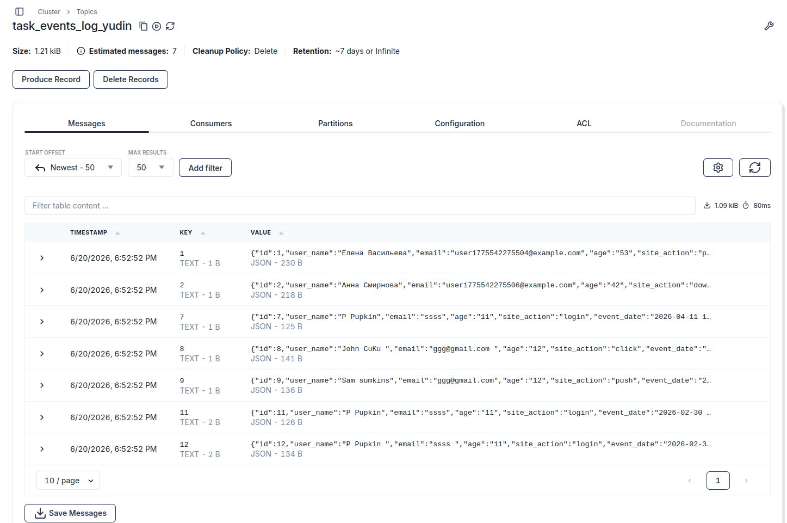
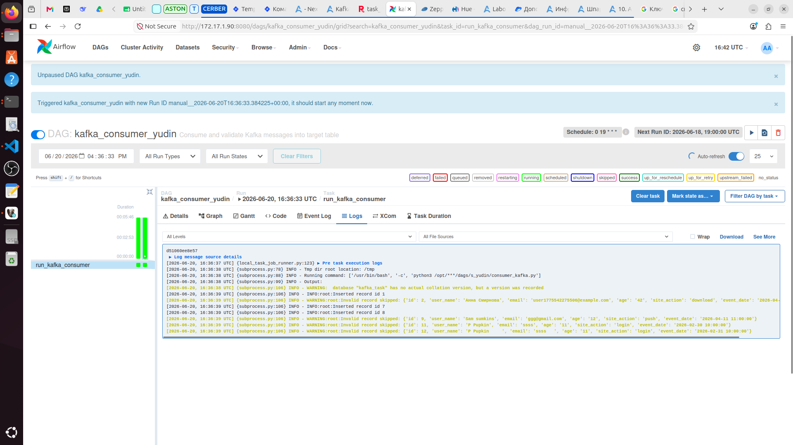
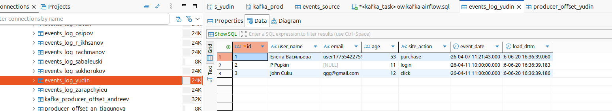
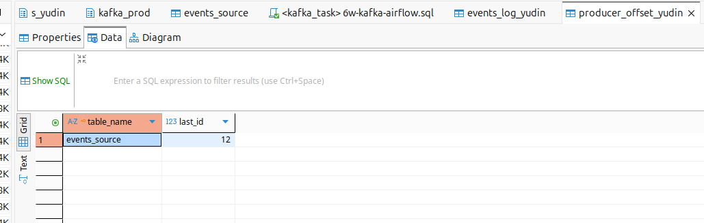

# Kafka_and_Airflow_practice

## Решение задачи по Kafka


### 1. Создание топика Kafka
Воспользуйемся Kafka UI и создадим топик   



---

### 2. Создание целевой таблицы
Выполним в PostgreSQL (схема `kafka_task.kafka_dev`) следующий код:
```sql
--Создание целевой таблицы

CREATE TABLE IF NOT EXISTS kafka_task.kafka_dev.events_log_yudin (
    id           BIGSERIAL PRIMARY KEY,
    user_name    VARCHAR(100),
    email        VARCHAR(254),
    age          SMALLINT,
    site_action  VARCHAR(20),
    event_date   TIMESTAMP,
    load_dttm    TIMESTAMP DEFAULT CURRENT_TIMESTAMP
);


--создадим таблицу для харнения последнего обработанного id для нашего источника

CREATE TABLE IF NOT EXISTS kafka_task.kafka_dev.producer_offset_yudin (
	table_name TEXT PRIMARY KEY,
	last_id BIGINT
);
```

### 3. Продюсер (Python-скрипт)
Скрипт читает из таблицы `events_source` записи, которые ещё не были отправлены. Для этого используем служебную таблицу `kafka_task.kafka_dev.producer_offset` где хранится последний обработанный `id`.

Файл скрипта - [producer_kafka.py](./artifacts/producer_kafka.py)

### DAG продюсера

Создадим DAG для продьюсера

Файл скрипта - [producer_dag_yudin.py](./artifacts/producer_dag_yudin.py)

Поместим созданные фалы на сервер и запустим для проверки работоспособности.



После отладки - сообщения отправляются в брокер.



### 4. Консьюмер (Python-скрипт)
Консьюмер читает сообщения из топика, применяет правила валидации и вставляет только корректные записи в целевую таблицу. 

Файл скрипта - [consumer_kafka.py](./artifacts/consumer_kafka.py)


### DAG продюсера

Файл скрипта - [consumer_dag_yudin.py](./artifacts/consumer_dag_yudin.py)

После загрузки файлов на сервер, проверим работоспособность.



Данные успещно трансформированы и загружены в целевую таблицу. Всего произведено три записи, обновлена запись последнего id.



