# Power_BI_practice

## Импорт и первичная очистка (Power Query)


Задачи --


(Инструменты Power Query: Replace Values, Remove Duplicates, Split Column, Group By, Add Column, Custom Column, Text Transform.)


## Часть 1: Импорт и первичная очистка (Power Query)

### 1. Загрузка CSV-файла

1. **Получить данные** -> **Текст/CSV**.
2.  **Преобразовать данные** (это откроет Power Query Editor).

### 2. Приведение типов данных к корректным форматам

По умолчанию Power Query автоматически определяет типы, но мы проверим и исправим вручную:

| Столбец | Требуемый тип |
| :--- | :--- |
| `id` | **Целое число** |
| `published` | **Дата/время** 
| `salary_from` / `salary_to` | **Денежный формат** |
| `experience`, `employment`, `city` и др. | **Текст** |


### 3. Очистка Null-значений

Нам нужно заменить пустые строки (`""`), пробелы (`" "`) и нули (`0`) на `null`.

1. **Выделите все столбцы**
2. **Главная** -> **Преобразовать** -> **Заменить значения**.


### 4. Удаление дубликатов по `id`

1. Сначала выплоним сортировку по убыванию, затем
2. Правой кнопкой мыши -> **Удалить дубликаты**


### 5. Добавление вычисляемого поля `salary_avg`

1. **Добавление столбца** -> **Пользовательский столбец**.

   ```powerquery
    if [salary_from] <> null and [salary_to] <> null then ([salary_from] + [salary_to]) / 2
    else if [salary_from] <> null then [salary_from]
    else if [salary_to] <> null then [salary_to]
    else null
   ```

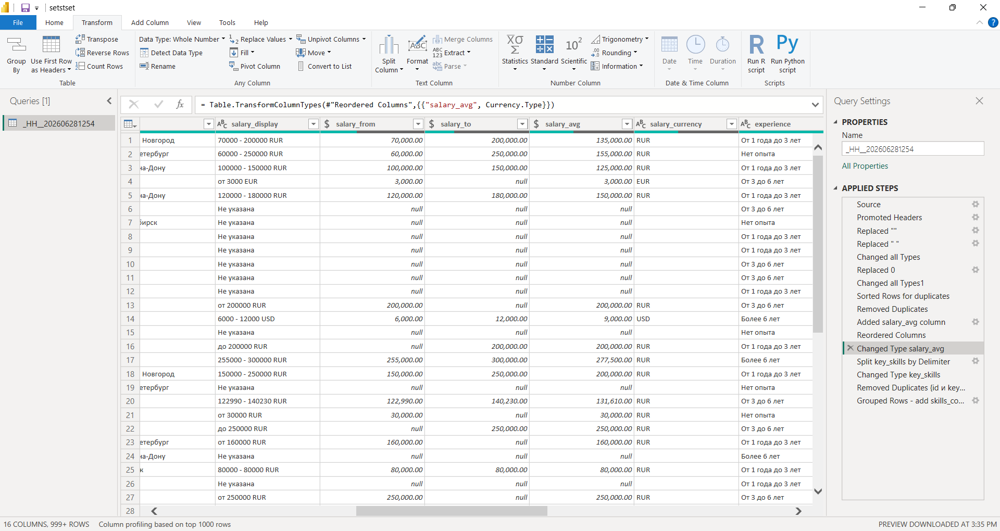


### 6. Обработка столбца `key_skills`

#### Шаг 6.1: Разделение строки на отдельные значения

1. **Главная** -> **Разделить столбец** -> **По разделителю**.
3. В открывшемся окне:
   - *Разделитель*: **Запятая**.
   - *Разбить на*: **Строки**.

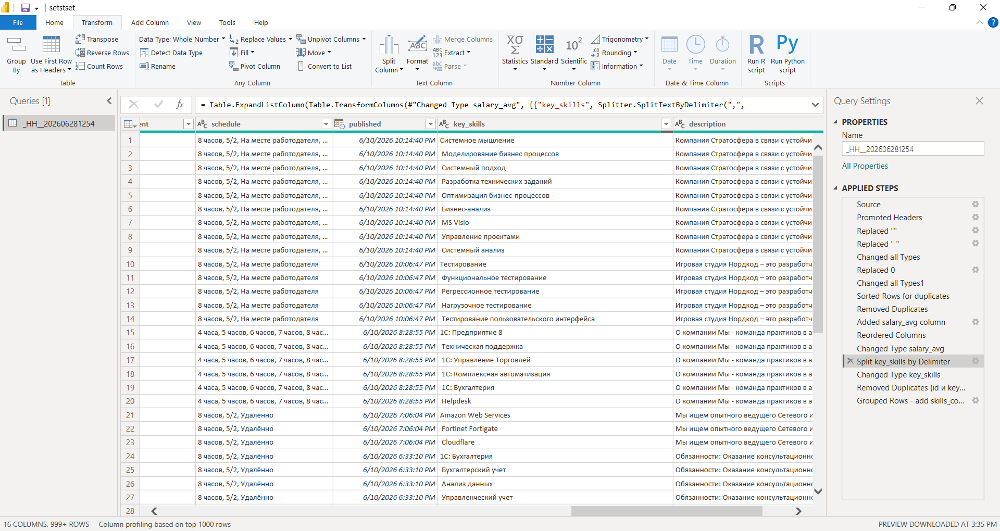

#### Шаг 6.2: Удаление дубликатов навыков внутри одной вакансии

1. Выделите столбцы: `id` и `key_skills`
2. Правая кнопка -> **Удалить дубликаты**.

#### Шаг 6.3: Создание столбца `skills_count`

Теперь нам нужно вернуться к формату *одна строка = одна вакансия* и посчитать количество навыков.

1. На вкладке **Главная** -> **Группировать по**.
2. В выпадающем списке выберем все столбцы **кроме** `skill`.
3. В разделе *Новый именем столбца*  `skills_count`.
4. В разделе *Операция*  **Количество строк**.

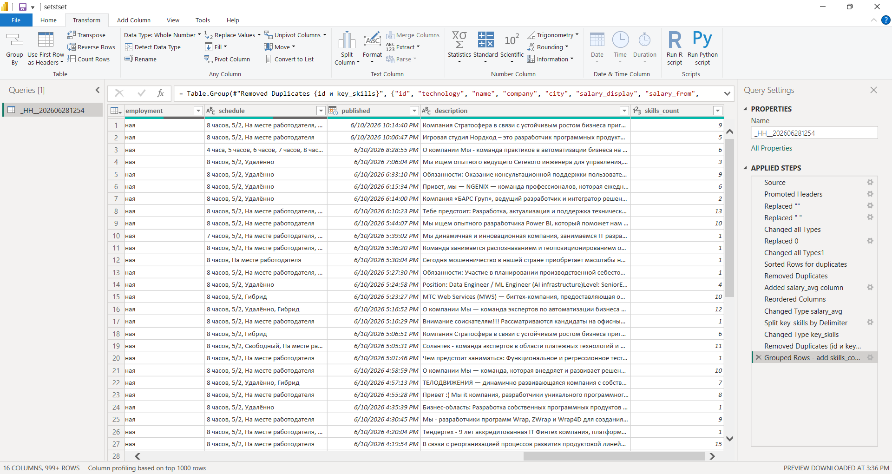

## Часть 2

1. Создайте вычисляемую колонку salary_band, распределяющую вакансии по диапазонам:
- До 100 000
- 100 000–200 000
- 200 000+

2. Постройте таблицы-справочники:
- dim_city
- dim_technology
- dim_employment
Свяжите их с основной таблицей vacancies (one-to-many).

3. Создайте вычисляемую таблицу skills_exploded, где каждая строка представляет отдельный скилл (используйте Power Query или DAX с SELECTCOLUMNS и UNION).
Это позволит анализировать популярность навыков отдельно.

4. Добавьте конвертацию валют:
Cоздайте справочник курсов  и используйте RELATED()для пересчета salary_avg в рубли.

Отлично! Давайте выполним вторую часть задания по обогащению данных и построению модели.

---

## Часть 2: Обогащение данных и построение модели

### 1. Создание вычисляемой колонки `salary_band` через Power Query

1. **Добавление столбца** -> **Пользовательский столбец**.

```powerquery
= if [salary_avg] < 100000 then "До 100 000"
  else if [salary_avg] >= 100000 and [salary_avg] < 200000 then "100 000–200 000"
  else if [salary_avg] >= 200000 then "200 000+"
  else "Не указана"
```

2. тип столбца: **Текст**.

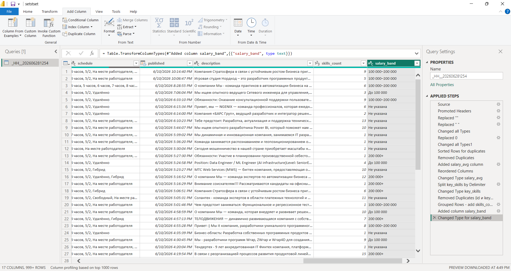

### 2. Построение таблиц-справочников

#### 2.1. `dim_city`

**В Power Query:**

1. `vacancies` (правой кнопкой -> **Дублировать**).
2. Переименуем в `dim_city`.
3. **Главная** -> **Удалить другие столбцы**.
4. **Главная** -> **Удалить строки** -> **Удалить дубликаты**.
5. Добавим столбец-ключ `city_id`:
   - **Добавление столбца** -> **Индекс-столбец** -> **С 1**.
   - Переименуем в `city_id`.
6. Удалите строки с `null` в `city` (фильтр: remove empty).

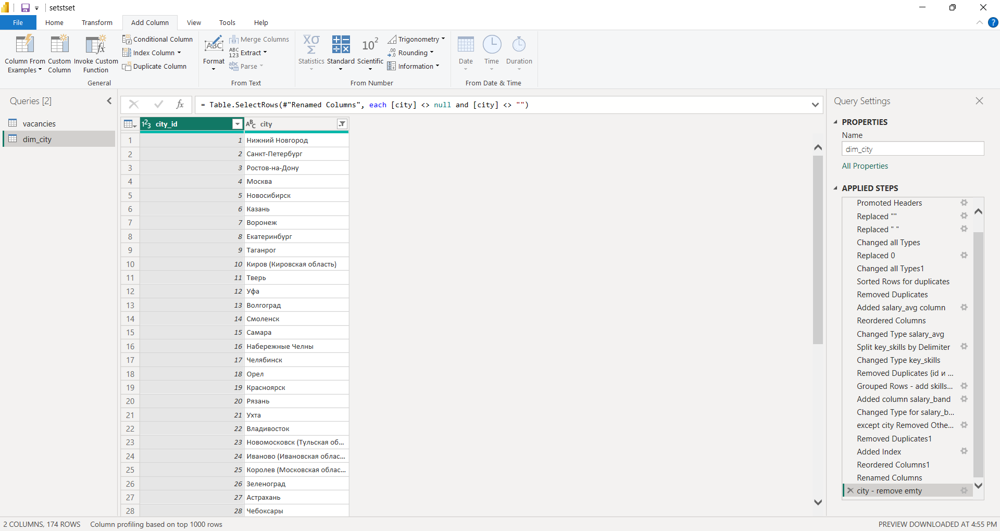

**Аналогично для других столбцов**

#### 2.2. `dim_technology`

...
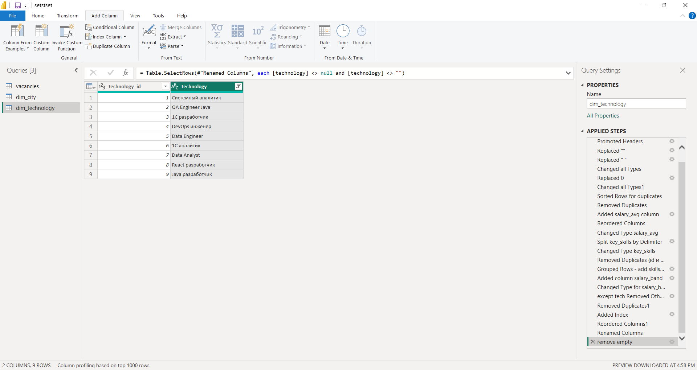

#### 2.3. `dim_employment`

...
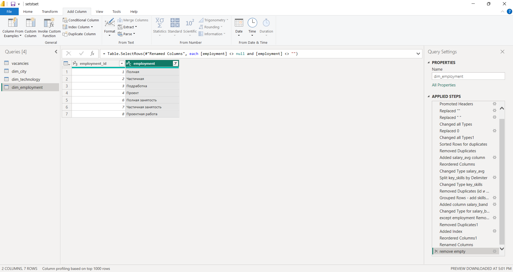

#### Связи one-to-many

В модели данных вкладка **Модель** -> **Управление связями**.
1. Связь: один `dim_city` -> много `vacancies`.
2. Аналогично для `dim_employment` и `dim_technology`.

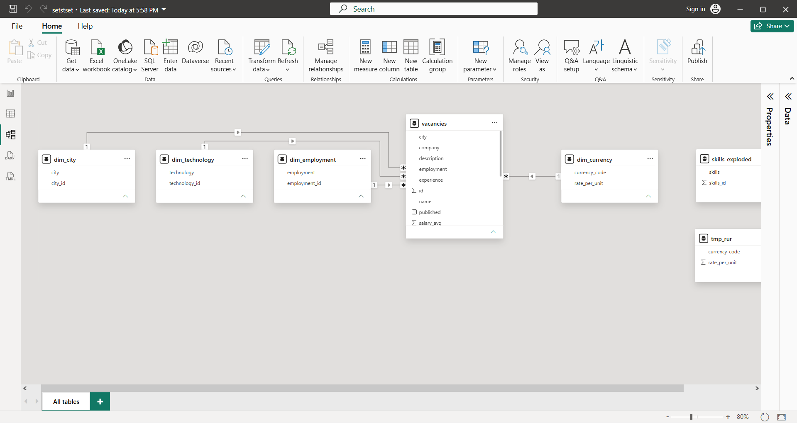

### 3. Создание вычисляемой таблицы `skills_exploded`

1. Копия запроса `vacancies` -> `skills_exploded`.
2. `key_skills` -> **Разделить столбец** -> **По разделителю** -> Запятая -> **Строки**.
4. Удалите дубликаты внутри вакансии (`id` и `skill` -> **Удалить дубликаты**).
5. Оставьте только столбцы: `id`, `skill`
7. Удалим строки с пустыми значениями (`remove empty`)

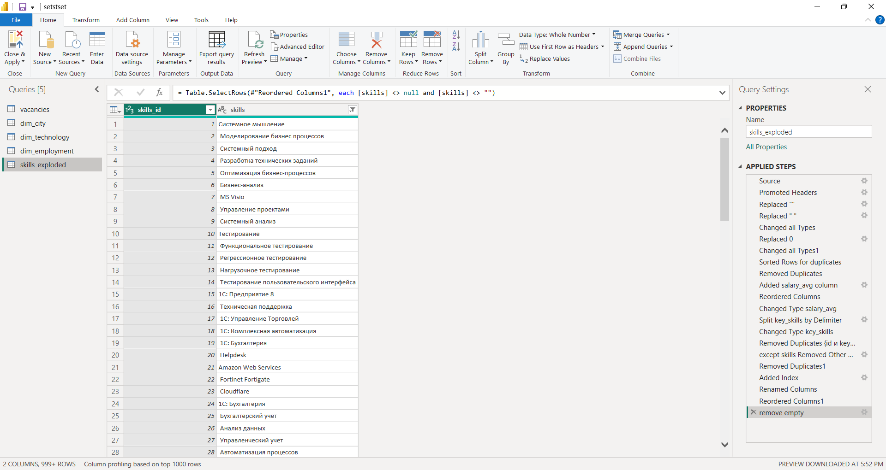


Отличный подход! Давайте реализуем автоматическую загрузку курсов валют через веб-запрос к API Центробанка, а затем используем `RELATED()` для пересчета зарплат в рубли.

---

## 1. Создание справочника курсов с автоматическим обновлением

### Шаг 1.1: Настройка веб-запроса в Power Query

1. В Power Query Editor **Новый источник** -> **Веб**.
2. URL API Центробанка:
   ```
   https://www.cbr-xml-daily.ru/daily_json.js
   ```

3. В окне предпросмотра **Преобразовать данные**.

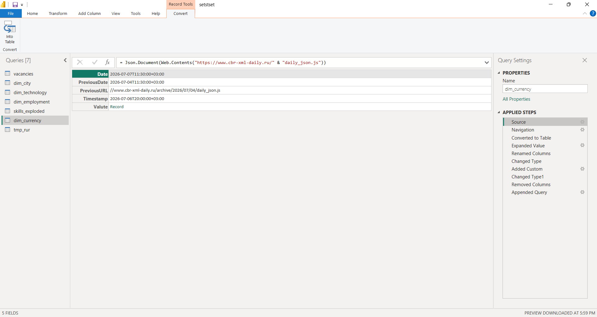

### Шаг 1.2: Преобразование JSON в таблицу

После загрузки данных преобразуем в таблицу:

Оставим следующие поля:
   - `CharCode` (код валюты, например USD, EUR)
   - `Name` (название валюты)
   - `Nominal` (номинал)
   - `Value` (курс)

### Шаг 1.3: Очистка и подготовка таблицы курсов

1. Переименуйте запрос в `dim_currency`.
2. Оставим столбцы:
   - `CharCode` → переименуем в `currency_code`
   - `Value` → переименуем в `rate_to_rub`
   - `Nominal` → переименуем в `nominal`
3. Установите правильные типы данных:
   - `currency_code` → **Текст**
   - `rate_to_rub` → **Десятичное число**
   - `nominal` → **Десятичное число**
4. Добавим столбец с курсом за единицу валюты:
   - **Добавление столбца** -> **Пользовательский столбец**
   - Формула: `= [rate_to_rub] / [nominal]`
   - Переименуем в `rate_per_unit`
5. Удалите столбец `nominal` и `rate_to_rub`, оставьте только `currency_code` и `rate_per_unit`.

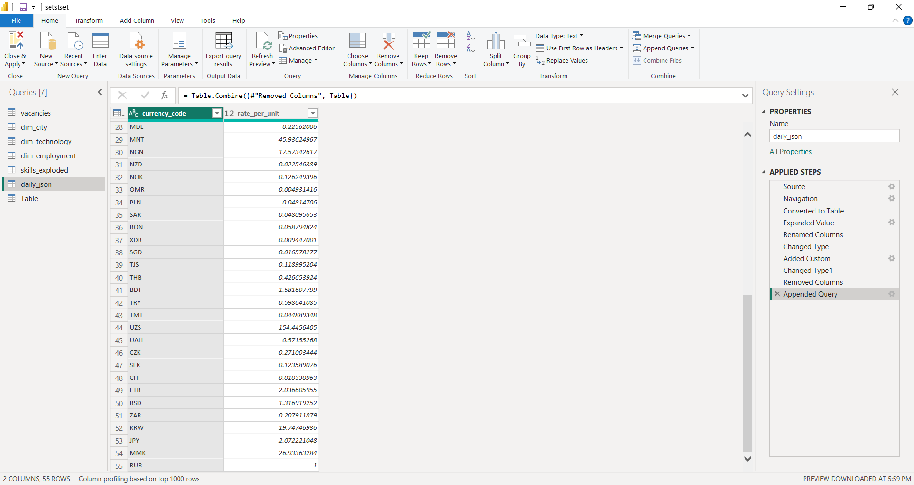

### Шаг 1.4: Добавление рубля

Добавим вручную курс для рубля (RUR):

1. **Главная** -> **Ввод данных** -> создаем таблицу:
   | currency_code | rate_per_unit |
   | :--- | :--- |
   | RUR | 1 |

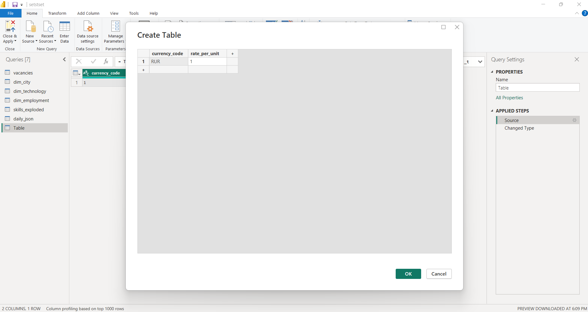

2. Затем **Объединить** эту таблицу с основным запросом `dim_currency`.

## 2. Создание связи для RELATED()

### Шаг 2.1: Настройка отношений в модели

1. Перейдите на вкладку **Модель** в Power BI.
2. Создайте связь между таблицами:
   - **Одна сторона:** `dim_currency[currency_code]`
   - **Много сторон:** `vacancies[salary_currency]`
3. Тип связи: **Один ко многим** (1:*)

### Шаг 2.2: Использование RELATED() для пересчета зарплаты

Создайте вычисляемый столбец в таблице `vacancies`:

```dax
salary_rub = 
IF(
    NOT ISBLANK(vacancies[salary_avg]) && 
    NOT ISBLANK(RELATED(dim_currency[rate_per_unit])),
    vacancies[salary_avg] * RELATED(dim_currency[rate_per_unit]),
    BLANK()
)
```

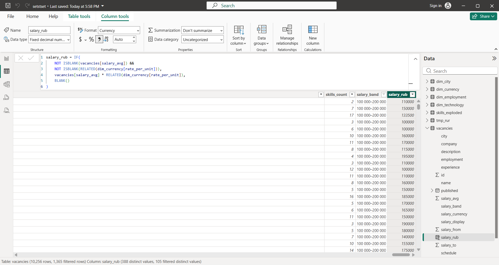


## Часть 3

Расширенные вычисления (DAX)

Примеры мер:

- Avg_Salary = AVERAGE(vacancies[salary_avg])
- Count_Vacancies = COUNT(vacancies[id])
- Vacancies_Per_Tech = COUNTROWS(RELATEDTABLE(vacancies))
- Top_Skill = CALCULATE(COUNTROWS('skills_exploded'), TOPN(1, 'skills_exploded', [Count], DESC))
- Published_Last_30_Days = CALCULATE([Count_Vacancies], FILTER(vacancies, vacancies[published] >= TODAY() -
30))

Создайте не менее 5 разных мер с применением функций CALCULATE, FILTER, DISTINCTCOUNT, RANKX и переменных (VAR).


Отлично! Давайте создадим 5 продвинутых мер с использованием CALCULATE, FILTER, DISTINCTCOUNT, RANKX и VAR.

---

## Расширенные вычисления (DAX) — 5 мер

### Мера 1: Средняя зарплата в рублях для активных вакансий

```dax
Avg_Salary_RUB_Active = 
VAR Last30Days = TODAY() - 30
RETURN
    CALCULATE(
        AVERAGE(vacancies[salary_rub]),
        FILTER(
            vacancies,
            vacancies[published] >= Last30Days &&
            NOT ISBLANK(vacancies[salary_rub])
        )
    )
```

**Что делает:** Считает среднюю зарплату (в рублях) только для вакансий, опубликованных за последние 30 дней, исключая пустые значения.

**Использует:** CALCULATE, FILTER, VAR

---

### Мера 2: Количество уникальных компаний в выбранном городе

```dax
Unique_Companies_in_City = 
CALCULATE(
    DISTINCTCOUNT(vacancies[company]),
    FILTER(
        vacancies,
        NOT ISBLANK(vacancies[city])
    )
)
```

**Что делает:** Показывает количество уникальных компаний, разместивших вакансии. При выборе города через срез (slicer) обновляется автоматически.

**Использует:** CALCULATE, DISTINCTCOUNT, FILTER

---

### Мера 3: Рейтинг навыков по количеству вакансий

```dax
Tech_Rank_Check = 
VAR CurrentSkill = SELECTEDVALUE('skills_exploded'[skill])
RETURN
    RANKX(
        ALL('skills_exploded'[skill]),  -- Все навыки
        CALCULATE(COUNTROWS('skills_exploded')),  -- Их количество
        CALCULATE(COUNTROWS('skills_exploded'), 'skills_exploded'[skill] = CurrentSkill),  -- Текущий
        DESC,
        Dense
    )
```

**Что делает:** Присваивает ранг каждому навыку по количеству вакансий. Навык с наибольшим количеством вакансий получает ранг 1.

**Использует:** RANKX, SELECTEDVALUE, CALCULATE, VAR, VALUES

---

### Мера 4: Доля вакансий с зарплатой выше среднего

```dax
%_Vacancies_Above_Avg_Salary = 
VAR AvgSalaryOverall = 
    CALCULATE(
        AVERAGE(vacancies[salary_rub]),
        ALL(vacancies)
    )
VAR CountAboveAvg = 
    CALCULATE(
        COUNTROWS(vacancies),
        FILTER(
            vacancies,
            vacancies[salary_rub] > AvgSalaryOverall &&
            NOT ISBLANK(vacancies[salary_rub])
        )
    )
VAR TotalVacancies = COUNTROWS(vacancies)
RETURN
    DIVIDE(CountAboveAvg, TotalVacancies, 0) * 100
```

**Что делает:** Рассчитывает процент вакансий, у которых зарплата выше среднего по всем вакансиям. Использует ALL() для игнорирования текущих фильтров при расчете среднего.

**Использует:** CALCULATE, FILTER, VAR, ALL, DIVIDE

---

### Мера 5: Топ-3 навыка по популярности (с динамическим фильтром)

```dax
Top_3_Skills_By_Count = 
VAR TopSkills = 
    TOPN(
        3,
        SUMMARIZE(
            'skills_exploded',
            'skills_exploded'[skill],
            "SkillCount", COUNTROWS('skills_exploded')
        ),
        [SkillCount],
        DESC
    )
VAR SkillsList = 
    CONCATENATEX(
        TopSkills,
        'skills_exploded'[skill] & " (" & [SkillCount] & ")",
        ", "
    )
RETURN
    SkillsList
```

**Что делает:** Возвращает текстовую строку с тремя самыми популярными навыками и количеством их упоминаний. Динамически обновляется при применении фильтров (город, опыт, тип занятости).

**Использует:** TOPN, SUMMARIZE, CONCATENATEX, VAR

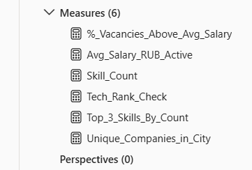


### Проверим все меры через визуализации

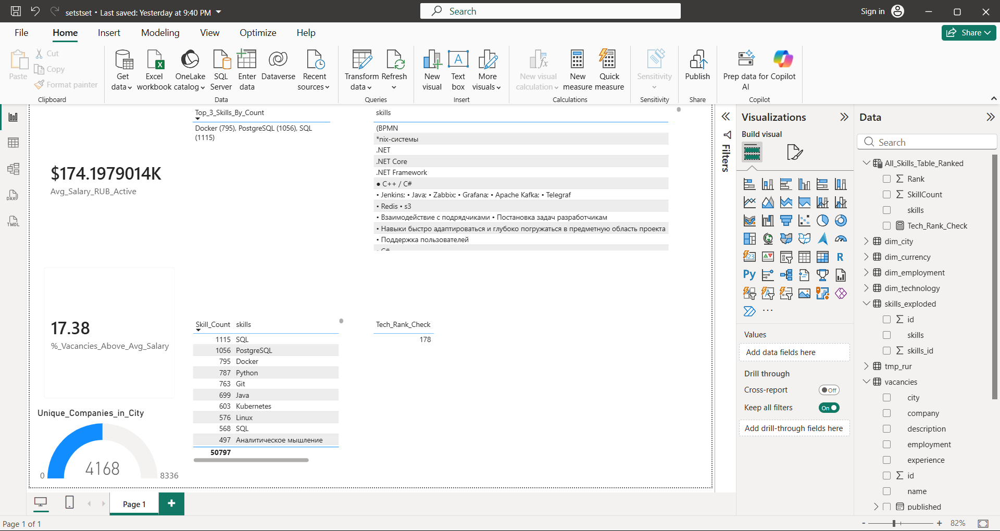

Выберем навык `Docker` и посмотрим, как обновятся меры

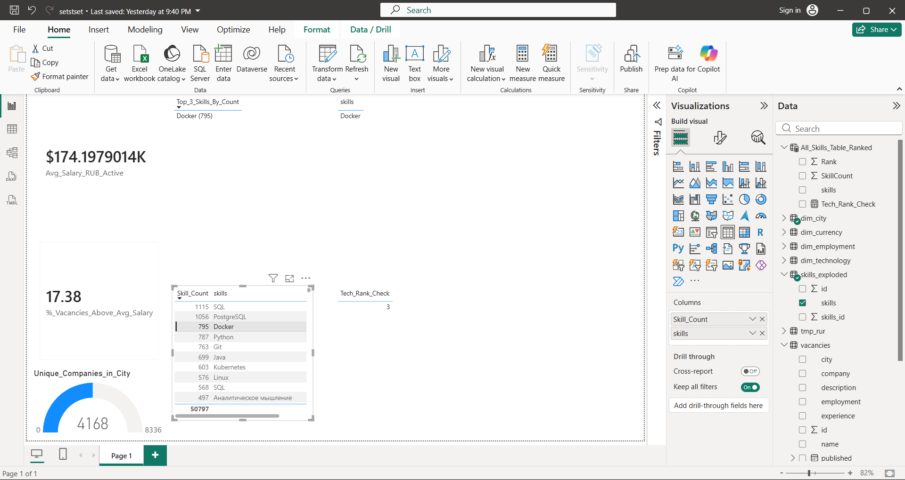

Все меры работают корректно

## Часть 4

Визуализация
Создайте 2 страницы дашборда:

Страница 1 — «Общая аналитика рынка»
- Карта вакансий по городам (количество).
- Диаграмма по технологиям (топ-10).
- Средние зарплаты по диапазонам salary_band.
- Фильтры (slicers):
* Город
* Технология
* Опыт (experience)
* Тип занятости (employment)

Страница 2 — «Навыки и зарплаты»

- Word Cloud по ключевым навыкам (через custom visual) скачать можно тут (https://github.com/deldersveld/power-bi-sunset-visuals/tree/master/Custom-visuals)
- Диаграмма "Опыт vs зарплата" — box plot или scatter chart.
- Динамика вакансий по дате(линейный график по published).
- KPI-индикаторы:
* Средняя зарплата.
* Кол-во вакансий за 30 дней.
* Средняя длительность вакансии (если есть даты обновления).


Отлично! Переходим к финальной части — созданию дашборда. Вот пошаговая инструкция.

---

## Страница 1 — «Общая аналитика рынка»

### Шаг 1.2: Карта вакансий по городам

1. **Заполненная карта** (Filled Map)
2. Добавим поля:
   - **Location**: `vacancies[city]`
   - **Значения**: `Count_Vacancies` (мера)


### Шаг 1.3: Топ-10 технологий

1. **Горизонтальная гистограмма** (Stacked Bar Chart)
2. поля:
   - **Ось**: `skills_exploded[skill]`
   - **Значения**: `Count_Vacancies` или `Skill_Count_All`
3. Настройки:
   - **Фильтры** (панель Filters): `skill` → **Фильтр по типу** → **Топ N**
   - **По значению** → `Count_Vacancies` → **Топ 10** → **По убыванию**

### Шаг 1.4: Средние зарплаты по диапазонам

1. **Столбчатая диаграмма**
2. поля:
   - **Ось** или **Легенда**: `vacancies[salary_band]`
   - **Значения**: `Avg_Salary_RUB`


### Шаг 1.5: Фильтры (Slicers)

1. **Город**:
   - Поле: `vacancies[city]`
   - Формат: **Выпадающий список**

2. **Технология**:
   - Поле: `dim_technology[technology]`
   - Формат: **Выпадающий список**

3. **Опыт**:
   - Поле: `vacancies[experience]`
   - Формат: **Кнопки**

4. **Тип занятости**:
   - Поле: `vacancies[employment]`
   - Формат: **Лист**

Введем название города и часть названия технологии, выберем опыт и занятость - визуализации интерактивно поменялись, отобразив данные для актуального сета параметров.


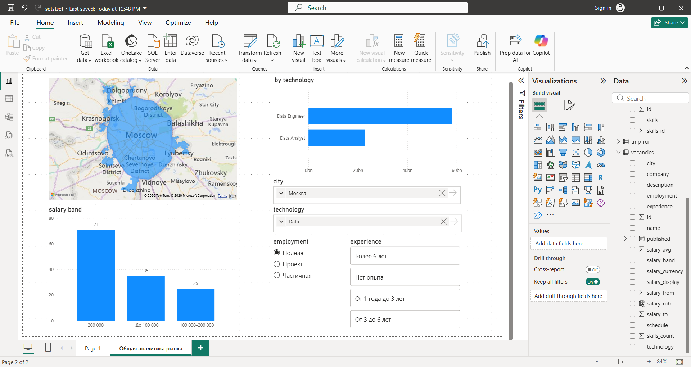


## Страница 2 — «Навыки и зарплаты»

### Шаг 2.2: Word Cloud (Облако слов)

1. Скачанная визуализацию по ссылке: https://github.com/deldersveld/power-bi-sunset-visuals/tree/master/Custom-visuals не пропускается антивирусом 


2. Импорт из магазина требует корпоративной почты.

- пропустим этот шаг

### Шаг 2.3: Диаграмма "Опыт vs зарплата"

**Вариант A: Точечная диаграмма (Scatter Chart)**

1.  **Точечная диаграмма**

2. Преобразуем столбец experience. Получим средние значения по опыту в дополнительном столбце.

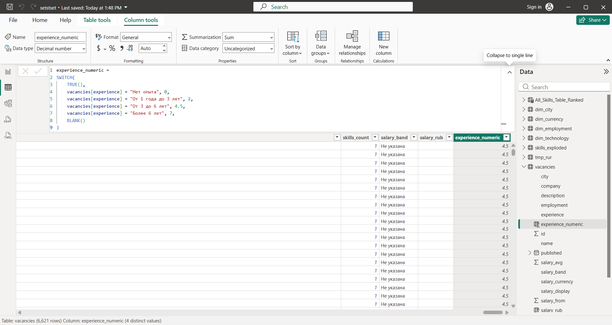

3. Настроим диаграмму, чтобы данные отображались визуально корректно.


### Шаг 2.4: Динамика вакансий по дате

1. **Линейный график** (Line Chart)
2. поля:
   - **Ось**: `vacancies[published]`
   - **Значения**: `COUNT(vacancies[id])`

3. Отформатируем оси и название

### Шаг 2.5: KPI-индикаторы

Визуализации типа **Карточка** (Card):

Создадим таблицу с таргетными значениями:

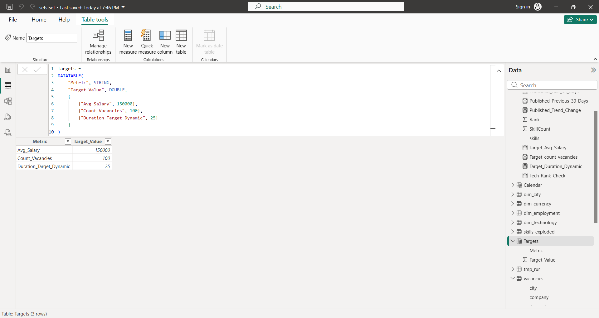


#### KPI 1: Средняя зарплата
- Поле: `Avg of Salary_RUB`
- Trend - `technology`
- Таргет `Target_Avg_Salary = LOOKUPVALUE(Targets[Target_Value], Targets[Metric], "Avg_Salary")`

#### KPI 2: Кол-во вакансий за 30 дней
- Поле: `Published_Last_30_Days`
```dax
Published_Last_30_Days = 
CALCULATE(
    COUNT(vacancies[id]),
    vacancies[published] >= TODAY() - 30
)
```
- Таргет `Target_count_vacancies = LOOKUPVALUE(Targets[Target_Value], Targets[Metric], "Count_Vacancies")`

#### KPI 3: Средняя длительность вакансии
- Даты обновления нет - просто посчитаем среднее время размещения вакансии за последний месяц:
```dax
Avg_Vacancy_Duration = 
VAR TodayDate = TODAY()
RETURN
    AVERAGEX(
        vacancies,
        DATEDIFF(vacancies[published], TodayDate, DAY)
    )
```
- Таргет `Target_Duration_Dynamic = LOOKUPVALUE(Targets[Target_Value], Targets[Metric], "Duration_Target_Dynamic")`

Окончательный вид страницы отчета

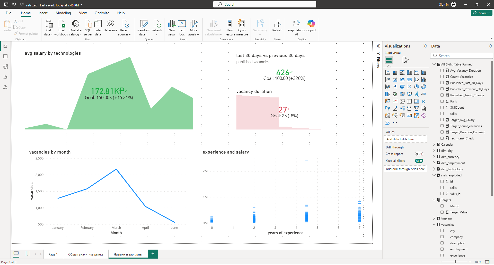