# Superset_practice


## Профилирование данных через SQL Lab

```sql
SELECT * from default.HH limit 10;

DESCRIBE TABLE default.HH;

SELECT count() AS total_rows FROM default.HH;
```
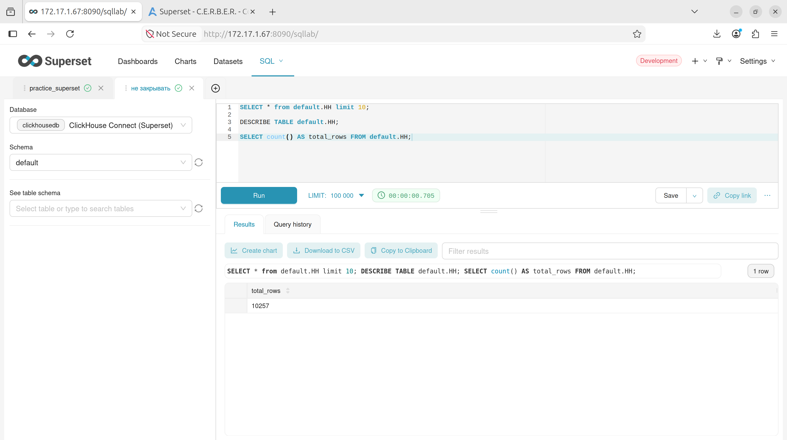

```sql

SELECT
    countIf(id IS NULL) AS null_id,
    countIf(technology = '' OR technology IS NULL) AS empty_technology,
    countIf(name = '' OR name IS NULL) AS empty_name,
    countIf(company = '' OR company IS NULL) AS empty_company,
    countIf(city = '' OR city IS NULL) AS empty_city,
    countIf(salary_from IS NULL) AS null_salary_from,
    countIf(salary_to IS NULL) AS null_salary_to,
    countIf(salary_currency = '' OR salary_currency IS NULL) AS empty_currency,
    countIf(experience = '' OR experience IS NULL) AS empty_experience,
    countIf(employment = '' OR employment IS NULL) AS empty_employment,
    countIf(schedule = '' OR schedule IS NULL) AS empty_schedule,
    countIf(published IS NULL) AS null_published,
    countIf(key_skills = '' OR key_skills IS NULL) AS empty_key_skills,
    countIf(description = '' OR description IS NULL) AS empty_description
FROM default.HH;
-- null_id	empty_technology	empty_name	empty_company	empty_city	null_salary_from	null_salary_to	empty_currency	empty_experience	empty_employment	empty_schedule	null_published	empty_key_skills	empty_description
-- 0	0	0	0	0	0	0	6368	0	3636	3636	0	3620	0
```

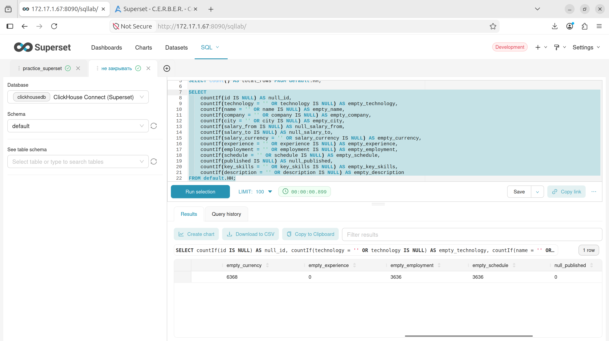

```sql
--дубликаты
SELECT
    count() AS total,
    countDistinct(id) AS unique_ids,
    count() - countDistinct(id) AS duplicates_count
FROM default.HH;
--total	unique_ids	duplicates_count
--10257	10256	1
```

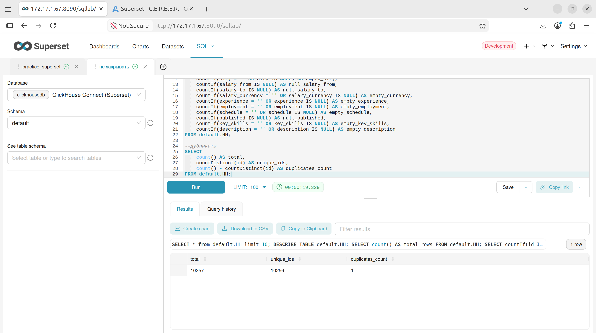

```sql
SELECT technology, count() AS cnt
FROM default.HH
WHERE (technology != '') AND (technology IS NOT NULL)
GROUP BY technology
ORDER BY cnt DESC
LIMIT 20;
--все ок

-- Опыт
SELECT experience--, count() AS cnt
FROM default.HH
WHERE (experience != '') AND (experience IS NOT NULL)
GROUP BY experience;
--ORDER BY cnt DESC;
--все ок

SELECT employment--, count() AS cnt
FROM default.HH
WHERE (employment != '') AND (employment IS NOT NULL)
GROUP BY employment;
--ORDER BY cnt DESC;

--need to be replaced
```
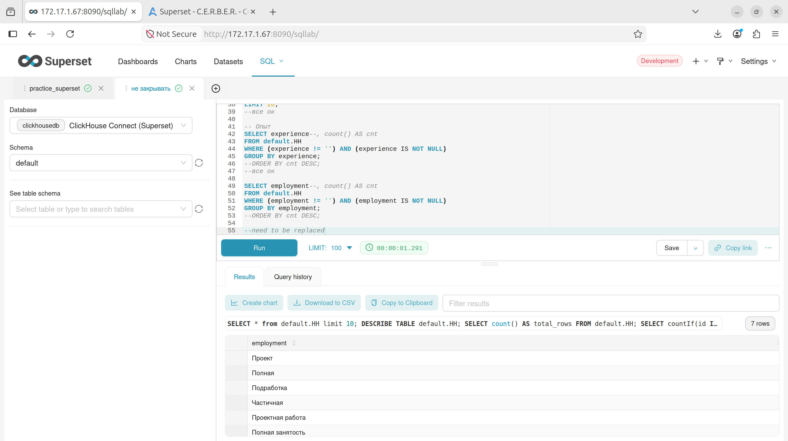

```sql
-- График
SELECT schedule--, count() AS cnt
FROM default.HH
WHERE (schedule != '') AND (schedule IS NOT NULL)
GROUP BY schedule;
--ORDER BY cnt DESC;
--too much
```

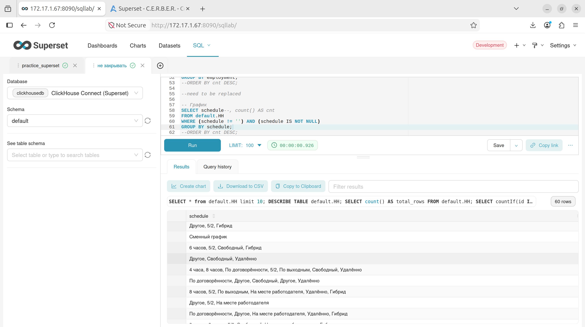

```sql
-- Валюты
SELECT salary_currency--, count() AS cnt
FROM default.HH
WHERE (salary_currency != '') AND (salary_currency IS NOT NULL)
GROUP BY salary_currency;
--ORDER BY cnt DESC;
-- salary_currency
-- RUR
-- USD
-- EUR
```

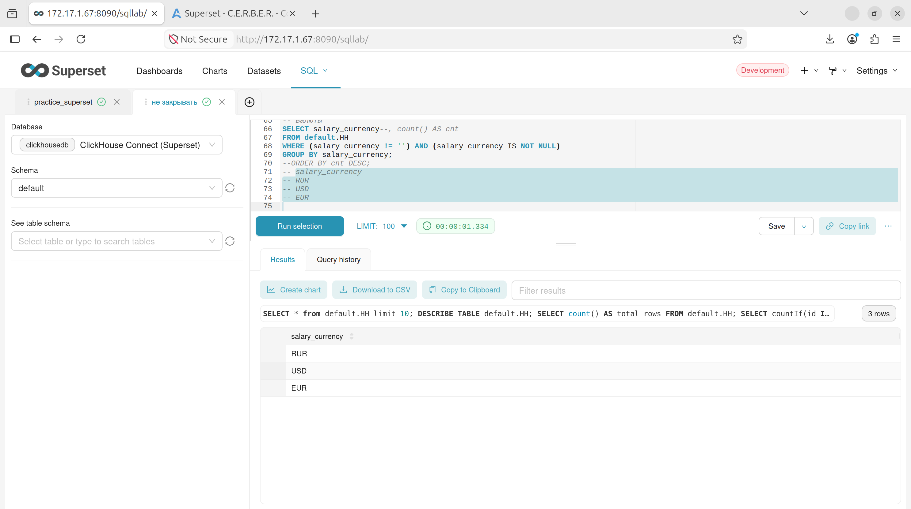

## Подготовка данных по результатам профилирования

Сформируем запрос для создания **Dataset**

```sql
SELECT
  id,
  any(technology) AS technology,
  any(name) AS vacancy_name,
  any(company) AS company,
  any(city) AS city,
  -- средняя зарплата в валюте (все значения приведены к Float64)
  if(
      ifNull(toFloat64(any(salary_from)), 0) > 0 AND ifNull(toFloat64(any(salary_to)), 0) > 0,
      (toFloat64(any(salary_from)) + toFloat64(any(salary_to))) / 2,
      if(ifNull(toFloat64(any(salary_from)), 0) > 0, toFloat64(any(salary_from)),
         if(ifNull(toFloat64(any(salary_to)), 0) > 0, toFloat64(any(salary_to)), NULL))
  ) AS avg_salary_currency,
  -- конвертация в рубли
  CASE
      WHEN any(salary_currency) = 'USD' THEN avg_salary_currency * 76.37
      WHEN any(salary_currency) = 'EUR' THEN avg_salary_currency * 87.09
      ELSE avg_salary_currency   -- или NULL, если нужно только RUR
  END AS salary_rub_avg,
  -- Группировка опыта
  CASE
      WHEN any(experience) = 'Нет опыта' THEN 'Junior'
      WHEN any(experience) = 'От 1 года до 3 лет' THEN 'Middle'
      WHEN any(experience) = 'От 3 до 6 лет' THEN 'Senior'
      WHEN any(experience) = 'Более 6 лет' THEN 'Lead'
      ELSE 'Unknown'
  END AS experience_group,

  -- Группировка занятости (объединение по вашему списку)
  CASE
      WHEN any(employment) IN ('Проект', 'Проектная работа') THEN 'Проектная работа'
      WHEN any(employment) IN ('Полная', 'Полная занятость') THEN 'Полная занятость'
      WHEN any(employment) IN ('Подработка', 'Частичная', 'Частичная занятость') THEN 'Частичная занятость'
      ELSE 'Unknown'
  END AS employment_group,

  toDate(any(published)) AS published_date,
  toYear(any(published)) AS published_year,
  toMonth(any(published)) AS published_month

FROM default.HH
-- WHERE id IS NOT NULL
--   AND (technology != '' AND technology IS NOT NULL)
--   AND (company != '' AND company IS NOT NULL)
--   AND (city != '' AND city IS NOT NULL)
GROUP BY id
-- при необходимости раскомментировать фильтр по дате
-- HAVING published_date >= '2025-01-01'
;

```

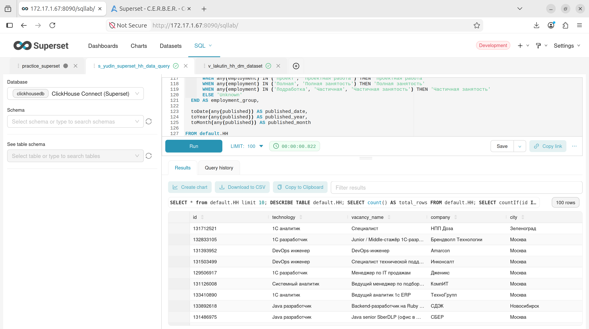

## 

## Задача 1.2. Сбор требований (аналитика до визуализации)

**Цель дашборда**  
Проанализировать рынок вакансий из базы `hh.ru` (данные загружены в ClickHouse) для выявления ключевых трендов:  
- региональное распределение предложений;  
- связь уровня опыта с зарплатными вилками;  
- динамика публикаций вакансий во времени.

**Ключевые вопросы (3–5), на которые должен отвечать дашборд**  
1. Детальная информация в разрезе Город - Уровень опыта - Дата публикации
2. Как распределяются вакансии по городам (где больше всего предложений)?  
3. Каково соотношение вакансий по уровню опыта (Junior / Middle / Senior / без опыта)?  
4. Как меняется количество публикуемых вакансий по месяцам (есть ли сезонность или тренд)?  


**Типы визуализаций (обязательные)**  
- **Bar chart (гистограмма)** – для сравнения количества вакансий по технологиям, городам или компаниям.  
- **Pie chart (круговая диаграмма)** – для долевого распределения по уровню опыта.  
- **Line chart (линейный график)** – для динамики публикаций по месяцам (с возможностью наложения линии тренда).  
- **Table (таблица)** – для детального просмотра списка вакансий с возможностью сортировки и поиска.

**Фильтры и срезы (интерактивность)**  
- Фильтр по городу (мультивыбор).  
- Фильтр по уровню опыта (выпадающий список).  
- Фильтр по дате публикации (период).  

## Cоздание dataset

Сохраним подготовленный запрос **Save** -> **Save Dataset**

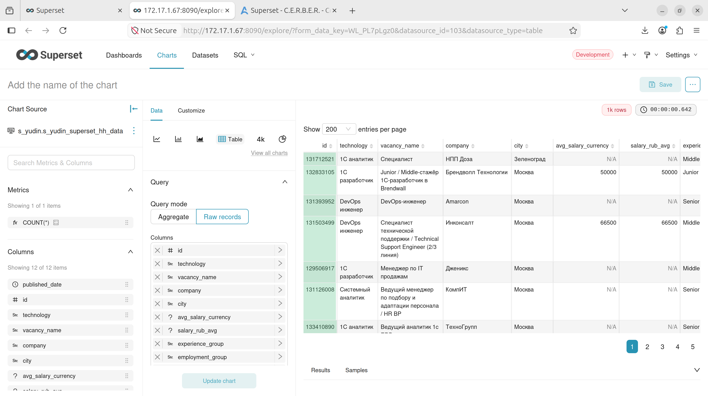

## 1. Создание визуализаций

Используя датасет как источник. Для каждого чарта перейдем в **Charts** → **+ Chart**, выберем датасет и тип.

#### 1.1. Гистограмма (Bar Chart) – «Количество вакансий по городам»
- **Тип**: `Bar Chart`
- **Dimension**: `city`
- **Metric**: `COUNT(*)`
- **Сортировка**: по убыванию COUNT
- **Название**: «Количество вакансий по городам»

#### 1.2. Круговая диаграмма (Pie Chart) – «Распределение по опыту»
- **Тип**: `Pie Chart`
- **Dimension**: `experience_group`
- **Metric**: `COUNT(*)`
- **Название**: «Распределение по опыту»
- **Легенда**: включить, разместим внизу

#### 1.3. Линейный график (Line Chart) – «Динамика публикаций по месяцам»
- **Тип**: `Line Chart`
- **Time Dimension**: `published_date` (или `published_month` – используйте `published_date` как дату)
- **Metric**: `COUNT(*)`
- **Группировка**: по `experience_group` для нескольких линий
- **Название**: «Динамика публикаций вакансий по месяцам»
- **Ось X**: месяц

#### 1.4. Таблица (Table) – «Список вакансий»
- **Тип**: `Table`
- **Колонки**: `vacancy_name`, `company`, `city`, `salary_rub_avg`, `experience_group`, `published_date`
- **Сортировка**: по `published_date` (по убыванию)
- **Название**: «Детальная таблица вакансий»


### 2. Настройка фильтров и срезов (на дашборде)


Добавим 3 фильтра:
- **Город** (`city`) – множественный выбор (Dropdown)
- **Уровень опыта** (`experience_group`) – множественный выбор
- **Дата публикации** (`published_date`) – диапазон (Date range)

Привяжите каждый фильтр к вашему датасету (выберите колонку). Фильтры будут влиять на все чарты, использующие этот датасет.

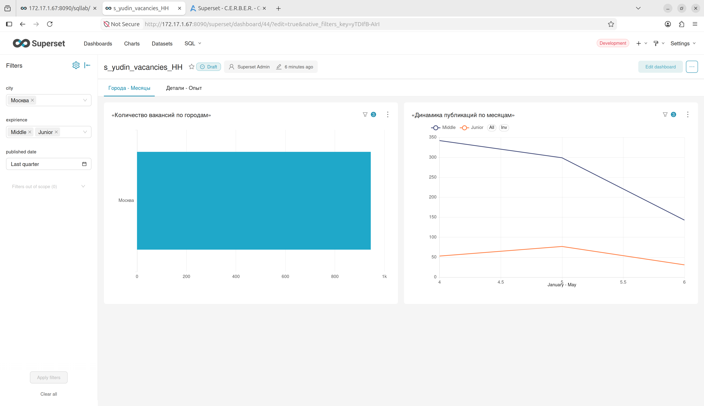

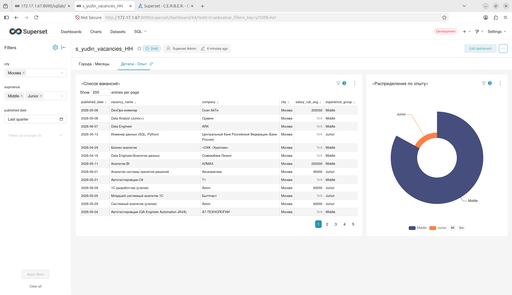

### 3. Настройка взаимодействия графиков (Cross‑filtering)

При клике на элемент одного чарта другие автоматически фильтруются

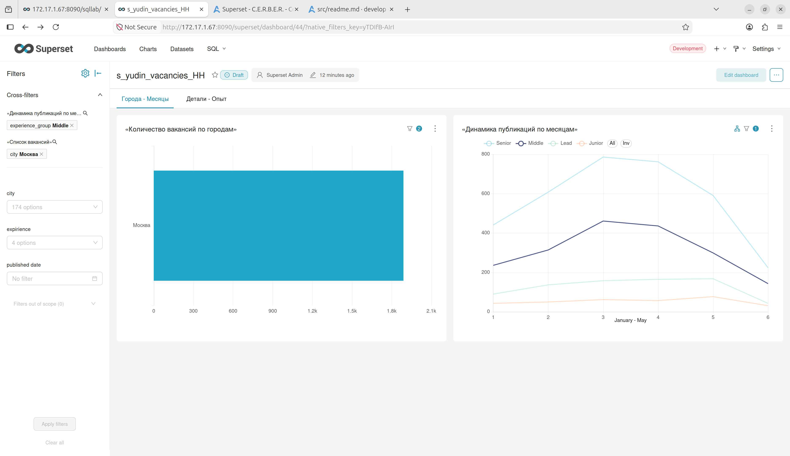

### 4. Сборка дашборда с двумя вкладками

1. **Dashboards** → **+ Dashboard**.
2. Компонент **Tabs** (значок вкладок на панели инструментов).
3. Создадим две вкладки:
   - **Вкладка 1:** «Общий обзор» → Bar chart, Line chart (крупно).
   - **Вкладка 2:** «Детализация» → Table и Pie Chart.
4. Разместим фильтры.


### 5. Визуальная настройка

Выполним **Выравнивание**, добавим **Названия** Названия осей, **Легенда**, **Подписи данных**, **Форматирование чисел**


**Итоговый вид дашбордов:**

[http://172.17.1.67:8090/superset/dashboard/p/Bovg3oVngbE/](http://172.17.1.67:8090/superset/dashboard/p/Bovg3oVngbE/)

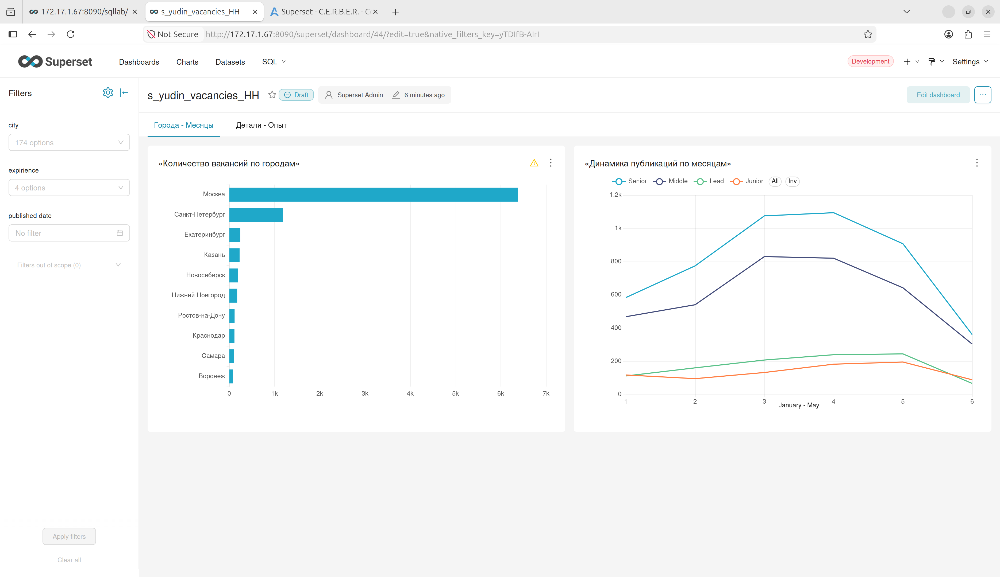

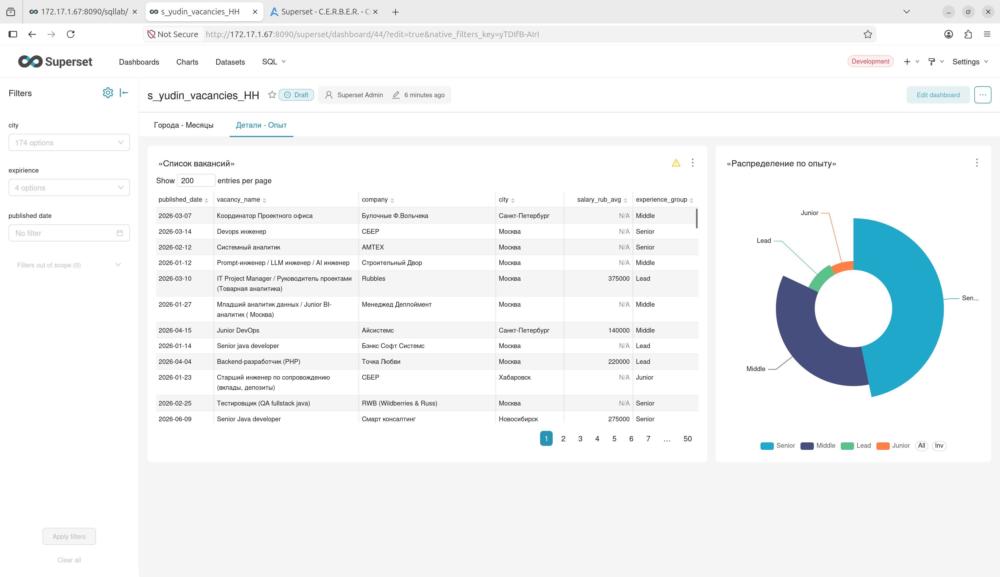